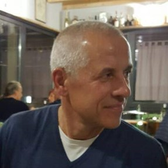

::::: grid
::: {.g-col-12 .g-col-md-6}

:::

::: {.g-col-12 .g-col-md-6}
I am an associate professor at the BioRobotics Institute of the Scuola Superiore Sant'Anna, in Pisa, Italy. In my posts, I attempt to explain various concepts that I studied, in my double role of teacher and researcher.

There have been two main reasons for me to start this blog: first, learning - since writing is a very effective tool against shallow understanding (mine!); second, I wish to help others who may be struggling with similar problems.

My teaching is in the general area of instrumentation & measurement, statistics, signal processing and data analysis. My research focuses on developing algorithms for wearable inertial-sensor-based systems applied to motion analysis and assessment of human performance, including the study of diffusive processes for modeling human motion time series.

More recently---and quite surprisingly to me---my research has taken a new direction at the intersection of Digital Humanities and Computational Literary Studies, where I investigate statistical models and machine learning algorithms to explore style, narrative structure, and the evolution of genres over time.

For a record of my publications, please visit [this site](https://scholar.google.com/citations?user=cz_S3UkAAAAJ&hl=en). Feel free to reach out to me via [mail](mailto:angelo.maria.sabatini@gmail.com).

## Copyright/permissions

This blog's content is under the Creative Commons Attribution-ShareAlike 4.0 International License:

Angelo Maria Sabatini’s blog by Angelo Maria Sabatini is licensed under a Creative Commons Attribution-ShareAlike 4.0 International License.

Based on a work at https://amsabatini.netlify.app
:::
:::::
