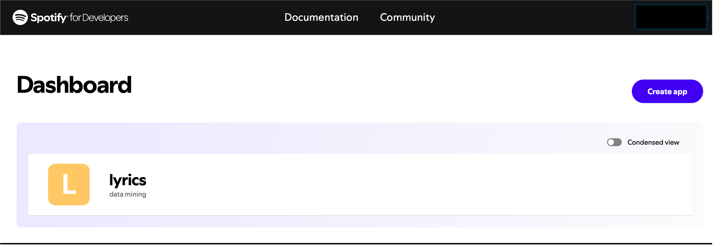

In this post, I’ll be exploring how to pull back audio features and other information available for any track in the Spotify library. This information is usually hidden to users, however it can be easily retrieved. This will be done here using the [spotifyr](https://github.com/charlie86/spotifyr) R wrapper package, whose description sounds as *a quick and easy wrapper for pulling back audio features from Spotify's Web API in bulk*. Information about the various audio features offered by Spotify in the analysis of each track, as well as what all those features actually mean, is part of the discussion herein.

The first step in accessing Spotify data is to get an API key. This can be done by first logging into the Personal Dashboard available in the "Spotify for Developers" page (this requires that I signed on to a valid account, of course!) - see @fig-fig1.

{#fig-fig1 fig-align="center"}

From within the 'Basic information page' of the app lyrics I have created in my Dashboard, I was directed to select “Create a Client ID”. After filling out the required questions, I received my Client ID and Client Secret. The following code chunk is then needed to get the Spotify access token:

```{r}
#| echo: true
#| eval: false

library(spotifyr)

id <- 'my client ID'
secret <- 'my client secret'

Sys.setenv(SPOTIFY_CLIENT_ID = id)
Sys.setenv(SPOTIFY_CLIENT_SECRET = secret)

access_token <- get_spotify_access_token()
```

For one of the several playlists that I have created using my Spotify account, namely `trial`, I invoke the function `get_user_playlists()` to obtain the associated `playlist_id`. This is possible once I have retrieved the information about the desired playlist using, e.g., the verb `filter` from tidyverse, as in the code chunk below, where how to use the [Spotify ID](https://developer.spotify.com/documentation/web-api/concepts/spotify-uris-ids) to complete the authentication process is also shown.

```{r}
#| echo: true
#| eval: false

library(tidyverse)

my_id <- 'my Spotify ID'
playlist_id <- get_user_playlists(my_id) %>%
  filter(name == 'trial') %>%
  pull(id)
```

All is done. Now, a number of functions are available in spotifyr to get access to the audio features of all the tracks contained in the playlist `trial`.

```{r}
#| echo: true
#| eval: false

tracks <- get_playlist_tracks(playlist_id = playlist_id, 
                              limit = 100, 
                              authorization = access_token)
features <- get_track_audio_features(tracks,
                                     authorization = access_token)
```

The call to `get_playlist_tracks()` with `limit` fixed to 100 (default maximum value) clarifies that only data of up 100 tracks can be retrieved from any Spotify playlist using just one call. The argument `authorization` requires a valid access token, as explained above. With the function `get_track_audio_features()` we finally get the values of the audio features. These numerical representations of various characteristics of each music track of interest are derived, behind the scenes, through the advanced audio analysis algorithms developed by Spotify as an important part of their business strategy. It is worth noting that `tracks` contains a wealth of other relevant information, including track title, author, album, release date and so forth.

## Audio features

The following table reports a list of the audio features, see [here](https://developer.spotify.com/documentation/web-api/reference/get-audio-features). Since my native language is Italian, I translate each English term (in **bold**) into a corresponding Italian term (in *italic.*) Next to the column **Audio feature**, the column **Explanation** provides information regarding what each audio feature can mean.

| Audio feature | Explanation |
|----|----|
| **acousticness** (*acusticità*) | Index from 0.0 to 1.0 of whether the track is acoustic. 1.0 represents high confidence that the track is acoustic, i.e., with little or no electronic elements. |
| **danceability** (*ballabilità*) | Index from 0.0 to 1.0 describing how suitable a track is for dancing. The index is based on a combination of tempo, rhythm stability, beat strength and overall regularity. A higher danceability score indicates a more danceable track. |
| **duration_ms** (*durata*) | Track duration, in ms. |
| **energy** (*energia*) | Index from 0.0 to 1.0, which helps representing the intensity and activity level of a track. Tracks with high energy values tend to be more upbeat and energetic (they sound faster, louder and noisier than tracks with lower energy). Perceptual features contributing to this attribute include dynamic range, perceived loudness, timbre, onset rate, and general entropy. |
| **instrumentalness** (*proporzione di parte strumentale su parte vocale*) | Index from 0.0 to 1.0, which helps predicting whether a track contains no vocals. A higher instrumentalness values indicates a higher likelihood that the track is purely instrumental. Values above 0.5 are intended to represent instrumental tracks, but confidence is higher as the value approaches 1.0. |
| **key** (*chiave*) (\*) | The estimated overall key of the track. Integers, from -1 to 11, map to pitches using standard [Pitch Class](https://en.wikipedia.org/wiki/Pitch_class) notation. E.g., 0 = C (*do*), 1 = C♯/D♭ (*do diesis*/*re bemolle*), 2 = D (*re*) up to 11 = B (*si*). If no key is detected, the value is -1. |
| **liveness** (*vivacità*) | Index from 0.0 to 1.0, which helps detecting the presence of an audience in the recording. A higher liveness values suggests the track was performed live. |
| **loudness** (*presenza*) | This index represents the overall loudness of a track in decibels (dB). Loudness values are averaged across the entire track and are useful for comparing relative loudness of tracks. Typical values range between -60 and 0 dB. |
| **mode** (*tonalità*) (\*) | Mode indicates the modality (major or minor) of a track, the type of scale from which its melodic content is derived. Major is represented by 1 and minor by 0. |
| **speechiness** (*proporzione di parlato*) | Index from 0.0 to 1.0, which helps identifying tracks that contain spoken words. Higher values indicate more speech-like sounds, distinguishing them from purely instrumental tracks. Values above 0.66 describe tracks that are probably made entirely of spoken words. Values between 0.33 and 0.66 describe tracks that may contain both music and speech. Values below 0.33 most likely represent music and other non-speech-like tracks. |
| **tempo** (*tempo*) | The overall estimated tempo of a track in beats per minute (BPM). In musical terminology, tempo is the speed or pace of a given piece and derives directly from the average beat duration. |
| **time signature** (*indicazione del tempo*) (\*) | It yiels an estimated overall time signature for a track. The time signature (meter) is a notational convention to specify how many beats are in each bar (or measure). The time signature ranges from 3 to 7 indicating time signatures of "3/4", to "7/4". |
| **valence** (*positività emotiva*) | Also known as the “positiveness” index, valence describes, in a range from 0.0 to 1.0, the musical positiveness conveyed by a track. Tracks with higher valence values tend to sound more positive, cheerful, and euphoric, while lower scores suggest more negative, sad, or depressing emotions. |

(\*) Key, mode and time signature relate to the fundamental musical components of a track - these features are essential for understanding its harmonic structure and rhythmic pattern.

Another parameter that can be retrieved is named **popularity**. The popularity of a track will be between 0 and 100, with 100 being the most popular. The popularity is calculated by an algorithm and is mostly based on the total number of plays the track has had and how recent those plays are. Generally speaking, tracks that are being played a lot now will have a higher popularity than tracks that were played a lot in the past.

## Example

As a matter of example, my Spotify's playlist `trial` contains just four tracks. They were extracted from those published by a beloved singer of mine, [Sergio Caputo](https://www.sergiocaputo.com) in his debut album "Un Sabato Italiano", which was released in 1983. The magazine "Rolling Stone Italia" ranks the album "Un Sabato Italiano" at the 37th position in the list of the greatest 100 Italian albums of all time ([here](https://it.wikipedia.org/wiki/I_100_migliori_album_italiani_secondo_Rolling_Stone)).

The songs in this album are a sort of diary of the life that the singer lived in the early Eighties. We can enjoy the chance to find ourselves immersed with him and his great friend Rino into smoky bars and complicated love stories, dealt with in noisy never-ending Saturday nights. Prevalent in all the tracks is the rhythm of swing and jazz. The high quality of the lyrics concurs, with the music, to evoke brilliantly those atmospheres, and even today the album can be considered a remarkable *testimonianza* of the mood of the early Eighties.

For the sake of better visualization, I grouped the results of the audio analysis of these tracks in the following three tables; moreover, I condensed the values of the three parameters key, mode and time signature into only one cell.

```{r}
#| echo: false
#| eval: true
#| message: false
#| warning: false

library(tidyverse)
library(kableExtra)

structure <- c("F major in 3/4", "F major in 4/4", "G major in 4/4", "G major in 4/4")

features <- readRDS("features.RdS") %>%
    rename(`track title` = track) %>%
    mutate(duration_ms = (duration_ms*1e-3) %/% 60 + ((duration_ms*1e-3) %% 60)/100,
           structure = structure)
features %>%
    select(`track title`, structure, tempo, duration_ms, loudness) %>%
    kable(
        align = "lrrrr",
        col.names = c("track title", "key-mode-time signature", "tempo, BPM", "duration, min", "loudness, dB"),
        digits = 2,
        caption = "Key, mode, time signature, tempo, duration and loudness",
        booktabs = TRUE,
        linesep = ""
    ) %>%
    kable_classic(
       full_width = F,
       font_size = 10,
    )

features %>%
    select(`track title`, acousticness, instrumentalness, liveness, speechiness) %>%
    kable(
        align = "lrrrr",
        digits = 2,
        caption = "Acousticness, instrumentalness, liveness and speechiness",
        booktabs = TRUE,
        linesep = ""
    ) %>%
    kable_classic(
        full_width = F,
        font_size = 10,
    )

features %>%
    select(`track title`, danceability, energy, valence, popularity) %>%
    kable(
        full_width = F,
        align = "lrrrr",
        digits = 2,
        caption = "Danceability, energy, valence and popularity",
        booktabs = TRUE,
        linesep = ""
    ) %>%
    kable_classic(
        full_width = F,
        font_size = 10,
    )

duration = round((features$duration_ms[1]*1e-3) %/% 60 + ((features$duration_ms[1]*1e-3) %% 60)/100, 3)
```

> *Translating music in numbers* as exemplified above, might be, and actually is, the starting point of some heavy data mining for doing interesting research at the intersection between several different domains, which may include data science, statistics, machine learning, sociology, psychology, neuroscience, just to mention a few of them. Something more about these opportunities will be discussed in future posts ... up to now, that's my two cents for the day!

The thumbnail image is credited to <a href="https://www.flaticon.com/free-icons/spotify" title="spotify icons">Spotify icons created by Creative - Flaticon</a>
