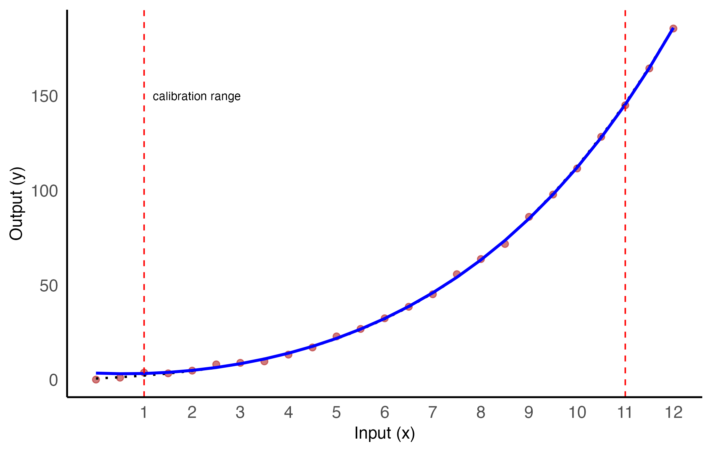

Calibrating a transducer means establishing a functional relationship between a physical input (e.g., pressure, temperature, force) and a measured output. In many real-world applications, however, the actual objective lies elsewhere: once the system is calibrated, the focus shifts to model inversion. Given an observed output, the task is to determine which input value could plausibly have produced it. This is precisely the challenge faced during deployment, when the transducer is integrated into an operational system.

This post explores — through a simple but realistic example — the conceptual limits of direct model inversion in regression. The discussion also includes a brief note on orthogonal regression and introduces a Monte Carlo simulation strategy for addressing inverse prediction.

## Simulating a calibration scenario {.unnumbered}

A simplified yet technically plausible calibration scenario is considered. The system under calibration is a nonlinear transducer — for instance, a sensor whose output voltage varies smoothly with a physical input quantity such as pressure or displacement. The underlying (noiseless) response function is assumed to be injective, meaning that each output corresponds to exactly one input value. In functional terms, the response curve is monotonic, ensuring that inversion remains well-defined in the absence of noise.

The true input–output relationship is assumed to follow a smooth nonlinear curve, here modeled as a fourth-degree polynomial (truth model). Measurement noise is introduced by adding zero-mean Gaussian noise with standard deviation $\sigma$ to the target outputs.

The R code below simulates 25 calibration data points from the reference model. A distinction is drawn between the transducer's full operating range, $[0,12]$, and the actual calibration interval, $[1,11]$ — henceforth referred to as the measurement interval. This setup reflects common practice, where calibration is limited to a central portion of the device's range. Within this interval, an operating point $x^*=3.5$ is selected, corresponding to a target output $y^*=11$. All variables are expressed in arbitrary units.

```{r scenario, eval = TRUE, message = FALSE, warning = FALSE}
#| code-fold: true
#| code-summary: "Simulate the calibration dataset"

library(tidyverse)
set.seed(123)

x_full <- seq(0, 12, length.out = 25)

# Coefficients for a strictly increasing polynomial on [0, 10]
beta <- c(0.681125, 1.2, 0.3, 0.05, 0.002)

# Define the operating point ...
x_star <- 3.5
# ... the corresponding target output
y_star <- 11

# Truth model function
f_true <- function(x) {
  beta[1] + beta[2]*x + beta[3]*x^2 + beta[4]*x^3 + beta[5]*x^4
}

# True outputs
y_true <- f_true(x_full)

sigma <- 1
y <- y_true + rnorm(length(x_full), mean = 0, sd = sigma)

# Build full dataset
df_full <- data.frame(x = x_full, y = y, y_true = y_true)

# Subset for calibration: (1, 11)
df_calib <- subset(df_full, x > 1 & x < 11)
```

**Cautionary note**: The noise added to the simulated outputs assumes constant standard deviation and Gaussian distribution — a deliberate simplification. In reality, calibration is often performed under carefully controlled laboratory conditions, which minimize thermal drift, power supply variations, and other environmental effects.

Once deployed, however, the transducer is left to "breathe" — it operates in a dynamic environment, subject to factors that were effectively considered constant during calibration. As a result, the actual variability in output readings is typically greater than what the calibration model suggests.

Moreover, it is not uncommon for the noise standard deviation to depend on the input value itself — for instance, in thermocouples or strain gauge sensors, measurement variability often increases with temperature or applied force due to physical nonlinearities and sensitivity drift and/or drop.

## Fitting the calibration model {.unnumbered}

Calibration is performed by fitting a polynomial regression model to the observed data — restricted to the measurement interval, as would typically be the case in practice to avoid excessive extrapolation at the boundaries. A fourth-degree polynomial is fitted using least squares, which coincides with the true data-generating mechanism adopted in the simulation (though in real applications, such knowledge would not be available).

```{r model fit, eval = TRUE, message = FALSE, warning = FALSE}
#| code-fold: true
#| code-summary: "Fit a 4th-degree polynomial model"

# Fit the calibration model only within (1, 11)
model_poly4 <- lm(y ~ poly(x, 4), data = df_calib)

# Predict over the full domain for visualization
df_full$y_pred <- predict(model_poly4, newdata = df_full)
```

To better understand the validity range of the model, we plot the full dataset along with the fitted curve, highlighting the measurement interval.

```{r helper, echo = FALSE, eval = TRUE, message = FALSE, warning = FALSE}
library(ggplot2)
library(kableExtra)

# Define a custom color palette
my_colors <- c("steelblue", "lightblue", "firebrick", "salmon")

# Define a custom ggplot2 theme
my_theme_here <- function() {
  theme_minimal(base_size = 14) +   
    theme(
      panel.grid.major = element_blank(),  # rimuove la griglia principale
      panel.grid.minor = element_blank(),  # rimuove la griglia secondaria
      axis.line = element_line(),
      axis.text = element_text(size = 12),
      axis.title = element_text(size = 12),
      strip.text = element_text(size = 12),
      plot.title = element_text(size = 12, hjust = 0.5),
      panel.background = element_blank(),
      plot.background = element_blank(),
      legend.position = "none"   
    )
}

# Set knitr global HTML table option (Quarto-safe)
options(knitr.table.html.attr = "quarto-disable-processing = true")

# Define custom kable styling for HTML tables
my_kable_styling <- function(dat, caption, digits = 3, font_size = 14, format = "html") {
  kable(dat, format, escape = FALSE, caption = caption, digits = digits) %>%
    kable_styling(
      bootstrap_options = c("condensed", "bordered"),
      font_size = font_size,
      position = "center",
      full_width = FALSE
    )
}
```

To assess the validity domain of the fitted model, the entire dataset is visualized alongside the estimated regression curve [@fig-1]. The measurement interval is explicitly marked, highlighting the region where data were actually used for model fitting. Outside this interval, the model operates in extrapolation mode, relying on limited or no information — a situation in which prediction accuracy and reliability can rapidly deteriorate.

```{r plot, echo = FALSE, eval = FALSE, message = FALSE, warning = FALSE}
calib_plot <- ggplot(df_full, aes(x = x)) +
    geom_point(aes(y = y), color = "firebrick", size = 2, alpha = 0.6) +
    geom_line(aes(y = y_true), color = "black", linetype = "dotted", linewidth = 0.8) +
    geom_line(aes(y = y_pred), color = "blue", linewidth = 1) +
    geom_vline(xintercept = c(1, 11), linetype = "dashed", color = "red") +
    annotate("text", x = 1, y = 150, label = "calibration range", hjust = -0.1, angle = 0, size = 3) +
    scale_x_continuous(breaks = 1:12) +
    labs(x = "Input (x)", y = "Output (y)") + 
    my_theme_here()

# Save figure (preview)
ggsave("fig1.png", plot = calib_plot, width = 7.08, height = 4.5, 
       dpi = 300, bg = "white")
```

{#fig-1 fig-align="center" width="75%"}

## From direct prediction to inversion {.unnumbered}

Now suppose the calibrated system is to be used in the field. For a new observed target output $y^*$, the goal is to estimate the corresponding input $x$ under the fitted model. This task is known as **inverse prediction**. A common misunderstanding is to simply reverse the roles of input and output and fit a new regression model of the form $x \sim y$. This "reversed regression" approach, however, lacks a solid statistical foundation and yields incorrect uncertainty estimates — especially when measurement noise affects the output, not the input.

In most calibration settings, the values of the input variable are assumed to be known with negligible uncertainty, while the output is subject to measurement noise. This asymmetry is foundational: classical regression assumes uncertainty in the response, not in the predictor. Swapping their roles invalidates that assumption and leads to biased estimates. The underlying statistical inconsistency is further discussed below in the context of orthogonal regression.

Instead, the correct formulation requires solving the equation

$$
\hat{y}(x) = y^*
$$

i.e., finding the value of $x$ for which the predicted output equals the observed measurement. In general, this equation cannot be solved in closed form for a polynomial of degree greater than two, unless specific simplifying conditions apply. However, since the fitted polynomial is strictly increasing over the full input domain $[0, 12]$, the solution exists and is unique for any $y^*$ in the measurement interval, where reliable inverse predictions can thus be expected.

The inversion can be carried out numerically — for example, using `uniroot()` in R, which implements the bisection method. This approach is robust and well-suited to continuous, monotonic functions like the fitted polynomial. Below, the inversion is performed for the chosen target output.

```{r root finder, eval = TRUE, message = FALSE, warning = FALSE}
#| code-fold: true
#| code-summary: "Invert the calibration model"

# Define the target output
y_star <- 11

# Define the prediction function from the model
predict_poly <- function(x) {
  predict(model_poly4, newdata = data.frame(x = x))
}

# Define the function to solve: f(x) = y_pred(x) - y_star
f_inversion <- function(x) predict_poly(x) - y_star

# Solve numerically in the interval [1, 11] (calibration zone)
x_hat <- uniroot(f_inversion, lower = 1, upper = 11)$root
```

An target output of `r y_star` corresponds to an estimated input of `r round(x_hat, 3)`, based on the fitted calibration model.

```{r inverse plot, echo = FALSE, eval = FALSE, message = FALSE, warning = FALSE}
inverse_fit_plot <- ggplot(df_full, aes(x = x)) +
    geom_line(aes(y = y_pred), color = "blue", linewidth = 1) +
    geom_hline(yintercept = y_star, linetype = "dashed", color = "red") +
    geom_vline(xintercept = x_hat, linetype = "dotted", color = "darkgreen") +
    annotate("point", x = x_hat, y = y_star, color = "black", size = 2) +
    annotate("text", x = x_hat-0.75, y = y_star + 5, label = paste0("x̂ = ", round(x_hat, 3)), size = 3.5) +
    scale_x_continuous(breaks = 1:12) +
    labs(x = "Input (x)", y = "Fitted output (ŷ)" )+
    my_theme_here()

# Save figure (preview)
ggsave("fig2.png", plot = inverse_fit_plot, width = 7.08, height = 4.5, 
       dpi = 300, bg = "white")
```

{#fig-2 fig-align="center" width="75%"}

This kind of inverse prediction relies entirely on the deterministic structure of the fitted model and does not account for uncertainty. In the next section, a Monte Carlo approach will be introduced to estimate the distribution of plausible inputs given an observed output.

Before proceeding, it is useful to reflect on the geometry of the problem — in particular, on the fact that ordinary least-squares regression minimizes the sum of squared vertical distances from the data points to the fitted curve. This choice is justified when the input variable is regarded as fixed and known without error, and all uncertainty is attributed to the output. When this assumption no longer holds — as is often the case in inverse usage — minimizing vertical deviations may no longer be the most appropriate strategy.

### A geometric note: vertical vs orthogonal residuals {.unnumbered}

In classical regression, the output variable $y$ is modeled as random, while treating the input $x$ as fixed or measured without error — or equivalently, as a random variable with **zero standard deviation**. This modeling choice is what justifies minimizing the *vertical distance* between the observed $y$ values and the fitted curve $\hat{y}(x)$ in least-squares estimation.

However, when using the model in reverse — i.e., to estimate $x$ given $y$ — this assumption becomes questionable. In real-world settings, the input itself is subject to measurement uncertainty, or the roles of input and output may conceptually reverse (e.g., in calibration vs deployment).

This motivates the idea of orthogonal regression, or total least squares, where the residuals are measured perpendicularly to the curve, taking into account errors in both variables.

Although not implemented here, orthogonal regression serves as an important conceptual reminder: the least-squares fit is geometrically asymmetric. Direct prediction (forward use) is naturally supported; inverse prediction must be handled with care, especially in nonlinear settings like the one examined here.

::: callout-important
## Orthogonal regression in practice

A practical method for regression with errors in both x and y is Deming regression, which minimizes the sum of squared orthogonal distances to the fitted line, assuming a known error variance ratio.

While classical regression assumes the input x is known precisely — or has negligible variance — this is often not the case in calibration tasks, particularly when inputs are indirectly observed or reversed during deployment.

Deming regression has two key limitations here:

1.  It applies only to linear models — not to polynomials like the one used above;

2.  It requires the specification of the error variance ratio between $x$ and $y$. In practice, this ratio must be inferred from physical knowledge of the system, including the intrinsic noise of the transducer and the propagation of input uncertainty through the calibration curve.
:::

While orthogonal regression becomes numerically complex in nonlinear settings, the next section takes a different route — not to improve the regression fit, but to explore how output noise affects the inference of input values. The goal is to simulate, under known conditions, how a calibrated system behaves when used in reverse.

## Inverse prediction under different noise levels {.unnumbered}

This section illustrates a simulation-based strategy for inverse prediction. Given a target output, the goal is to characterize the distribution of input values $x$ that could plausibly have generated it, under the assumption that the noise affecting the output is Gaussian and matches the standard deviation used during calibration.

The procedure is as follows:

1.  Fix a target output $y^*$;

2.  Generate samples of random noise $\varepsilon_i \sim \mathcal{N}(0, \sigma^2)$, using the known standard deviation;

3.  For each sample, solve the perturbed equation:

$$
y(x_i)=y^*+\varepsilon_i
$$

using the truth model (i.e., the exact polynomial coefficients), to obtain a sample of input values consistent with the observed output.

This approach provides a probabilistic reconstruction of the likely inputs that could have produced a given output under a known model with output noise. It highlights how variability in the output propagates backward through the system, inducing uncertainty in the inferred inputs.

To illustrate how noise affects inverse estimation, two scenarios are compared. The first replicates the controlled conditions of the calibration process, where the noise level is low and well-characterized. The second represents a more realistic deployment setting, where the same transducer operates in a less stable environment, leading to larger variability in the output. By repeating the Monte Carlo simulation under both conditions, it becomes possible to observe how increased noise distorts the distribution of plausible input values — including shifts in bias, widening of confidence intervals, and an increase in failed inversion attempts due to extrapolation beyond the calibrated domain [@fig-3].

```{r Monte Carlo-both, eval = TRUE, message = FALSE, warning = FALSE}
#| code-fold: true
#| code-summary: "Compare two noise scenarios for inverse prediction"

n_sim <- 5000
# First scenario: sigma = 1
sigma_A <- sigma
eps_A   <- rnorm(n_sim, 0, sigma_A)
x_inv_A <- sapply(y_star + eps_A, function(y_t) {
  tryCatch(uniroot(function(x) f_true(x) - y_t, lower = 1, upper = 11)$root, 
           error = function(e) NA_real_)
})
x_emp_A  <- mean(x_inv_A, na.rm = TRUE)
bias_A   <- x_emp_A - x_hat
ci_emp_A <- quantile(x_inv_A, probs = c(0.025, 0.975), na.rm = TRUE)
n_NA_A   <- sum(is.na(x_inv_A))

# Second scenario: sigma = 2
sigma_B <- 2
eps_B   <- rnorm(n_sim, 0, sigma_B)
x_inv_B <- sapply(y_star + eps_B, function(y_t) {
  tryCatch(uniroot(function(x) f_true(x) - y_t, lower = 1, upper = 11)$root, 
           error = function(e) NA_real_)
})
x_emp_B  <- mean(x_inv_B, na.rm = TRUE)
bias_B   <- x_emp_B - x_hat
ci_emp_B <- quantile(x_inv_B, probs = c(0.025, 0.975), na.rm = TRUE)
n_NA_B   <- sum(is.na(x_inv_B))

df_plot <- tibble(
  x = c(x_inv_A, x_inv_B),
  scenario = factor(rep(c("Calibration (σ = 1)", "Deployment (σ = 2)"), each = n_sim)))
```

```{r Monte Carlo-results, echo = FALSE, eval = TRUE, message = FALSE, warning = FALSE}
#| tbl-caption: "Monte Carlo simulation: distribution of input values consistent with the observed output"

# Combine results
tibble(
  Scenario = c("σ = 1 (calibration)", "σ = 2 (deployment)"),
  `Monte Carlo mean (x̄)` = c(round(x_emp_A, 3), round(x_emp_B, 3)),
  Bias = c(round(bias_A, 3), round(bias_B, 3)),
  `95% CI (quantiles)` = c(
    paste0("[", round(ci_emp_A[1], 3), ", ", round(ci_emp_A[2], 3), "]"),
    paste0("[", round(ci_emp_B[1], 3), ", ", round(ci_emp_B[2], 3), "]")
  ),
  `Failed inversions (NA)` = c(n_NA_A, n_NA_B)
) |> 
  my_kable_styling(caption = "Monte Carlo simulation under two noise scenarios. The table summarizes the distribution of input values consistent with the target output. The number of failed inversions (NA) indicates the samples falling outside the measurement interval.")
```

::: callout-note
## Notation key

$y^*$: target output to be inverted (deployment phase)

$\hat{x}$: input estimate obtained by inverting the fitted model

$x_i$: individual input values sampled via Monte Carlo simulation

$\bar{x}$: empirical mean of the Monte Carlo input distribution

Bias: computed as $\bar{x} - \hat{x}$
:::

```{r densities, echo = FALSE, eval = FALSE, message = FALSE, warning = FALSE}

# Rebuild df_plot safely with Scenario
df_plot <- bind_rows(
  tibble(x = x_inv_A, Scenario = "Calibration (σ = 1)"),
  tibble(x = x_inv_B, Scenario = "Deployment (σ = 2)")) %>%
  drop_na() %>%
  mutate(Scenario = factor(Scenario, levels = c("Calibration (σ = 1)", "Deployment (σ = 2)")))

# Define custom colors
plot_colors <- c("Calibration (σ = 1)" = "#1f77b4", 
                 "Deployment (σ = 2)" = "#d62728")

# Plot
density_plot <- ggplot(df_plot, aes(x = x, color = Scenario, fill = Scenario)) +
  geom_density(alpha = 0.15, linewidth = 1.0) +
  geom_vline(xintercept = x_hat, linetype = "dashed", color = "black") +
  scale_color_manual(values = plot_colors) +
  scale_fill_manual(values = plot_colors) +
  scale_x_continuous(breaks = 1:6, limits = c(1, 6)) +
  labs(
    x = "Input value (x)",
    y = "Density",
    color = "Scenario",
    fill = "Scenario"
  ) +
  my_theme_here() +
  theme(legend.position = "top")

# Save figure (preview)
ggsave("fig3.png", plot = density_plot, width = 7.08, height = 4.5, 
       dpi = 300, bg = "white")
```

![Monte Carlo density estimates of input values consistent with the target output under two noise conditions. Blue: calibration scenario ($\sigma = 1$). Red: deployment scenario ($\sigma = 2$). The vertical dashed line marks $\hat{x}$, the input estimate obtained by inverting the fitted model. As noise increases, the density skews leftward — a consequence of the fact that sensitivity (i.e., the slope of the calibration curve) tends to increase with input value. This results in asymmetric confidence intervals, with heavier tails toward lower $x$ values.](fig3.png){#fig-3 fig-align="center" width="75%"}

This method illustrates how even a fixed output measurement may correspond to a range of plausible inputs. The spread of this distribution depends on the noise level, the local slope of the calibration curve near $y^*$, and the model’s nonlinearity.

In linear settings, Monte Carlo inversion recovers the classical prediction interval for $x^*$ derived from theory. In nonlinear cases, however, simulation becomes essential to reveal the actual shape and spread of the inverse uncertainty.

**Key observations:**

The peak of the simulated density typically does not align with $\hat{x}$, the inverse prediction from the fitted model. This reflects a small bias introduced by the asymmetry of the transformation $x \rightarrow y$, which distorts symmetric output noise into skewed input uncertainty.

Despite Gaussian noise on the output, the resulting distribution of plausible $x$ values is not normal. Nonlinear calibration curves map symmetric errors into asymmetric input spreads, especially in regions with varying slope or curvature.

As noise increases, the inverse distribution becomes wider and increasingly left-skewed. This behavior is consistent with the increasing sensitivity of the model at higher $x$ values and results in confidence intervals that shift and become asymmetric — as clearly shown in @fig-3. However, the use of numerical solvers like `uniroot()` comes with important caveats near the edges of the calibration domain. When the slope of the model becomes very small — as it often does at low input values — the inversion becomes ill-conditioned: small variations in output may correspond to large variations in input, or even result in multiple or no real-valued solutions. In such cases, the solver may return only one of several possible roots, typically the one closer to the lower boundary. This effect contributes to the asymmetric shape and heavy left tail of the inverse distribution shown in @fig-3, even when the output noise itself is symmetric.

A further complication arises from the fitted polynomial model used for inversion. While the interpolating polynomial approximates the calibration curve well over central regions, it tends to oscillate or flatten toward the boundaries, particularly in higher-order fits. These edge effects can amplify instability in the inverse prediction — both for numerical solvers and for lookup-table interpolation — unless the prediction range is appropriately restricted or the model complexity reduced.

## A final word: this is the optimistic case {.unnumbered}

The Monte Carlo simulations shown so far illustrate a powerful approach to inverse prediction — but under conditions that are more optimistic than most real-world applications. In particular, the numerical solver was applied to the truth model, i.e., the same polynomial function used to generate the data. This means that, although noise was present in the output, the model structure was assumed to be perfectly known and invertible. In reality, due to computational constraints at deployment time or industrial protocols that can prevent real-time inversion via numerical methods, inverse prediction is rarely implemented via numerical solvers — more often, it relies on lookup tables derived from synthetic calibration curves.

### A first step toward table-based inverse prediction {.unnumbered}

Lookup tables link input values to their expected outputs based on the fitted model, enabling fast and resource-efficient retrieval of approximate inverses during deployment.

The idea is simple:

-   Step 1: Generate a synthetic grid of input values over the calibration interval;
-   Step 2: Evaluate the fitted model on each input to obtain corresponding outputs;
-   Step 3: Store the resulting pairs $(x_j, \hat{y}_j)$ in a lookup table;
-   Step 4: At deployment, when an output $y^*$ is observed, find the two closest values in the table and return the associated $\hat{x}$ (possibly via linear interpolation between adjacent points). Of course, this step can work only if the table columns are strictly monotonic.

It is worth noting that the requirement of monotonicity is shared with the numerical solver: non-monotonic regions in the model may lead to multiple valid solutions or to failed inversions when the output falls outside the achievable range. However, the problem is often more acute with lookup tables. Unlike solvers, which can dynamically refine their search and isolate a valid root, lookup tables are constrained to a discrete grid of stored values — and interpolation may become unstable or misleading near flat or turning regions of the model.

This limitation highlights a trade-off between computational efficiency and robustness of inversion. It also suggests that, before deploying lookup-based inverse prediction, one should:

1.  carefully inspect the fitted model for monotonicity;
2.  possibly restrict the input range to regions where inversion is well-defined;
3.  or simplify the model structure (e.g., reducing polynomial degree) to avoid non-monotonic behavior.

## Test with a lookup table under deployment conditions {.unnumbered}

To evaluate inverse prediction under realistic deployment conditions, I simulate noisy output observations centered at the target output, with a standard deviation of $\sigma=2$.

A lookup table is constructed from the fitted model, but only over a restricted interval where monotonicity has been both visually and numerically verified. This ensures that the inversion procedure remains well-defined and avoids regions where multiple or unstable solutions might occur.

```{r lookup table, echo = FALSE, eval = TRUE, message = FALSE, warning = FALSE}
#| code-fold: true
#| code-summary: lookup table

# Set seed for reproducibility
set.seed(123)

# Generate full lookup table over the measurement interval
x_full <- seq(1, 11, length.out = 200)
y_full <- predict(model_poly4, newdata = data.frame(x = x_full))
table_full <- tibble(x = x_full, y = y_full)

# Identify maximal monotonic segment
dy <- diff(table_full$y)
monotonic_idx <- which(dy > 0)

# Extract continuous monotonic interval
rle_blocks <- rle(diff(monotonic_idx) == 1)
lengths <- rle_blocks$lengths
values <- rle_blocks$values

# Find the longest stretch of consecutive TRUEs
longest_run_idx <- which.max(ifelse(values, lengths + 1, 0))
start_idx <- monotonic_idx[sum(head(lengths, longest_run_idx - 1)) + 1]
end_idx <- start_idx + lengths[longest_run_idx]

# Construct trimmed lookup table
lookup_table <- table_full[start_idx:end_idx, ]
stopifnot(all(diff(lookup_table$y) > 0))  # double-check monotonicity

# Simulate deployment scenario
y_star <- 11
sigma_deploy <- 2
y_noisy <- rnorm(10000, mean = y_star, sd = sigma_deploy)

# Define safe inversion via lookup
invert_lookup <- function(y_star, table) {
    # Assume table$y is sorted in increasing order
    idx <- which(table$y <= y_star)
    if (length(idx) == 0 || tail(idx, 1) == nrow(table)) {
        return(NA_real_)  # y_star outside range
    }
    i <- tail(idx, 1)
    
    # Linear interpolation between (i) and (i + 1)
    x0 <- table$x[i]
    y0 <- table$y[i]
    x1 <- table$x[i + 1]
    y1 <- table$y[i + 1]
    
    x_interp <- x0 + (y_star - y0) * (x1 - x0) / (y1 - y0)
    return(x_interp)
}

# Apply lookup inversion
x_inv_lookup <- sapply(y_noisy, invert_lookup, table = lookup_table)
valid <- !is.na(x_inv_lookup)

# Data frame for plotting
df_lookup <- tibble(
  x = x_inv_lookup[valid],
  Scenario = "Lookup table (σ = 4)"
)

x_look    <- mean(x_inv_lookup, na.rm = TRUE)
bias_look <- x_look - x_hat
ci_look   <- quantile(x_inv_lookup, probs = c(0.025, 0.975), na.rm = TRUE)
n_look    <- sum(is.na(x_look))
```

```{r lookup stats, echo = FALSE, eval = FALSE, message = FALSE, warning = FALSE}
# Plot
density_plot <- ggplot(df_lookup, aes(x = x)) +
  geom_density(alpha = 0.15, linewidth = 1.0, fill = "#d62728", color = "#d62728") +
  geom_vline(xintercept = x_hat, linetype = "dashed", color = "black") +
  scale_x_continuous(breaks = 1:6, limits = c(1, 6)) +
  labs(
    x = "Input value (x)",
    y = "Density") +
  my_theme_here()

# Save figure (preview)
ggsave("fig4.png", plot = density_plot, width = 7.08, height = 4.5, 
       dpi = 300, bg = "white")
```

![Density of inverse input values obtained via a lookup table. Because of the good quality of the table in terms of monotonicity and range, the distribution closely resembles that obtained using the numerical solver in @fig-3. No inversion failures occurred in the Monte Carlo simulation. The 95% confidence interval is $[2.652, 4.126]$, with a Monte Carlo mean $\bar{x} = 3.471$ and a bias of approximately $-0.028$.](fig4.png){#fig-4 fig-align="center" width="75%"}

## Conclusion and outlook {.unnumbered}

This post has explored the challenge of inverse prediction in static calibration, highlighting the often-overlooked asymmetry of uncertainty when working backward from output to input. Using both numerical solvers and lookup tables, I showed how Monte Carlo simulation can quantify the resulting variability — even in optimistic settings where the model is perfectly known and the only uncertainty comes from measurement noise.

Along the way, I emphasized that inverse prediction is more sensitive than forward prediction to model structure, output noise, and edge behavior. In particular, it should be remarked that:

1.  confidence intervals become skewed and asymmetric as noise increases;

2.  the numerical solver can fail silently near the domain boundaries;

3.  lookup tables, while efficient and interpretable, require monotonicity and careful grid design.

I deliberately kept the noise levels moderate and the model structure well-behaved. This allowed us to isolate key phenomena without introducing unnecessary complications. But real-world problems are rarely so kind: noise and non-monotonicity are recurring nightmares — not just in calibration, but in data-driven projects, where transducers often serve as the gateway to the information we rely on.

The next post in this series will dive deeper into these complications. I’ll explore what happens when the true model structure is unknown or misestimated, when noise levels are high enough to push the inverse prediction outside the measurement interval, and when the forward function is non-monotonic. These “edge cases” pose significant risks — but also offer valuable opportunities to rethink how calibration is designed and implemented in practice.
