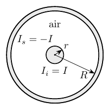
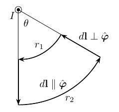
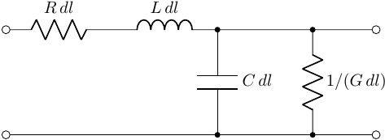
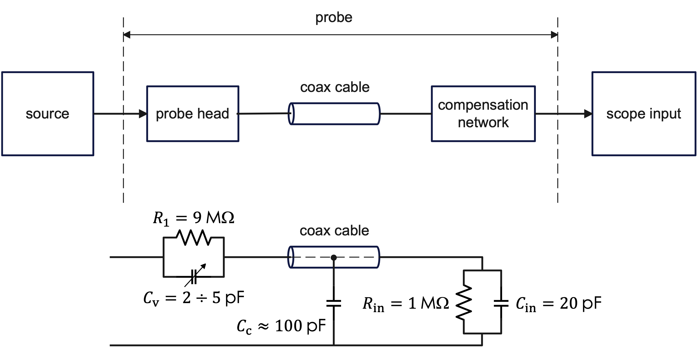
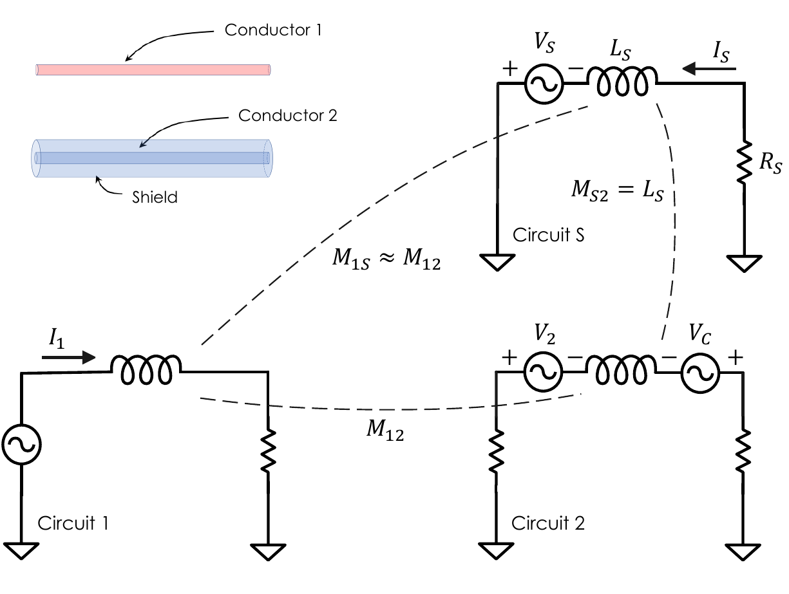

> 💾 **Prefer reading offline?** You can [download a PDF version of this post](post_pdf.pdf) for printing or future reference.

The coaxial cable is one of those devices that seem entirely unremarkable. Most engineers encounter it early in their education and then spend the rest of their careers using it without much hesitation. Yet the same cable can acquire rather different identities when examined through different conceptual lenses.

When I was an engineering student myself, I encountered the coaxial cable three times. First in disguise, during a sophomore course on electromagnetism. Years later, I learned about its role as an effective transmission line for high-frequency voltage and current waveforms. Finally, it appeared once more in a course on electronic measurement systems, where coaxial cables are routinely used to connect generic signal sources to instruments such as oscilloscopes. Had my path — unlike what actually happened — led me into electromagnetic compatibility, the coaxial cable would probably have surfaced once again, this time as one of the canonical devices for improving electromagnetic integrity. In that context, the relevant buzzword may be shielding.

A quantity known as inductance — more precisely, inductance per unit length — appears repeatedly throughout this multifaceted journey. Yet, upon closer inspection, even the seemingly simple question "what is the inductance of a coaxial cable?" admits different answers depending on the viewpoint adopted.

## First encounter: Magnetostatics

The geometry of the coaxial cable considered in magnetostatics is shown in @fig-1.

{#fig-1 fig-align="center" width="250"}

An infinitely long cylindrical metallic conductor of radius $r$ (the inner conductor) is surrounded by a hollow cylindrical conductor (the shield) with inner radius $R$ — the outer radius is usually left unspecified. The two conductors share the same axis, while air is typically assumed to fill the region between them.

A current $I$ is assumed to flow through the structure. In the simplest magnetostatic treatment, the current density is taken to be uniformly distributed across the cross-section of the inner conductor, while the return current is assumed to be concentrated on the inner surface of the shield.

If the current in the inner conductor points outward from the page, the current flowing on the shield points inward. The inner conductor and the shield are therefore explicitly treated as parts of the same physical circuit. Nonetheless, it will be useful to distinguish explicitly between the current flowing in the inner conductor, $I_i=I$, and the return current flowing on the shield, $I_s=-I$.

To compute the inductance, students are usually reminded that the magnetic flux $\Phi$ linked — or, in older terminology, concatenated — with the current $I$ must first be evaluated:

$$L=\dfrac{\Phi}{I}.$$

Geometrical symmetry greatly simplifies the visualization of the magnetic induction field $B$. By combining cylindrical symmetry with Ampère’s law (or equivalently the Biot–Savart law), one finds that in the region between the inner conductor and the shield ($r\leq\rho\leq R$) the magnetic field is purely azimuthal and depends only on the radial coordinate $\rho$:

$$B(\rho,\theta)=\dfrac{\mu_0}{2\pi}\,\dfrac{I}{\rho},$$ {#eq-1}

where cylindrical coordinates ($\rho,\theta$) are used and all quantities are expressed per unit length. In @eq-1 $\mu_0 = 4\pi\times10^{-7}\,\mathrm{H/m}$ is the permeability of vacuum (in SI units).

At this point, however, two details deserve attention.

First, if the current density is assumed to be uniformly distributed across the surface of the inner conductor, the magnetic field also exists inside the conductor itself. Therefore, the flux linkage associated with the region $0\leq\rho<r$ must be treated with some care. This is the familiar contribution known as the internal inductance of the wire.

Second, the return current on the shield is not usually treated as a separate source of magnetic flux in the derivation. Instead, it enters the argument through a boundary condition: the current is assumed to be concentrated on the inner surface of the shield and to be equal and opposite to the current in the inner conductor. With this assumption, the magnetic field drops to zero for $\rho>R$.

Why different assumptions are adopted for the current distribution in the inner conductor and in the shield is usually left unexplained. The resulting model is perfectly adequate for deriving the inductance of the coaxial structure, but it quietly combines idealizations that are seldom discussed explicitly in introductory courses.

From a teaching perspective, it is far more convenient to impose the boundary condition directly: the return current is simply assumed to flow on the inner surface of the shield. Under this assumption, the magnetic field vanishes abruptly for $\rho > R$, allowing students to appreciate, at least qualitatively, the field-confining nature of the coaxial geometry without requiring a more elaborate electromagnetic treatment. The price paid for this pedagogical convenience is the implicit assumption that nature makes abrupt jumps (*natura facit saltus*), which of course it does not.

More importantly, one may legitimately wonder whether the shield current $I_s$, regardless of the details of its distribution within the shield, should itself contribute to the magnetic field within the cavity between the two conductors. At first sight, the answer appears ambiguous. After all, the magnetic field inside the cavity is ultimately generated by the entire current distribution, not solely by the current flowing in the inner conductor. Yet, in the standard derivation, the shield current enters only indirectly through the boundary condition imposing field confinement outside the cable. The magnetic field within the cavity is therefore computed as if it were entirely generated by the enclosed current $I_i$. This is one subtle conceptual point in the study of coaxial structures, often overlooked in introductory treatments, and we’ll return to it in the callout below.

The magnetic field generated by the current distribution can now be evaluated using Ampère’s law. In integral form, the law states that the circulation of the magnetic induction field along a closed path is proportional to the total current enclosed by that path:

$$\oint_{\Gamma}\mathbf{B}\cdot d\mathbf{l}=\mu_0 I_{\mathrm{enc}},$$

where $\Gamma$ denotes an arbitrary closed integration path (an *Amperian path*), $d\mathbf l$ is an infinitesimal oriented line element along that path, and $I_{\mathrm{enc}}$ is the net current enclosed by it. The dot symbol $\cdot$ denotes the scalar product between vectors.

In the case of the coaxial cable, symmetry suggests choosing circular Amperian paths centered on the cable axis and lying within the cavity. For such paths, the enclosed current is simply $I_{\mathrm{enc}}=I_i=I$, leading directly to @eq-1.

Ampère’s law provides information about the circulation of the magnetic field along closed paths. The evaluation of magnetic flux, however, requires the field distribution itself, since flux is defined over surfaces rather than curves:

$$\Phi=\int_S \mathbf{B}\cdot d\mathbf{S}$$

where $S$ denotes an arbitrary oriented surface and $d\mathbf S$ its infinitesimal oriented surface element.

::: callout-important
## Internal inductance of the inner conductor

Consider circular Amperian paths with radius $0<\rho\leq r$. Under the assumption of uniformly distributed current density, the enclosed current is only a fraction of the total current $I_i=I$:

$$I_{\mathrm{enc}}(\rho)=\dfrac{\rho^2}{r^2}I.$$

The magnetic field inside the inner conductor therefore increases linearly with the radial coordinate:

$$B(\rho)=\dfrac{\mu_0\,I}{2\pi\,r^2}\,\rho.$$ {#eq-4}

As a consequence, magnetic flux is present not only in the cavity between the two conductors, but also inside the inner conductor itself. The corresponding magnetic field stores energy and therefore contributes to the total inductance of the structure: this contribution is known as the internal inductance of the conductor.

The magnetic energy density is

$$u_B(\rho)=\dfrac{B^2(\rho)}{2\mu_0}$$

To find the total magnetic energy per unit length ($U_m$), we integrate this density over the cross-sectional surface area $A$ of the wire:

$$U_m=\int_A u_B\,dA=\int_0^{r}\dfrac{B^2(\rho)}{2\mu_0}\,2\pi\rho\,d\rho$$

Substituting the expression of $B(\rho)$ from @eq-4 into the surface integral yields:

$$U_m=\int_0^{r}\dfrac{1}{2\mu_0}\left(\dfrac{\mu_0I}{2\pi\,r^2}\rho\right)^22\pi\rho\,d\rho=\dfrac{\mu_0I^2}{4\pi r^4}\int_0^{r}\rho^3d\rho=\dfrac{\mu_0I^2}{16\pi}$$

The total magnetic energy stored per unit length can also be expressed in terms of the internal inductance of the inner conductor per unit length ($L_{\text{int}}$):

$$\dfrac{1}{2}L_{\text{int}}I^2=\dfrac{\mu_0I^2}{16\pi} \to L_{\text{int}}=\dfrac{\mu_0}{8\pi}$$

This contribution is independent of the conductor radius and depends only on the assumption of uniformly distributed current density.
:::

Now we are in a position to complete the calculation of the inductance. As for the magnetic flux linkage generated by $I_i=I$ within the cavity, one obtains:

$$\Phi_{\mathrm{cav}}=\dfrac{\mu_0\,I}{2\pi}\int_r^R\dfrac{1}{\rho}\,d\rho=\dfrac{\mu_0\,I}{2\pi}\log\left(\dfrac{R}{r}\right).$$

The total inductance per unit length is therefore obtained by summing the cavity and internal contributions:

$$\boxed{L=\dfrac{\mu_0}{2\pi}\left[\log\left(\dfrac{R}{r}\right)+\dfrac{1}{4}\right]}$$ {#eq-7}

A parallel journey takes place in electrostatics, where the capacitance per unit length of the coaxial cable is evaluated. This time, the calculation relies on Gauss’s law together with the definition of capacitance:

$$\boxed{C=\dfrac{2\pi\epsilon_0\,\epsilon_r}{\log\left(\dfrac{R}{r}\right)}}$$ {#eq-8}

where $\epsilon_0=8.854\cdot 10^{-12}\,\mathrm{F/m}$ denotes the permittivity of vacuum (in SI units), while $\epsilon_r$ is the relative permittivity of the dielectric medium filling the cavity between the two conductors (for air, $\epsilon_r\approx1$).

Whether one follows the magnetostatic or the electrostatic route, frequency and wavelength have not yet entered the picture. Our first encounter with the coaxial cable ends here.

::: callout-warning
## Zero circulation does not necessarily imply a zero magnetic field

Consider the closed path shown in @fig-2.

{#fig-2 fig-align="center" width="250"}

A steady current along a straight wire emerges from the page. The generated magnetic field is tangential to circles centered on the wire axis and can therefore be written in cylindrical coordinates as:

$$\mathbf{B}(\rho)=\dfrac{\mu_0 I}{2\pi\rho}\,\hat{\boldsymbol{\varphi}},$$

where $\hat{\boldsymbol{\varphi}}$ denotes the azimuthal unit vector, i.e., the local tangential direction along the circular arcs of the closed path.

The contributions to the circulation along the two circular arcs are:

$$\frac{\mu_0 I}{2\pi}\int_0^\theta\dfrac{1}{r}r\,d\theta=\frac{\mu_0 I}{2\pi}\theta
\qquad\text{and}\qquad
-\frac{\mu_0 I}{2\pi}\theta$$

respectively (this is because $d\mathbf{l}\parallel\hat{\boldsymbol{\varphi}}$), while the contribution along the radial segments vanishes (this is because $d\mathbf{l}\perp\hat{\boldsymbol{\varphi}}$).

Summing the contributions from the two circular arcs and the two radial segments, the total circulation becomes:

$$\oint \mathbf{B}\cdot d\mathbf{l}=\frac{\mu_0 I}{2\pi}\theta-\frac{\mu_0 I}{2\pi}\theta+0=0.$$

The minus sign arises from the opposite traversal direction along the inner circular arc. The vanishing circulation therefore results from the cancellation of nonzero contributions, not from the absence of magnetic field along the path. The result remains unchanged even when the angle is extended to $\theta=2\pi$.

> | A vanishing circulation therefore does not, in general, imply a vanishing magnetic field.

In the coaxial cable, the conclusion that the shield current does not contribute directly to the magnetic field within the cavity—and therefore to the associated flux and flux linkage—follows only because cylindrical symmetry constrains the field to remain purely azimuthal and uniform along circular Amperian paths. The conclusion therefore relies not only on Ampère’s law, but also on the strong symmetry constraints imposed by the coaxial geometry.
:::

## Second Encounter: Transmission Lines

Our first encounter with the coaxial cable took place entirely within the world of electrostatics and magnetostatics. Electric and magnetic fields could be treated separately, frequency never entered the discussion, and the physical length of the cable played essentially no role. The cable appeared mainly as a geometrical structure capable of storing magnetic (or electric) energy.

The situation changes once propagation effects can no longer be neglected, that is, when the cable length becomes a non-negligible fraction of the signal wavelength.

At this point, the traditional lumped-parameter description begins to fail. Voltage and current can no longer be regarded as quantities depending only on time; they must instead be treated as functions of both time and position along the cable. The coaxial cable is no longer simply a pair of conductors separated by a dielectric medium: it becomes a transmission line.

A conceptual shift follows naturally. Resistance, inductance, conductance, and capacitance are no longer treated as global quantities associated with an entire circuit element, but rather as distributed parameters defined per unit length (@fig-3).

{#fig-3 fig-align="center" width="400"}

Interestingly, two of them — the inductance and capacitance per unit length — have already emerged implicitly in the previous magnetostatic and electrostatic analyses.

Under these conditions, the electrical behavior of the cable is described through the distributed-parameter model of transmission-line theory. One of its central quantities is the characteristic impedance, which in its most general form is

$$Z=\sqrt{\dfrac{R+j\omega L}{G+j\omega C}},$$

where $R$ (resistance), $L$, $G$ (conductance), and $C$ are all understood per unit length. For low-loss transmission lines, where

$$R \ll \omega L,
\qquad
G \ll \omega C,$$

the impedance approaches the familiar expression:

$$Z_0\approx\sqrt{\dfrac{L\mathstrut}{C}}.$$

The propagation viewpoint introduces another important quantity: the wave propagation velocity along the cable. In the ideal low-loss approximation, it is given by

$$v=\frac{1}{\sqrt{LC}}.$$

Neglecting the internal inductance of the inner conductor, this expression becomes

$$v=\frac{c}{\sqrt{\epsilon_r}},$$

revealing that electromagnetic propagation in an ideal coaxial cable occurs at a fraction $1/\sqrt{\epsilon_r}$ of the speed of light in vacuum, where

$$c=\frac{1}{\sqrt{\epsilon_0\mu_0}}.$$

For the coaxial geometry considered previously, substitution of the electrostatic and magnetostatic expressions for $L$ and $C$ (@eq-7 – @eq-8) recovers the familiar transmission-line formulas widely encountered in engineering handbooks, RF practice, and EMC-oriented design literature.

The characteristic impedance plays a central role in signal transmission problems. Whenever the load impedance matches the characteristic impedance, reflections are ideally suppressed and the cable behaves, from the viewpoint of the source, as if it were infinitely long. Conversely, if the terminal load differs from $Z_0$, part of the propagating waveform is reflected back toward the source.

At sufficiently high frequency another phenomenon progressively enters the picture: skin effect. The current distribution inside the conductors is no longer approximately uniform, but becomes increasingly confined near the conductor surfaces. As a consequence, the effective ohmic resistance per unit length becomes frequency dependent and generally increases with frequency. At the same time, the contribution associated with the internal inductance of the inner conductor — already comparatively small in the low-frequency treatment — becomes progressively less relevant, since the magnetic field is expelled from the conductor bulk together with the current itself.

Interestingly, the simplifying assumption introduced almost implicitly in the magnetostatic discussion — namely, that the return current flows on the inner surface of the shield — now acquires a concrete physical justification: at sufficiently high frequency, the electromagnetic field supported by the coaxial geometry confines the return current to the inner surface of the shield, precisely where the tangential magnetic field is present. What appeared as a mathematically convenient magnetostatic assumption in the first encounter emerges as a natural consequence of the propagation regime in the second.

## Third Encounter: Instrumentation

The third encounter with the coaxial cable takes place far from the idealized world of infinitely long structures and perfectly matched transmission lines. The cable now appears on a laboratory bench, connecting signal generators, oscilloscopes, sensors, and measurement instruments.

At first sight, this may seem like a return to the familiar world of lumped circuits. In many practical measurement setups, the cable length is indeed much smaller than the wavelength associated with the dominant spectral components of the signal. Yet the transmission-line viewpoint has not become irrelevant. The distributed nature of the coaxial cable remains present, although it manifests itself in a rather different way.

One of the most immediate consequences is cable capacitance. Since capacitance is specified per unit length, longer cable sections introduce progressively larger capacitive loading effects. From the viewpoint of the measured circuit, the coaxial cable itself becomes part of the measurement system. Its capacitance acts as a load, forming a distributed or lumped RC low-pass structure together with the source resistance and thereby modifying rise times and attenuating fast waveform transitions.

This phenomenon becomes especially evident in oscilloscope measurements. A passive oscilloscope probe connected through a coaxial cable may significantly distort fast voltage transients unless appropriate compensation techniques are adopted. Probe compensation introduces a carefully adjusted capacitive network intended to counteract the loading effects of the cable and preserve waveform shape over a wider frequency range.

::: callout-note
## Probes for oscilloscopes

The coaxial cable and the oscilloscope input introduce capacitive loading effects that may distort fast waveform transitions. A passive probe therefore combines resistive attenuation with a carefully adjusted compensation capacitor $C_v$ (@fig-4).

{#fig-4 fig-align="center" width="750"}

Proper compensation is achieved when the corresponding RC time constants satisfy

$$R_1C_v = R_{in}(C_{in}+C_c)$$

Under this condition, the transfer function becomes approximately independent of frequency over a wider operating range, preserving the waveform shape during fast rising and falling transitions.

Typical undercompensated and overcompensated responses are shown in @fig-5.

{#fig-5 fig-align="center" width="500"}
:::

## Final Encounter: Electromagnetic Compatibility (EMC)

Our discussion has so far treated the coaxial cable as a largely self-contained structure. In real systems, however, the shield rarely behaves as a perfectly isolated return path. Multiple interconnected conductors, grounds, and return paths coexist, and currents do not always remain confined to the ideal coaxial geometry. Interactions with the surrounding electromagnetic environment are therefore inevitable.

My fourth — and, at least for the moment, last — encounter with coaxial cables was mediated by Henry Ott. His classic textbook on electromagnetic compatibility is rich with practical insights on grounding, cabling, shielding, and noise reduction (H.W. Ott, "Noise reduction techniques in electronic systems", 2nd ed., John Wiley & Sons, 1988). A recurring theme throughout Ott’s work is deceptively simple: every circuit requires a reference. Voltages do not exist in isolation; they acquire meaning only when measured with respect to some reference point.

Difficulties arise when multiple circuits and signal paths attempt to coexist within the same physical environment. Currents that once appeared to be harmless return currents may begin to share conductors, ground systems, metallic structures, and even cable shields. Signals that were intended to remain independent start interacting with one another.

The situation resembles a crowded cocktail party: many conversations take place simultaneously, and each participant struggles to distinguish the message of interest from the surrounding background. Coaxial cables are widely used precisely because they help separate these competing conversations.

Yet, when viewed through the lens of electromagnetic compatibility, the illusion of a self-contained device quickly disappears. In real-world multi-chassis systems, the shield is often connected to the local reference structure at both ends. Under these conditions, it ceases to be merely one of the conductors forming a transmission line and becomes an independent current path whose behavior is determined by the surrounding grounding topology.

The inner conductor, the shield, and the external return structure now participate in a set of coupled current loops rather than a single self-contained circuit. For clarity henceforth, the common ground plane is assumed to be equipotential. It provides the return path for all currents but is not treated as a fourth circuit in the analysis.

### The shield as an electrical circuit

Before proceeding, it is worth pausing briefly on one detail. In Ott's treatment, the shield is viewed as a thin metallic partition capable of influencing the spatial distribution of electromagnetic fields. Although the analysis does not require a cylindrical geometry, Ott adopts one because it leads to a particularly simple and insightful model.

The resulting configuration bears a striking resemblance to a coaxial cable. The resemblance is not accidental: much of the discussion that follows relies on electromagnetic properties already seen during our previous encounters. Unlike the transmission-line configurations discussed previously, however, the inner conductor and the shield no longer belong to the same circuit. Instead, they are elements of distinct circuits that share a common return structure, represented here by an equipotential ground plane.

A surprising observation follows immediately. Because electrostatic shields are often grounded at only one end, it is tempting to assume that a metallic shield surrounding a conductor should provide protection against magnetic coupling in the same configuration. Unfortunately, this is not the case.

To fix ideas, consider the configuration shown in @fig-6, consisting of three coupled circuits:

- Circuit 1: the disturbance source,
- Circuit S: the shield circuit,
- Circuit 2: the receptor (or victim) circuit.

The underlying mechanism of magnetic shielding is simply Faraday’s law of electromagnetic induction. The time-varying magnetic flux generated by Circuit 1 induces a voltage in both Circuit S and Circuit 2. The configuration shown in @fig-6 represents the case in which Circuit S is closed and supports an induced current $I_S$. It is useful, however, to first imagine opening Circuit S. In that case, the induced voltage cannot drive a current through the shield. Without a shield current, no opposing magnetic field can be generated and therefore no magnetic cancellation can take place in Circuit 2.

{#fig-6 fig-align="center" width="500"}

Ott’s analysis highlights a remarkable property of a cylindrical shield surrounding a conductor. The magnetic flux generated by a current flowing in the shield links the inner conductor. As a consequence, the mutual inductance between shield and inner conductor is equal to the self-inductance of the shield $L_S$:

$$\boxed{M_{S2}=L_S}$$ {#eq-9}

The reason is purely geometrical. For a cylindrical shield carrying a uniformly distributed axial current, the magnetic field vanishes everywhere inside the cavity enclosed by the shield, as discussed during our first encounter. All magnetic flux generated by the shield current therefore remains external to the shield itself. Consequently, every flux linkage contributing to the shield self-inductance also links the inner conductor, leading directly to @eq-9.

### The shield cut-off frequency

In phasor notation, the net voltage developed in Circuit 2 is

$$V_N=V_2-V_C=j\omega M_{12}I_1-j\omega M_{S2}I_S$$

where the first term represents the direct magnetic coupling from Circuit 1 to Circuit 2, while the second accounts for the opposing contribution generated by the shield current.

The current flowing in the shield circuit is

$$I_S=\dfrac{V_S}{R_S+j\omega L_S}=\dfrac{j\omega M_{1S}I_1}{R_S+j\omega L_S}$$

where $R_S$ denotes the shield resistance.

Two observations allow the model to be simplified further.

First, from the viewpoint of Circuit 1, both the shield and the receptor circuit occupy nearly the same spatial position. Consequently,

$$M_{1S}\approx M_{12}.$$

An additional simplifying assumption is implicit in the model. The shield and receptor circuits are assumed not to load Circuit 1 significantly. The source current $I_1$ can therefore be treated as prescribed, and the coupling regarded as predominantly one-way.

Using $M_{S2}=L_S$, the net voltage becomes

$$V_N=j\omega M_{12}I_1-j\omega L_S\left(\dfrac{j\omega M_{1S}I_1}{R_S+j\omega L_S}\right).$$

Using $M_{1S}\approx M_{12}$, this can be written as

$$V_N=j\omega M_{12}I_1\left[1-\dfrac{j\omega L_S}{R_S+j\omega L_S}\right].$$

Therefore,

$$V_N=j\omega M_{12}I_1\dfrac{R_S}{R_S+j\omega L_S}.$$

The result reveals the existence of the shield cut-off frequency

$$f_c=\dfrac{R_S}{2\pi L_S},$$ {#eq-10}

which governs the transition between two distinct operating regimes.

At frequencies well below $f_c$, the shield behaves predominantly as a resistive element and provides little magnetic shielding. At frequencies well above $f_c$, inductive effects dominate, substantial shield currents can circulate, and magnetic cancellation becomes increasingly effective.

::: callout-warning
## A note on shield inductance

At this stage it is worth emphasizing that two fundamentally different inductances have appeared in our encounters.

The inductance derived in @eq-7 belongs to the coaxial transmission line itself. It is associated with the current flowing in the inner conductor and returning through the shield, and is determined entirely by the internal geometry of the cable. This is the inductance governing energy storage, wave propagation, and characteristic impedance.

The quantity $L_S$ introduced in the EMC analysis refers to a different physical circuit. Here the relevant current no longer returns through the inner conductor. Instead, it circulates through the shield and the common ground structure shared by the surrounding system.

Consequently, $L_S$ is the inductance of the external loop formed by the shield and the ground plane acting as the common return path. To understand what determines this inductance, consider how it is defined in practice: EMC standards define a reference setup, typically fixing the cable height above a standardized ground plane. Under these controlled conditions, $L_S$ is calculated by applying the method of images--effectively treating the system as an equivalent two-wire transmission line:

$$L_S \approx \dfrac{\mu_0}{2\pi}\log\left(\dfrac{2h}{r_S}\right)$$ where $h$ is the cable height above the reference ground plane and $r_S$ is the effective shield radius.

This formulation reveals that $L_S$ depends on the physical spacing $h$ through a natural logarithm. Because the logarithmic function strongly attenuates large variations in its argument, the resulting inductance is relatively insensitive to moderate changes in geometry; shifting the cable slightly closer to or farther from a metallic enclosure will not drastically alter the value of $L_S$.

Crucially, however, the shield cut-off frequency is not dictated by geometry alone. It also depends strongly on the shield resistance $R_S$, which in turn reflects the electrical properties and construction of the shield itself. As a result, two cables with similar geometries may exhibit noticeably different shielding behavior, even though the corresponding cut-off frequencies are typically only of the order of a few kilohertz for ordinary shielded cables.

--- 

One distinction is subtle but essential. The inductance of @eq-7 is associated with the conductor pair

$$\text{inner conductor} \leftrightarrow \text{shield},$$

whereas $L_S$ is associated with the conductor pair

$$\text{shield} \leftrightarrow \text{ground plane}.$$

Because the cylindrical shield completely encloses the protected conductor, all magnetic flux generated by a shield current links that conductor, leading to the remarkable EMC identity of @eq-9.

This relation explains why shield currents can effectively cancel magnetic coupling. It also highlights the role of the external return path in determining the shield inductance and, together with the shield resistance, the resulting cut-off frequency. As a result, shielding effectiveness is determined not only by the cable itself but also by the electromagnetic environment in which the cable is installed.

> | In short, the inductance $L$ of @eq-7 and the shield inductance $L_S$ belong to two different electromagnetic stories, even though they may involve the same physical cable.
:::

The previous discussion suggests that effective magnetic shielding requires current to circulate in the shield. In practice, this generally favors connecting the shield at both ends, allowing the compensating current to develop and the mechanism described above to operate. For electric fields, however, the situation is different. Even a shield connected at only one end may still behave as a Faraday cage and provide substantial electrostatic shielding.

This apparent contradiction is one of the recurring lessons of electromagnetic compatibility: there is rarely a universally correct grounding strategy. The optimal solution depends on both the frequency range of interest and the physical mechanism responsible for the disturbance. Moreover, although both $R_S$ and $L_S$ are distributed quantities, their ratio often corresponds to frequencies far below the radio-frequency regime normally associated with EMC.

The apparently simple coaxial cable has therefore revealed one final identity. Beyond storing energy, guiding waves, and connecting instruments, it becomes a device for controlling where currents are allowed to flow — and, equally importantly, where they are not.

## Conclusion: shifting lenses

Our four encounters with the coaxial cable reveal a broader methodological lesson. The apparent contradictions encountered along the way are neither mistakes nor failures of rigor. Engineering simplifications deliberately isolate the dominant physical phenomenon within a particular operating regime.

In the first encounter, the coaxial cable appeared as a geometrical structure capable of storing electric and magnetic energy. In the second, it became the transmission line for which it is best known, supporting propagating waves. In the third, it became a component of a measurement system whose own capacitance could alter the observed signal. In the fourth, viewed through the lens of electromagnetic compatibility, it finally emerged as a device for controlling where currents are allowed to flow.

None of these descriptions is wrong, of course. Each is simply incomplete outside the context for which it was developed.

The four perspectives discussed here do not, of course, exhaust the behavior of the coaxial cable. More advanced models become necessary when addressing topics such as common-mode currents, signal and noise current separation, or the interaction between cables and complex electromagnetic environments. Rather, these four encounters simply illustrate how different physical questions naturally lead to different, yet equally legitimate, descriptions of the same device.

The familiar logarithmic inductance formula derived in introductory electromagnetics remains an extraordinarily powerful result when the relevant currents are confined within the cable geometry. Yet the moment return currents begin interacting with external grounding structures, new inductances emerge, new current paths become possible, and the original model ceases to capture the entire physical picture.

The most valuable lesson, however, is not the formula itself, but the habit of asking which assumptions made the formula possible. As engineers and physicists, we repeatedly revisit familiar objects through different conceptual lenses. The coaxial cable merely provides a particularly elegant example of this process: a device so common that it is easy to overlook how many different physical identities it can acquire depending on the questions we choose to ask.
