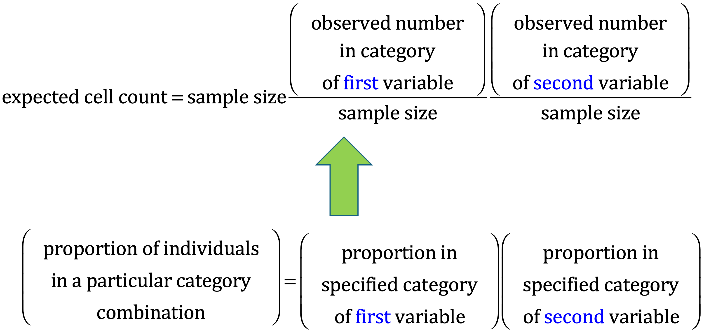
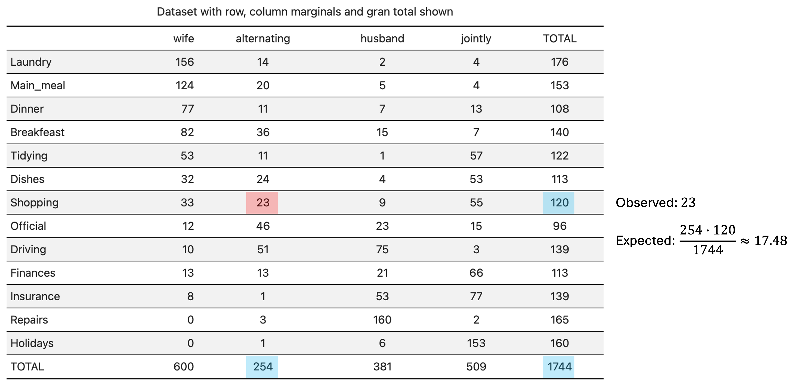

## Introduction

Correspondence Analysis (CA) is a type of multidimensional scaling, one of several methods that are available for developing spatial models that reveal associations between two or more categorical variables. If data of only two variables are involved, the method is usually called **Simple Correspondence Analysis** (SCA); if data of more than two variables are considered in the dataset, then the method is usually called Multiple Correspondence Analysis (MCA).

SCA is often used in combination with a standard chi-squared test of independence for two categorical variables that form a contingency table. We recall that a contingency table displays frequencies for combinations of two categorical variables; analysts also refer to contingency tables as crosstabulation and two-way tables. Contingency tables classify outcomes for one variable in rows and the other in columns. The values at the row and column intersections are frequencies for each unique combination of the two variables. These values can suggest whether or not the two variables are correlated.

```{r}
#| code-fold: true
#| eval: true
#| warning: false
#| message: false

# Libraries 

library(tidyverse)
library(gplots)
library(corrplot)
library(factoextra)
library(kableExtra) 
```

## Exemplary dataset

`housetasks`, available in the package factoextra, is a data frame that contains the frequency of execution of 13 house tasks performed by the couple in four different ways: a) the wife only; b) alternatively; c) the husband only; d) jointly.

```{r}
#| code-fold: true
#| warning: false
#| message: false

data(housetasks)
housetasks %>%
  kable(
    align = "rrrr",
    col.names = c("Wife", "Alternating", "Husband", "Jointly"),
    caption = "House tasks contingency table",
  ) %>%
  kable_classic()
```

To easily interpret the contingency table, a graphical matrix can be drawn using the function `balloonplot()` from the gplots package. In this graph, each cell contains a dot whose size reflects the relative magnitude of the value it contains.

```{r}
#| code-fold: true

# Convert the data frame to a table
dt <- as.table(as.matrix(housetasks))
# Graph
balloonplot(t(dt), main = "House tasks contingency table", xlab = "", ylab = "",
            label = FALSE, show.margins = FALSE)
```

## Theory: An overview

Let us consider a generic two-dimensional contingency table $\bf{T}$, having $R$ rows (corresponding to the levels of the categorical variable $X$) and $C$ columns (corresponding to the levels of the categorical variable $Y$). The table is built based on a dataset of $n$ observations, which are distributed across the $R\cdot C$ cells of $\bf{T}$. Each cell shows the count $n_{ij},\,i=1,\cdots,R;\,j=1,\cdots,C$.

### Key terms

**Row marginals**

The row marginals (or row margins) can be computed by taking the row sums of the counts $n_{ij}$:

$$
n_{i+}=\sum_{j=1}^C n_{ij},\;i=1,\dots,R
$$

**Column marginals**

The column marginals (or col margins) can be computed by taking the column sums of the counts $n_{ij}$:

$$
n_{+j}=\sum_{i=1}^R n_{ij}\;j=1,\dots,C
$$

**Grand total**

The gran total is the complete number after everything has been added up:

$$
n_{++}=\sum_{i=1}^R n_{i+}=\sum_{j=1}^Cn_{+j}=\sum_{i=1}^R\sum_{j=1}^Cn_{ij}=n
$$

```{r}
#| code-fold: true
#| eval: true

# Row marginals
row.sum <- apply(housetasks, 1, sum)
# Column marginals
col.sum <- apply(housetasks, 2, sum)
# Gran total
n <- sum(housetasks)
housetasks %>%
  mutate(total = row.sum) %>%
  rbind("Total" = c(col.sum, n)) %>%
  kable(
    align = "rrrrr",
    col.names = c("Wife", "Alternating", "Husband", "Jointly", "Total"),
    caption = "House task contingency table with row, column margins and gran total",
  ) %>%
  kable_classic()
```

The gran total is obtained by summing the values of the row margin or the values of the col margin ($n=$ `r n`).

To compare rows (or columns), their profiles can be analyzed, in the search for similar rows (or columns).

**Row profile**

The profile of a row (or row profile) is calculated by taking each row point and dividing by the corresponding value of the row margin:

$$
\underline{a}_i,\;i=1,\dots,R=\{\underline{a}_{i_j},\;j=1,\dots,C\}=\{n_{ij}/n_{i+},\;j=1,\dots,C\}
$$

**Average row profile**

The average row profile can be computed from the col margin after dividing it by the grand total:

$$
\underline{r}=\{r_j=n_{+j}/n,\;j=1,\dots,C\}
$$

```{r}
#| code-fold: true
#| eval: true

# Row profile
row.profile <- housetasks/row.sum
# Average row profile
average.row.profile <- col.sum/n
# Row margins
row.profile.sum <- apply(row.profile, 1, sum)

row.profile %>%
  mutate(TOTAL = row.profile.sum) %>%
  rbind(`Average row profile` = c(average.row.profile, sum(average.row.profile))) %>%
  kable(
    align = "rrrrr",
    col.names = c("Wife", "Alternating", "Husband", "Jointly", "Total"),
    digits = 4,
    caption = "House tasks data frame with row profiles and average row profile",
  ) %>%
  kable_classic()
```

**Column profile**

The profile of a column (or col profile) is calculated by taking each column point and dividing by the corresponding value of the col margin:

$$
\underline{b}_j,\;j=1,\dots,C=\{\underline{b}_{j_i},\;i=1,\dots,R\}=\{n_{ij}/n_{+j},\;i=1,\dots,R\}
$$

**Average column profile**

The average column profile (or average col profile) can be computed from the row marginal after dividing it by the grand total:

$$
\underline{c}=\{c_i=n_{i+}/n,\;i=1,\dots,R\}
$$

```{r}
#| code-fold: true
#| eval: true

# Column profile
col.profile <- t(housetasks)/col.sum
col.profile <- as.data.frame(t(col.profile))
# Average column profile
average.col.profile <- row.sum/n
# Column margins
col.profile.sum <- apply(col.profile, 2, sum)

col.profile %>%
  mutate(`Average col profile` = average.col.profile) %>%
  rbind(Total = c(col.profile.sum, sum(average.col.profile))) %>%
  kable(
    align = "rrrrr",
    col.names = c("Wife", "Alternating", "Husband", "Jointly", "Average col profile"),
    digits = 4,
    caption = "House tasks data frame with col profiles and average col profile",
  ) %>%
  kable_classic()
```

**Distance (or similarity) between row profiles**

This metrics is useful to compare how similar to each other are two rows of the contingency table:

$$
d^2_{kl},\;k,l=1,\dots,R=\Vert \underline{a}_k-\underline{a}_{l}\Vert^2_\underline{r}=\large\sum_{j=1}^C\dfrac{(\underline{a}_{k_j}-\underline{a}_{l_j})^2}{r_j}
$$

Recall that we need to normalize each component within the sum to the corresponding element of the average row profile.

```{r}
#| code-fold: true
#| eval: true

# "Dinner" and "Driving" profiles
dinner.p <- row.profile["Dinner", ]
driving.p <- row.profile["Driving", ]
# Distance between "Dinner" and "Driving"
d2_1 <- sum(((dinner.p - driving.p)^2)/average.row.profile)
# "Breakfeast" profile
breakfast.p <- row.profile["Breakfeast", ]
# Distance between "Dinner" and "Breakfeast"
d2_2 <- sum(((dinner.p - breakfast.p)^2)/average.row.profile)
```

Example - The similarity between "Dinner" and "Driving" profiles is `r round(d2_1,3)`, whereas the similarity between "Dinner" and "Breakfeast" is `r round(d2_2,3)`.

**Distance (or similarity) between col profiles**

This metrics is useful to compare how similar to each other are two columns of the contingency table:

$$
d^2_{kl},\;k,l=1,\dots,C=\Vert \underline{b}_k-\underline{b}_l\Vert^2_\underline{c}=\large\sum_{i=1}^R\dfrac{(\underline{b}_{k_i}-\underline{b}_{l_i})^2}{c_i}
$$

Recall that we need to normalize each component within the sum to the corresponding element of the average col profile.

```{r}
#| code-fold: true
#| eval: true

# "Wife" and "Husband" profiles
wife.p <- col.profile[, "Wife"]
husband.p <- col.profile[, "Husband"]
# Distance between "Wife" and "Husband"
d2_1 <- sum(((wife.p - husband.p)^2) / average.col.profile)
# "Jointly" profile
jointly.p <- col.profile[, "Jointly"]
# Distance between "Wife" and "Jointly"
d2_2 <- sum(((wife.p - jointly.p)^2) / average.col.profile)
```

Example - The similarity between "Wife" and "Husband" profiles is `r round(d2_1,3)`, whereas the similarity between "Wife" and "Jointly" is `r round(d2_2,3)`.

**Distance (or similarity) between each row profile and the average row profile**

This metrics is useful to compare how similar to the average row profile is any row profile.

$$
d^2_{k},\;k=1,\dots,R=\Vert\underline{a}_k-\underline{r}\Vert^2_\underline{r}=\large\sum_{j=1}^C\dfrac{(\underline{a}_{k_j}-r_{j})^2}{r_j}
$$

```{r}
#| code-fold: true
#| eval: true

d2.row <- apply(row.profile, 1, 
        function(row.p, av.p){sum(((row.p - av.p)^2)/av.p)}, 
        average.row.profile)

as.matrix(round(d2.row,3)) %>%
  kable(
    align = "rc",
    col.names = c("Task", "Similarity"),
    digits = 3,
    caption = "Similarity between each row profile and the average row profile",
  ) %>%
  kable_classic()
```

**Distance (or similarity) between each col profile and the average col profile**

This metrics is useful to compare how similar to the average col profile is any col profile.

$$
d^2_{l},\;l=1,\dots,C=\Vert\underline{b}_l-\underline{c}\Vert^2_\underline{c}=\large\sum_{i=1}^R\dfrac{(\underline{b}_{l_i}-c_i)^2}{c_i}
$$

```{r}
#| code-fold: true
#| eval: true

d2.col <- apply(col.profile, 2, 
        function(col.p, av.p){sum(((col.p - av.p)^2)/av.p)}, 
        average.col.profile)

as.matrix(round(d2.col,3)) %>%
  kable(
    align = "rc",
    col.names = c("Couple", "Similarity"),
    digits = 3,
    caption = "Similarity between each col profile and the average col profile",
  ) %>%
  kable_classic()
```

**Distance matrix**

The similarity can be computed between each row (col) profile and the other row (col) profiles in the contingency table, using, for example, the function `dist-matrix()` [(here)](https://www.sthda.com/english/articles/31-principal-component-methods-in-r-practical-guide/120-correspondence-analysis-theory-and-practice/#ca---singular-value-decomposition-of-the-standardized-residuals).

```{r}
#| code-fold: true
#| eval: true

# data: a data frame or matrix 
# average.profile: average profile
dist.matrix <- function(data, average.profile) {
   mat <- as.matrix(t(data))
   n <- ncol(mat)
   dist.mat <- matrix(NA, n, n)
   diag(dist.mat) <- 0
    for (i in 1:(n - 1)) {
        for (j in (i + 1):n) {
            d2 <- sum(((mat[, i] - mat[, j])^2) / average.profile)
            dist.mat[i, j] <- dist.mat[j, i] <- d2
        }
    }
  colnames(dist.mat) <- rownames(dist.mat) <- colnames(mat)
  dist.mat
}
```

The result is a distance matrix (a kind of correlation or dissimilarity matrix), either orientated per rows or columns. The distance between row (col) profiles can be computed using the package corrplot for visualization.

**Row distance matrix**

```{r}
#| code-fold: true
#| eval: true

# Distance matrix (row)
dist.mat <- dist.matrix(row.profile, average.row.profile)
dist.mat <- round(dist.mat, 2)
# Visualize the matrix (row)
corrplot(dist.mat, type = "upper", is.corr = FALSE, col = colorRampPalette(c("white", "steelblue"))(128))
```

**Col distance matrix**

```{r}
#| code-fold: true
#| eval: true

# Distance matrix (column)
dist.mat <- dist.matrix(t(col.profile), average.col.profile)
dist.mat <- round(dist.mat, 2)
# Visualize the matrix (column)
corrplot(dist.mat, type = "upper", is.corr = FALSE, col = colorRampPalette(c("white", "steelblue"))(128))
```

**Row mass and inertia**

The **row mass** can be defined as the total frequency of each row, obtained by dividing its row sum by the gran total. The **row inertia** is calculated as the row mass multiplied by the squared distance between the row and the average row profile. The inertia is a measure of the information contained in each row.

```{r}
#| code-fold: true
#| eval: true

# Row mass
row.sum <- apply(housetasks, 1, sum)
grand.total <- sum(housetasks)
row.mass <- row.sum/grand.total
# Row inertia
row.inertia <- row.mass*d2.row

row.inertia %>%
  kable(
    align = "rc",
    col.names = c("Task", "Inertia"),
    digits = 3,
    caption = "Row inertia of the house tasks contingency table",
  ) %>%
  kable_classic()
```

**Column mass and inertia**

The **column mass** can be defined as the total frequency of each column, obtained by dividing its col sum by the gran total. The **column inertia** is calculated as the column mass multiplied by the squared distance between the column and the average col profile. The inertia is a measure of the information contained in each column.

```{r}
#| code-fold: true
#| eval: true

# Column mass
col.sum <- apply(housetasks, 2, sum)
grand.total <- sum(housetasks)
col.mass <- col.sum/grand.total
# Column inertia
col.inertia <- col.mass*d2.col

col.inertia %>%
  kable(
    align = "rc",
    col.names = c("Couple", "Inertia"),
    digits = 3,
    caption = "Column inertia of the house tasks contingency table",
  ) %>%
  kable_classic()
```

**Total inertia**

The total inertia is the total information contained in the contingency table.

```{r}
#| code-fold: true
#| eval: true

# Total inertia
inertia_total_row <- sum(row.inertia)
inertia_total_col <- sum(col.inertia)
```

The total inertia is computed as the sum of row inertias (or equivalently, as the sum of column inertias), in the present case we get the value `r round(inertia_total_row,3)`.

```{r}
#| code-fold: true
#| eval: true

# Row mass
row.sum <- apply(housetasks, 1, sum)
grand.total <- sum(housetasks)
row.mass <- row.sum/grand.total
# Row inertia
row.inertia <- row.mass*d2.row
# Total inertia
inertia_total_row <- sum(row.inertia)

# Column mass
col.sum <- apply(housetasks, 2, sum)
col.mass <- col.sum/grand.total
# Column inertia
col.inertia <- col.mass*d2.col
# Total inertia
inertia_total_col <- sum(col.inertia)
```

## Results

The result for rows can be summarized in terms of the squared distance between row profiles and the average row profile (i.e., `d2.row`), the row mass (i.e., `row mass`), and the row inertia (i.e., `row.inertia`). Similarly, the results for columns can be summarized using `d2.col`, `col.mass` and `col.inertia`.

```{r}
#| code-fold: true
#| eval: true
 
row <- cbind.data.frame(d2 = d2.row, mass = row.mass, inertia = row.inertia)
col <- cbind.data.frame(d2 = d2.col, mass = col.mass, inertia = col.inertia)

row %>%
  kable(
    align = "rrrr",
    col.names = c("Task", "Squared distance", "Mass", "Inertia"),
    digits = 3,
    caption = "Summary statistics for the rows of the contingency table",
  ) %>%
  kable_classic()

col %>%
  kable(
    align = "rrrr",
    col.names = c("couple", "squared distance", "mass", "inertia"),
    digits = 3,
    caption = "Summary statistics for the columns of the contingency table",
  ) %>%
  kable_classic()
```

### Chi-square test

The **chi-square statistic** ($\chi^2$) is an overall measure of the difference between the frequencies observed in a contingency table and the expected frequencies calculated under the assumption of homogeneity of row profiles (or column profiles). Geometrically, the inertia measures how far away row profiles (or column profiles) are from their average profiles. The average profile can be thought of as the representative of the hypothesis of homogeneity (i.e., equality) of profiles. The distances between profiles are measured using the distance of the chi-square (distance $\chi^2$). This distance is similar in its formulation to the Euclidean distance between points in a physical space, except that any quadratic difference between coordinates is divided by the corresponding element of the mean profile.

It can be shown that the total inertia $\Phi$ of a contingency table is the statistic ($\chi^2$) divided by the grand total $n$:

$$
\Phi=\dfrac{\chi^2}{n}=\sum_{i}^Rc_i\Vert\underline{a}_i-\underline{r}\Vert^2_{\underline{r}}=\sum_{j}^Cr_j\Vert\underline{b}_j-\underline{c}\Vert^2_{\underline{c}}
$$

The **Chi-squared test** can be used to examine whether rows and columns of a contingency table are statistically significantly associated:

-   Null hypothesis (H0): the row and the column variables of the contingency table are independent;
-   Alternative hypothesis (H1): row and column variables are dependent

For each cell of the table, we have to calculate the expected value under H0. For a given cell $(i,j)$, the expected value is calculated by taking the product of the $i$-th element of the row margin (sum of the elements in the $i$-th row of the contingency table) and the $j$-th element of the col margin (sum of the elements in the $j$-th column of the contingency table), divided by the gran total.

::: callout-note
## Statistical testing of homogeneity/independence

Suppose that the population is divided into $R$ groups and each group (or the entire population) is divided into $C$ categories. We would like to test whether the distribution of categories in each group is the same (**homogeneity test**). If observations $X_1,\dots,X_n$ are sampled independently from the entire population then homogeneity over groups is the same as independence of groups and categories. If we have homogeneity:

$$
\text{Pr}(\text{Category}_j\vert\text{Group}_i)=\text{Pr}(\text{Category}_j)
$$

then we have independence:

$$
\text{Pr}(\text{Category}_j,\text{Group}_i)=\text{Pr}(\text{Category}_j\vert\text{Group}_i)\text{Pr}(\text{Group}_i)=\text{Pr}(\text{Category}_j)\text{Pr}(\text{Group}_i)
$$

It is also possible to move the other way around (i.e., start from independence to obtain homogeneity). In other words, to test homogeneity, we can use the test of independence. The computation of the expected cell counts under the null hypothesis H0 (the row and the column variables of the contingency table are independent) is done according to the scheme of @fig-fig1.

{#fig-fig1 fig-align="center" width="400"}
:::

For example, in the case of the house tasks contingency table, the scheme of computation for the cell "Shopping"-"Alternating" is shown in @fig-fig2.

{#fig-fig2 fig-align="center"}

```{r}
#| code-fold: true
#| eval: true

# Table of expected counts
E = (row.sum %*% t(col.sum))/n

row.names(E) <- row.names(housetasks)
E %>% 
  kable(
    align = "rrrr",
    col.names = c("Wife", "Alternating", "Husband", "Jointly"),
    digits = 2,
    caption = "Table of expected counts",
  ) %>%
  kable_classic()
```

The calculated Chi-square statistic $\chi^2$ is compared to the critical value (obtained from statistical tables) with $df=(R-1)(C-1)$ degrees of freedom and $p=0.05$. Recall that $R, C$ are the number of rows and columns in the contingency table, respectively. If the calculated Chi-square statistic is greater than the critical value, then we must conclude that the row and the column variables are not independent of each other. This implies that they are significantly associated. The function `chisq.test()` can be used to implement the test.

The result of `chisq.test()` function is a list containing the following components:

-   statistic: the value the chi-squared test statistic.
-   parameter: the degrees of freedom
-   p.value: the p-value of the test
-   observed: the observed count
-   expected: the expected count
-   residuals: Pearson residuals

It is worth noting that the total inertia is equal to the total Chi-square score divided by the grand total. The square root of the total inertia is called **trace** and may be interpreted as a correlation coefficient. Any value of the trace \> 0.2 indicates a significant dependency between rows and columns. In the present example `r round(sqrt(sum(row.inertia)), 3)`.

### Pearson residuals

If we want to know the most contributing cells to the total Chi-square score, we just have to calculate the Chi-square statistic for each cell:

$$
r_{ij} = \dfrac{o_{ij}-e_{ij}}{\sqrt{e_{ij}}},\,i=1,\dots,R;\,j=1,\dots,C
$$

The above formula returns the so-called Pearson residuals ($r$) for each cell (or standardized residuals). Cells with the highest absolute standardized residuals contribute the most to the total Chi-square score. Pearson residuals can be easily extracted from the output of the function `chisq.test()`.

```{r}
#| code-fold: true
#| eval: true

chisq <- chisq.test(housetasks)
chisq

# Observed counts
chisq$observed
# Expected counts
round(chisq$expected, 2)
# Pearson's residuals
e <- chisq$residuals
# Contribution in percentage of each cell (%)
contrib <- 100*chisq$residuals^2/chisq$statistic
```

The sign of the standardized residuals is also very important to interpret the association between rows and columns. Positive values in cells specify an attraction (positive association) between the corresponding row and column variables, such as, for instance, between the column "Wife" and the row "Laundry". There is a strong positive association between the column "Husband" and the row "Repairs". A negative residual implies a repulsion (negative association) between the corresponding row and column variables. For example the column "Wife" is negatively associated (i.e., “not associated”) with the row "Repairs". There is a repulsion between the column "Husband" and the rows "Laundry" and "Main_meal".

The contribution (in %) of a given cell to the total Chi-square score can be calculated as follows:

$$
\text{contrib}\,(\%)=100\,\dfrac{r^2}{\chi^2}
$$

The relative contribution of each cell to the total Chi-square score give some indication of the nature of the dependency between rows and columns of the contingency table. It can be seen that:

-   The column "Wife" is strongly associated with the rows "Laundry"
-   The column "Husband" is strongly associated with the row "Repairs"
-   The column "Jointly" is frequently associated with the row "Holidays"

```{r}
#| code-fold: true
#| eval: true

e %>% 
  kable(
    align = "rrrr",
    col.names = c("Wife", "Alternating", "Husband", "Jointly"),
    digits = 2,
    caption = "Pearson's residuals",
  ) %>%
  kable_classic()

contrib %>% 
  kable(
    align = "rrrr",
    col.names = c("Wife", "Alternating", "Husband", "Jointly"),
    digits = 2,
    caption = "Percentage contribution to the total Chi square",
  ) %>%
  kable_classic()
```

> SCA is just the singular value decomposition of the standardized residuals. How to perform this analysis using the R programming software will be explained in a future post ([here](https://amsabatini.netlify.app/posts/correspondence_analysis_2)), together with some discussion of the implications that the results of the analysis may have.
