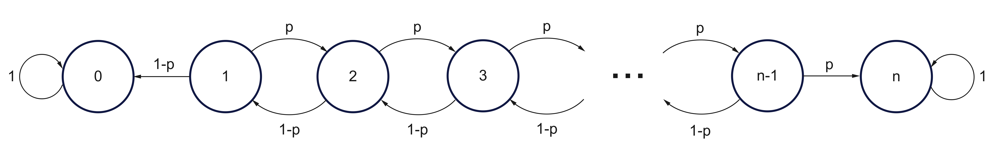

## Problem

The gambler's ruin problem, first mentioned by [Blaise Pascal](https://en.wikipedia.org/wiki/Blaise_Pascal) in one of his letters to [Pierre Fermat](https://en.wikipedia.org/wiki/Pierre_de_Fermat), was then reformulated by [Christiaan Huygens](https://en.wikipedia.org/wiki/Christiaan_Huygens), leading to important advances in the mathematical theory of probability. The statement of the problem considered here is slightly different from the one described by either Pascal or Huygens [@noauthororeditor].

> Consider a gambler who starts with an initial wealth of €$k$ and then on each successive bet either wins €1 or loses €1 with probabilities $p$ and $q=1−p$ respectively. Different bets are assumed independent. The gambler’s objective is to reach a total wealth of €$n$ ($n>k$). If the gambler succeeds, then the gambler is said to win the game. The gambler stops playing after winning or getting ruined (running out of money), whichever happens first.

Calculate the probability that the gambler wins. In particular, which is the probability of the gambler becoming infinitely rich?

## Solution

Let us denote by $A$ the event that the gambler ends up with €$n$ and by $F$ the event that the gambler wins the first bet. The probability of the event $A$ given that the gambler starts with €$k$ is written $w_k$. The total probability law allows us to write:

$$
\begin{split}
w_k&=P(A\,\vert\,F)P(F)+P(A\,\vert\,\overline{F})P(\overline{F})\\
&=pP(A\,\vert\,F)+(1-p)P(A\,\vert\,\overline{F})
\end{split}
$$ {#eq-eq1}

where $\overline{F}$ is the complement of $F$, namely the event $\overline{F}$ is that the gambler loses the first bet.

Now, the event $A\,\vert\,F$ is the event $A$ given that the gambler starts with €$(k+1)$, whose probability is $w_{k+1}$ (because of the independence from the past). The event $A\,\vert\,\overline{F}$ is the event $A$ given that the gambler starts with €$(k-1)$, whose probability is $w_{k-1}$ (because of the independence from the past). @eq-eq1 reads:

$$
w_k=p\,w_{k+1}+(1-p)\,w_{k-1}
$$ {#eq-eq10}

If we define $r=(1-p)/p$, we can also write:

$$
\left\{
\begin{split}
&w_{k+1}-w_k=r(w_k-w_{k-1}),\;0<k<n\\
&w_0=0\\
&w_n=1
\end{split}
\right.
$$ {#eq-eq2}

Since $w_{k+1}=w_k+r^k(w_1-w_0)=w_k+r^kw_1=w_1\sum_{i=0}^kr^i$, we can calculate $w_k$ as follows:

$$
w_k=\left\{
\begin{split}
&\frac{1-r^k}{1-r}w_1&\quad\text{if}\;r\neq1\\
&kw_1&\quad\text{if}\;r=1
\end{split}
\right.
$$ {#eq-eq3}

We also know that $w_n=1$. Therefore, we can solve @eq-eq3 for $w_1$:

$$
w_1=\left\{
\begin{split}
&\frac{1-r}{1-r^n}&\quad\text{if}\;r\neq1\\
&\frac{1}{n}&\quad\text{if}\;r=1
\end{split}
\right.
$$

Plugging this expression of $w_1$ into @eq-eq3, we obtain:

$$
\boxed{w_k=\left\{
\begin{split}
&\frac{1-r^k}{1-r^n}&\quad\text{if}\;r\neq1\\
&\frac{k}{n}&\quad\text{if}\;r=1
\end{split}
\right.}
$$ {#eq-eq4}

The probability that the gambler becomes infinitely rich (event $R$) is written:

$$
\left\{
\begin{split}
\text{Pr}(R)&=\lim_{n\rightarrow\infty}w_k=1-\left(\frac{1-p}{p}\right)^k>0,&\quad p>1/2\;(r<1)\\
\text{Pr}(R)&=\lim_{n\rightarrow\infty}w_k=0,&\quad p\leq1/2\;(r\geq1)\\
\end{split}
\right.
$$ {#eq-eq5}

To interpret the meaning of @eq-eq5, suppose that the gambler starting with an initial wealth of €$k$ wishes to continue gambling, with the intention of earning as much money as possible. So there is no winning value €$n$: the gambler will only stop if ruined. If $p>1/2$ (each gamble is in favor of the gambler), then there is a positive probability that the gambler will never get ruined but instead will become infinitely rich. Conversely, if $p\leq0.5$ (each gamble is not in favor of the gambler), then the gambler will get ruined with probability one.

## Markov chain model

The discrete-state discrete-time Markov chain show in @fig-fig1 can be proposed to model the gambler process [@noauthororeditor]. The $n+1$ states, numbered from 0 to $n$, represent the gambler's wealth at the start of each bet. The first state 0 corresponds to ruin (getting out of money), the last state $n$ corresponds to win. Given the rules of the game, the states 0 and $n$ are absorbing, in the sense that it is not possible to escape from each of them anymore, once they are entered. All the other states are transient.

{#fig-fig1 fig-align="center"}

The problem is then to find the probabilities of absorption at each one of the two absorbing states. These absorption probabilities depend on the initial state $k\;(0<k<n)$. It is worthy noting that the memoryless character of the process implies that, if the gambler happens to revisit the initial state $k$ after a while, the absorption probabilities are the same they were initially.

::: callout-note
## Transition probability matrix

The state of a discrete-state discrete-time Markov chain is denoted by $X_t$, that can change at certain discrete time instants $n$. The state space of the chain is composed of a finite set $\mathscr{S}=\{1,\cdots,m\}$. The Markov chain is described in terms of its transition probability $p_{ij}$:

$$
p_{ij}=P(X_{t+1}=j\,\vert\,X_t=i),\quad i,j\in\mathscr{S} 
$$ {#eq-eq6}

The key assumption underlying Markov chains is that the **Markov property** holds:

$$
P(X_{t+1}=j\,\vert\,X_t=i,X_{t-1}=i_{t-1},\cdots,X_0=i_0)=P(X_{t+1}=j \,\vert\,X_t=i)=p_{ij}
$$ {#eq-eq7}

for all times $t$, all states $i,j\in\mathscr{S}$ and all possible sequences $i_0,i_1,\cdots,i_{t-1}$ of earlier states. Thus, the probability law of the next state $X_{t+1}$ depends on the past only through the value of the present state $X_t$.

All of the elements of a Markov chain model can be encoded in a **transition probability matrix**, which is simply a two-dimensional array whose elements at the $i$th row and $j$th column is $P_{ij}$:

$$
\begin{bmatrix}
p_{11}&p_{12}&\cdots&p_{1m}\\
p_{21}&p_{22}&\cdots&p_{2m}\\
\vdots&\vdots&\vdots&\vdots\\
p_{m1}&p_{m2}&\cdots&p_{mm}
\end{bmatrix}
$$ {#eq-eq8}

Consider a Markov chain in which each state is either transient or absorbing. We fix a particular absorbing state $s$. It is possible to show that the probabilities $w_k$ of eventually reaching state $s$, starting from $k$, are the unique solution of the equations $w_s=1, w_i=0$, for all absorbing $i\neq s$, and for all transient $i$:

$$
w_i=\sum_{j=1}^mp_{ij}w_j
$$ {#eq-eq9}
:::

::: {#exm-exm1}
## Gambler's discrete-time Markov chain

For $n=4,p,q=1-p$ the transition probability matrix of the gambler's discrete-time Markov chain is given by:

$$
\begin{bmatrix}
1&0&0&0&0\\
q&0&p&0&0\\
0&q&0&p&0\\
0&0&q&0&p\\
0&0&0&0&1
\end{bmatrix}
$$

In the case of the gambler's ruin problem, @eq-eq9 can be reformulated as follows:

$$
w_k=(1-p)\,w_{k-1}+p\,w_{k+1}
$$

with $w_0=0,w_n=1$, leading to @eq-eq10.
:::

## Simulation

The following code written in R simulates the gambler process (adapted from [@dobrow2016]).

```{r}
#| code-fold: true
set.seed(2001)
gambler <- function(k, n, p) {
  stake <- k
	while (stake > 0 & stake < n) {
		bet <- sample(c(-1, 1), 1, prob = c(1-p, p))
		stake <- stake + bet
	}
	if (stake == n) return(1) else return(0)
}   
k <- 15         # initial wealth
n <- 120        # final wealth
p <- 0.5        # probability of win at each bet
ntrials <- 1000 # number of independent trials

sim <- replicate(ntrials, gambler(k, n, p))
p_ruin <- 1 - sum(sim)/ntrials 
```

The probability of ruin estimated over `r ntrials` iterations of the gambler process is `r round(p_ruin, 3)`, in close agreement with the value 0.875 computed from @eq-eq4.

It is noted that, at each time step, the gambler appears to move randomly, either to the left or to the right by a fixed unit distance with probability $p$ and $1-p$, respectively. The gambler undergoes a simple random walk in one dimension, whose state space is the set of the integers $\mathbb{Z}$. The limitations to values of $\mathbb{Z}$ between 0 (ruin) and $n$ (win) are the consequence of the gambling rules: these rules settle two absorbing barriers to the motion of the random walker. Nine exemplary sample paths of the random walk are shown in @fig-fig2, for the case that $k=30,n=120,p=0.5$.

```{r}
#| code-fold: true
#| message: false
#| warning: false
#| label: fig-fig2
#| fig-cap: "Gambler's random walk: nine sample paths. The outcome of up to a maximum of 1000 bets is considered here."
library(tidyverse)
library(ggpubr)

set.seed(2001)
k <- 30       # initial wealth
n <- 120      # final wealth
p <- 0.5      # probability of win at each bet
ntrials <- 9  # number of independent trials
nstep <- 1000 # number of steps
traj <- matrix(NA, nrow = nstep, ncol = ntrials)
for (i in 1:ntrials) {
  traj[1, i] <- k
  jmax <- nstep
  for (j in 2:nstep) {
		  bet <- sample(c(-1, 1), 1, prob = c(1-p, p))
		  traj[j, i] <- traj[j-1, i] + bet
		  if (traj[j, i] == 0 | traj[j, i] == n) {
		    break
		  }
  }
}   
t <- rep(seq(0, nstep-1, by = 1), ntrials)
path <- rep(c("1", "2", "3", "4", "5", "6", "7", "8", "9"), each = nstep)
traj <- c(traj)
df <- data.frame(t = t, path = path, data = traj)

my_theme = theme(
    axis.title.x = element_text(size = 14),
    axis.text.x = element_text(size = 12),
    axis.title.y = element_text(size = 14),
    axis.text.y = element_text(size = 12),
    legend.title = element_text(size = 12),
    legend.text = element_text(size = 12),
    panel.border = element_blank(),
    panel.grid.major = element_blank(),
    panel.grid.minor = element_blank(),
    panel.background = element_blank(),
    panel.spacing = unit(1, "lines"),
    axis.line = element_line(colour = "black"))

ggplot(df, aes(x = t, y = data, path = path)) + 
  geom_line() +
  labs(x = "bets",
       y = "gambler's wealth") +
  geom_hline(yintercept = 0, linetype = "dashed") + 
  geom_hline(yintercept = 120, linetype = "dashed") +
  scale_y_continuous(breaks = c(0, 30, 60, 90, 120)) +
  facet_wrap(~path, labeller = "label_both") + 
  my_theme
```
