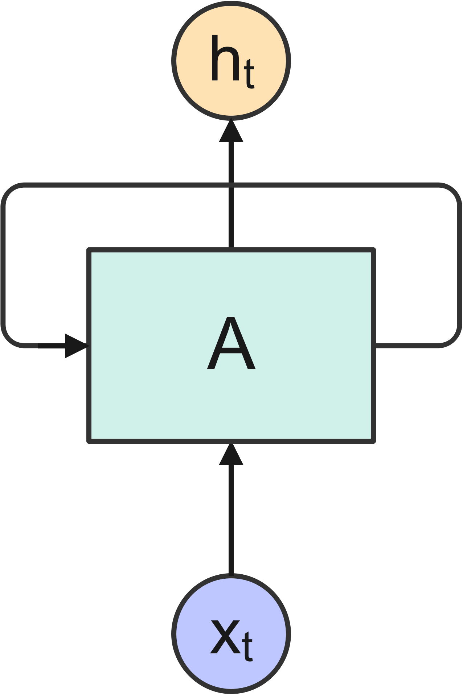
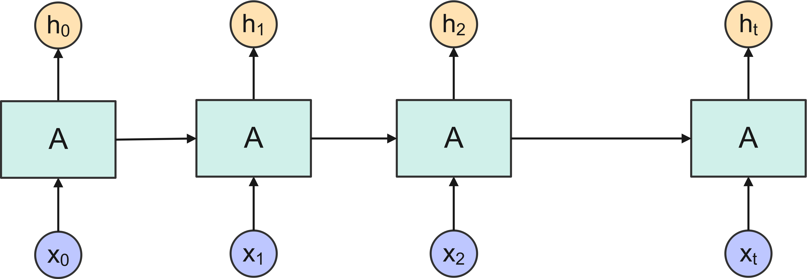
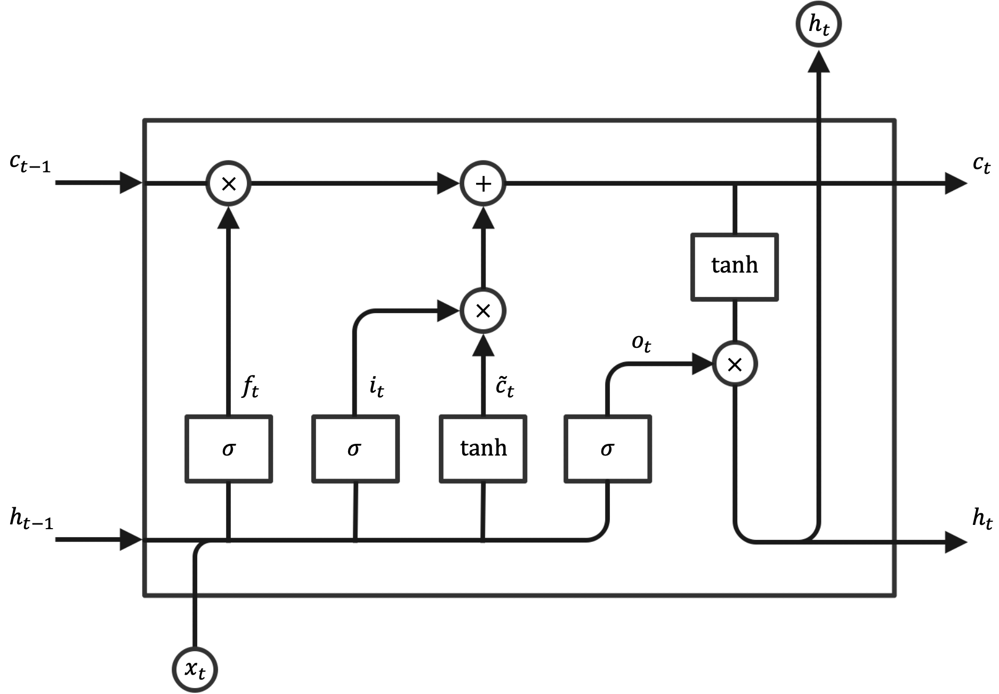

Long Short Term Memory (LSTM) networks are special kind of Recurrent Neural Networks (RNNs). LSTM networks can be used for time series forecasting, because of their ability to capture and learn the long-term dependencies, such as trends or patterns persisting over time, that are frequently exhibited by time series. In particular, LSTM networks can retain such information on long term behavior of time series much better than ordinary RNNs can do.

@fig-fig1 shows the cell of an ordinary RNN, $A$, which outputs a value $h_t$ in response to the input $x_t$.

{#fig-fig1 fig-align="center" width="134"}

Since the cell has a loop into it, information is allowed to persist through multiple steps of the network. An RNN can be thought as multiple copies of this cell, each copy passing a message to the next one, as shown in @fig-fig2. It is exactly this ability to retain information over multiple steps of the network that provides an RNN with the ability, in principle, to learn long-term dependencies of the input sequence.

{#fig-fig2 fig-align="center" width="576"}

LSTM are, in this regard, just a special kind of RNN, with much better capabilities to learn the long-term dependencies, compared with an ordinary RNN. @fig-fig3 shows that each repeating cell in an LSTM has four neural network layers (sigmoid $\sigma$ and hyperbolic tangent $\text{tanh}$). In this figure each line carries a vector, from the output of one node to the input of others. Pointwise operations of multiplication and addition coexist with the learned neural network layers.

{#fig-fig3 fig-align="center" width="720"}

The cell state is the horizontal line at the top of the diagram. The flow of information along the cell state is controlled by the neural network layers, which learn which information to pass and which information to forget through a number of gates:

-   The **forget gate** decides what information to discard from the cell state:

$$
f_t=\sigma\left[w_f\cdot(h_{t-1},x_t)+b_f\right]
$$

-   The **input gate** decides what new information to store in the cell state:

$$
\left\{
\begin{align}
i_t&=\sigma\left[w_i\cdot(h_{t-1},x_t)+b_i\right]\\
\tilde{c}_t&=\tanh\left[w_c\cdot(h_{t-1},x_t)+b_c\right]
\end{align}
\right.
$$

-   The **cell state update** is based on the following equations:

$$
c_t=f_t\cdot c_{t-1}+i_t\cdot \tilde{c}_t
$$

-   The **output gate** computes the output $h_t$ based on the updated cell state $c_t$.

$$
\left\{
\begin{align}
o_t&=\sigma\left[w_o\cdot(h_{t-1},x_t)+b_o\right]\\
h_t&=o_t\cdot \tanh({c_t})
\end{align}
\right.
$$

It is worth noting that the structure of the LSTM cell indicated in @fig-fig3 is just one of many variants that have been proposed in the literature.

## Load the libraries and the dataset

For demonstration purposes, the historical end-of-day stock price data $p_t$ for Apple Inc. are considered (period: 01/01/2022-06/30/2024). The `quantmod` package in R can be used to download this data from Yahoo Finance.

```{r}
#| code-fold: true
#| eval: true
#| message: false
#| warning: false

library(tidyverse)
library(quantmod)
library(keras)

tensorflow::set_random_seed(1234)

# Define the stock symbol for Apple Inc. and specifiy the date range
stock_symbol <- "AAPL"
start_date   <- as.Date("2021-12-31")
end_date     <- as.Date("2024-06-30")
# Download data from Yahoo Finance using quantmod
getSymbols(stock_symbol, src = "yahoo", 
           from = start_date, to = end_date) -> a
# Set data as dataframe
apple_data <- data.frame(date = as.Date(index(AAPL)), 
                         close = as.numeric(Cl(AAPL)))
# Compute log-returns from end-of-day stock price, adjusting for date
log_return <- diff(log(apple_data$close))
date <- apple_data %>%
    pull(date)
date <- date[-1]
apple_data <- data.frame(date = date, log_return = log_return)
```

## Data preparation

### Transform data to stationary

Usually, this is done by getting the difference between two consecutive values in the series. This transformation, commonly known as *differencing*, is considered in traditional time series models, such as ARIMA and GARCH. For a short discussion about non-stationarity in time series and statistical tests that can be used to detect whether a time series is stationary or not, see my previous post ([here](https://amsabatini.netlify.app/posts/dickey_fuller/)). There are different approaches in the literature regarding whether LSTM networks can be applied to stationary or non-stationary time series ([here](https://medium.com/@robinaiqbal/using-r-to-compare-the-applicability-of-long-short-term-memory-lstm-models-for-stock-prices-and-7a9b72250a95)). For the example discussed in this post, I decided to analyze the **log-returns** $z_t$ of the end-of-day stock prices:

$$
z_t=\log\left(\dfrac{p_t}{p_{t-1}}\right)=\log(p_t)-\log(p_{t-1})
$$

```{r}
#| echo: false
#| eval: true
#| message: false
#| warning: false
#| label: fig-fig4
#| fig.cap: "Log-returns of end-of-day stock price."

# Plot data
ggplot(apple_data, aes(date, log_return)) + 
    geom_line(color = "blue") +
    scale_x_date(date_labels = "%b %Y") + 
    xlab("time") + 
    ylab("daily log return") + 
    theme_classic()
```

The time series of log-returns plotted in @fig-fig4 is to be regarded as being stationary.

### Data normalization

For better learning, LSTM needs normalized data, i.e., data that are centered by the mean and scaled by the standard deviation. This step can be implemented using the `scale()` function of base R; the function `get_scaling_factors()` stores the scaling factors used for data normalization. When the original data scale needs to be restored at the time of making predictions, the function `reverse_data()` can be used.

```{r}
#| code-fold: true
#| eval: true
#| message: false
#| warning: false

get_scaling_factors <- function(data) {
  out <- c(mean = mean(data), sd = sd(data))
  return(out)
}

reverse_data <- function(data, scaling_factors) {
  temp <- (data*scaling_factors[2]) + scaling_factors[1]
  out <- as.matrix(temp)
  return(out)
}

# Data processing using differencing with diff() and normalization with scale() 
scaling_factors <- get_scaling_factors(apple_data$log_return)
log_return      <- scale(apple_data$log_return)
log_return      <- data.frame(log_return)
```

### Split dataset in training and testing sets

LSTM works in a supervised learning mode, with a predictor $\textbf{X}$ and a target variable $Y$. The time series needs therefore to be transformed by lagging the series, so as to have the values at times $(t−k),k=1,\cdots,L$ as the input and the value at time $t$ as the ouput, for a $L$-step lagged dataset: $\textbf{X}_t=[x_{t-L},x_{t-L+1},\cdots,x_{t-1}]$ and $Y_t=x_t$. Here, I choose $L=7$. Moreover, unlike in most analysis where training and testing data sets are randomly sampled, with time series data the order of the observations does matter. The following code splits the first 80% of the series as training set and the remaining 20% as testing set.

```{r}
#| code-fold: true
#| eval: true
#| message: false
#| warning: false

# Define the train and test split
split_data <- function(series, lag) {
    lag <- lag+1
    data_raw <- as.matrix(series) # convert to matrix (series is a data frame)
    data <- array(dim = c(0, lag, ncol(data_raw)))
    # Create all possible sequences of length lag
    for (i in 1:(nrow(data_raw)-lag)) {
        data <- rbind(data, data_raw[i:(i+lag-1), ])
    }
    train_set_size <- round(0.8*nrow(data))
    test_set_size  <- nrow(data)-train_set_size
    x_train <- data[1:train_set_size, 1:(lag-1)]
    y_train <- data[1:train_set_size, lag]
    x_test <- data[(train_set_size+1):nrow(data), 1:(lag-1)]
    y_test <- data[(train_set_size+1):nrow(data), lag]
    return(list(x_train = x_train, y_train = y_train,
                x_test = x_test, y_test = y_test))
}

# Divide data into train and test
lag <- 7 # Choose sequence length
split_data <- split_data(log_return, lag)
x_train <- split_data$x_train
y_train <- split_data$y_train
x_test <- split_data$x_test
y_test <- split_data$y_test
n_train <- dim(x_train)[1]
n_test <- dim(x_test)[1]
```

## Model construction

It is important to consider that the input to every LSTM layer must be three-dimensional. The three dimensions of the input are:

-   **Samples** This dimension indicates how many samples are included in each batch; in this example, we have `r n_train` samples for the training data and `r n_test` for the testing data.

-   **Time Steps** This dimension indicates how many points of observation are included in each sample; in this example, we have `r lag` points.

-   **Features** This dimension indicates how many features are in each observation at each time step; for a univariate case, like in this example, we have just one feature.

```{r}
#| code-fold: true
#| eval: true
#| message: false
#| warning: false

input_dim <- 1

# Reshape the training and test data to have a 3D array
x_train <- array_reshape(x_train, c(n_train, lag, input_dim))
x_test  <- array_reshape(x_test, c(n_test, lag, input_dim))
```

### Define the model

A sequential model is defined using `keras_model_sequential()`:

```{r}
#| code-fold: true
#| eval: true
#| message: false
#| warning: false

# Decide structure
hidden_dim <- 32
num_layers <- 2
output_dim <- 1

# Define the LSTM model using Keras
model <- keras_model_sequential() %>%
  layer_lstm(units = hidden_dim, input_shape = c(lag, input_dim), 
             return_sequences = TRUE) %>%
  layer_lstm(units = hidden_dim) %>%
  layer_dense(units = output_dim) 
model
```

The LSTM input layer is defined by the `input_shape` argument on the first hidden layer, which takes a tuple of two values that define the number of time steps and features.

### Compile and fit the model

The model is compiled in-place using `compile()`, which specifies the loss function (mean squared error) and the optimizer (Adam), with learning rate assigned over each update. The model is then fit using the training data and validated on the testing data. The training history is stored in the `history` object.

```{r}
#| code-fold: true
#| eval: true
#| message: false
#| warning: false

num_epochs <- 125
batch      <- 16

model %>%
  compile(loss = "mean_squared_error", 
          optimizer = optimizer_adam(learning_rate = 0.01))

# Train the model on the training data
history <- model %>% fit(x_train, y_train, 
                         epochs = num_epochs, 
                         batch_size = batch, 
                         validation_data = list(x_test, y_test),
                         verbose = FALSE,
                         shuffle = FALSE)
```

```{r}
#| echo: false
#| eval: true
#| message: false
#| warning: false
#| label: fig-fig5
#| fig.cap: "Loss over the number of epochs."

plot(history)
mse <- history$metrics$val_loss[length(history$metrics$val_loss)]
mse <- round(mse, 4)
```

The loss over the training epochs is shown in @fig-fig5. The validation mean squared error is `r mse`.

### Extract predictions

@fig-fig6 shows the results of the forecasting exercise using LSTM.

```{r}
#| code-fold: true
#| eval: true
#| message: false
#| warning: false

# Extract predictions from the estimated model
y_train_pred <- model %>% predict(x_train, verbose = FALSE)
y_test_pred  <- model %>% predict(x_test, verbose = FALSE)

# Rescale the predictions and original values
y_train_pred_orig <- reverse_data(y_train_pred, scaling_factors)
y_train_orig      <- reverse_data(y_train, scaling_factors)
y_test_pred_orig  <- reverse_data(y_test_pred, scaling_factors)
y_test_orig       <- reverse_data(y_test, scaling_factors)

# Shift the predicted values to start from where the training data predictions end
y_test_pred_orig_shifted <- c(rep(NA, n_train), y_test_pred_orig[, 1])
y_train_pred_orig        <- c(y_train_pred_orig, rep(NA, n_test))
```

```{r}
#| echo: false
#| eval: true
#| message: false
#| warning: false
#| label: fig-fig6
#| fig.cap: "LSTM predictions."

y_orig <- c(y_train_orig, y_test_orig)

t      <- apple_data$date[(lag+1):(n_train+n_test+lag)]
group  <- rep(c("original time series", "train-predictions", "test-predictions"), each = length(t))
t      <- c(t, t, t)
df     <- data.frame(condition = group, t = t, 
                     y = c(y_orig, y_train_pred_orig, y_test_pred_orig_shifted)) 

# Plot data
ggplot(df, aes(t, y, color = condition)) + 
    geom_line(linewidth = 0.5) +
    scale_color_manual(values = c("blue", "green" , "red")) + 
    scale_x_date(date_labels = "%b %Y") + 
    xlab("time") + 
    ylab("daily log-return") + 
    theme_classic()
```

<a href="https://www.flaticon.com/free-icons/forecasting" title="forecasting icons">Forecasting icons created by zero_wing - Flaticon</a>
