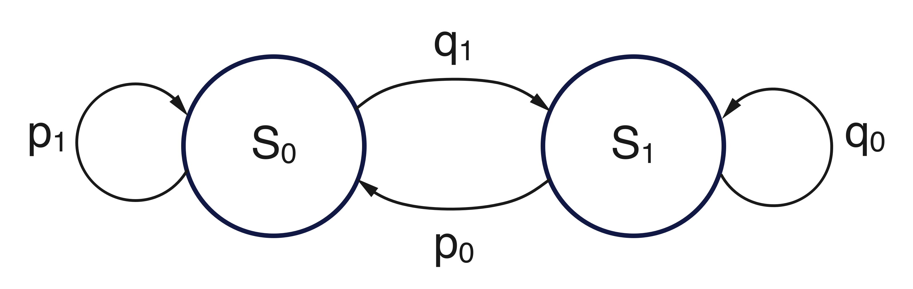
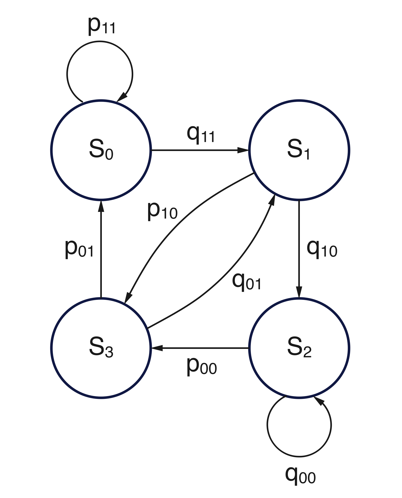
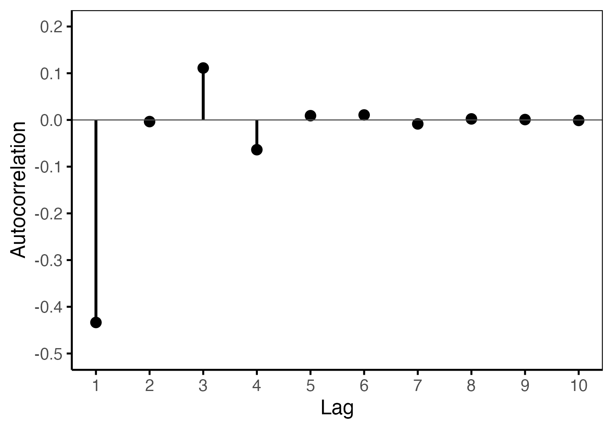

## The two-state Markov chain

Let us begin the discussion with the well-known two-state Markov chain (two-state MC) defined by the transition matrix:

$$
\mathbf{P} = \begin{bmatrix}
p_1 & 1-p_1 \\
p_0 & 1-p_0
\end{bmatrix}
$$

@fig-1 show the graph representation of this two-state MC.

{#fig-1 fig-align="center" width="50%"}

Here, $p_1$ and $p_0$ represent the probabilities of remaining in state $S_0$ and moving from state $S_1$ to $S_0$, respectively. Their complements, $q_1 = 1 - p_1$ and $q_0 = 1 - p_0$, correspond to the probabilities of leaving $S_0$ and remaining in $S_1$.

The conditions $p_0, p_1 > 0$ ensure that the chain is both irreducible (any state can be reached from any other) and aperiodic (no strict periodic cycle is enforced), two structural properties that guarantee the existence of a stationary distribution. This stationary distribution reflects the long-run proportion of time the process spends in each state, and can be written as:

$$
\text{Pr}(S_0) = p, \quad \text{Pr}(S_1) = q = 1 - p
$$

Recall that the $r$-step transition matrix, $\mathbf{P}^{(r)}$, provides the probabilities of transitioning from each state to any other state in exactly $r$ steps. In the case of the two-state MC introduced above, it is known that this matrix admits the following elegant closed-form expression:

$$
\mathbf{P}^{(r)} = \frac{1}{1 - (p_1 - p_0)}
\begin{bmatrix}
p_0 & q_1 \\
p_0 & q_1
\end{bmatrix}
+ \frac{(p_1 - p_0)^r}{1 - (p_1 - p_0)}
\begin{bmatrix}
q_1 & -q_1 \\
-p_0 & p_0
\end{bmatrix}
$$

This decomposition separates the long-run behavior (first term) from the transient dynamics (second term), which decays geometrically as $(p_1 - p_0)^r$. In other words, the process progressively "forgets" its initial state, and the transition probabilities stabilize over time.

This convergence is a hallmark of well-behaved Markov chains and underlies the existence of a unique stationary distribution:

$$
\boldsymbol{\pi} = \frac{1}{1 - (p_1 - p_0)} [p_0 \;\; q_1]
$$

This stationary distribution satisfies the fundamental balance condition $\boldsymbol{\pi} \mathbf{P} = \boldsymbol{\pi}$ and it characterizes the long-run proportion of time the process spends in each state — independently of the starting configuration.

We are now interested in the properties of the stochastic process $\{X_t\}$ generated by this chain, where $X_t$ denotes the state occupied by the process at time $t$. Since the chain evolves over two discrete states, this process is binary, and its behavior can be fully characterized by its first and second-order moments, including the autocorrelation function (ACF).

Assuming that the states $S_0$ and $S_1$ are coded as $\{1, 0\}$, the expectation and variance of the process $X_t$ are:

$$
\begin{aligned}
E[X_t] &= \pi_1 = \dfrac{p_0}{1 - (p_1 - p_0)} \\
\text{Var}(X_t) &= E[X_t^2] - E[X_t]^2 = E[X_t] - E[X_t]^2 \\
&= \pi_1 - \pi_1^2 = \dfrac{p_0 q_1}{\left[1 - (p_1 - p_0)\right]^2}
\end{aligned}
$$

To compute the ACF at lag $r$, note that only the case $X_t = 1, X_{t+r} = 1$ contributes to $E[X_t X_{t+r}]$, due to the binary coding:

$$
\begin{aligned}
E[X_t X_{t+r}] &= \sum_{i,j} i \cdot j \cdot \Pr(X_t = i, X_{t+r} = j) \\
&= \Pr(X_t = 1, X_{t+r} = 1) = \pi_1 \cdot P^{(r)}_{11}
\end{aligned}
$$

The covariance at lag $r$ is therefore:

$$
\begin{aligned}
\text{Cov}(X_t, X_{t+r}) &= E[X_t X_{t+r}] - E[X_t]^2 \\
&= \pi_1 \cdot P^{(r)}_{11} - \pi_1^2 \\
&= (p_1 - p_0)^r \cdot \frac{p_0 q_1}{[1 - (p_1 - p_0)]^2}
\end{aligned}
$$

::: callout-note
## A note on the variance computation

Since $X_t \in \{0,1\}$, it follows that $X_t^2 = X_t$ for all $t$, and hence $E[X_t^2] = E[X_t]$. This identity simplifies the computation of the variance, which becomes $\text{Var}(X_t) = E[X_t] - E[X_t]^2$.
:::

The ACF is:

$$
\boxed{\rho_r = \text{Corr}(X_t, X_{t+r}) = \frac{\text{Cov}(X_t, X_{t+r})}{\text{Var}(X_t)} = (p_1 - p_0)^r}
$$

This geometric decay reflects the memory of the chain, governed by the second eigenvalue of the transition matrix $\mathbf{P}$, namely $\lambda_2 = p_1 - p_0$.

::: callout-note
### Coding and autocorrelation

The ACF derived above is based on a binary coding of the process $X_t \in \{0,1\}$. In this setting, the autocovariance at lag $r$ is:

$$
\text{Cov}(X_t, X_{t+r}) = E[X_t X_{t+r}] - E[X_t]^2
$$

and the ACF is obtained as:

$$
\rho_r = \frac{\text{Cov}(X_t, X_{t+r})}{\text{Var}(X_t)} = (p_1 - p_0)^r
$$

Now, suppose we recode the process using values $\{-1, +1\}$, defining $Z_t = 2X_t - 1$. Then $Z_t \in \{-1, +1\}$ and:

$$
\begin{aligned}
E[Z_t] &= 2E[X_t] - 1 \\
\text{Var}(Z_t) &= 4 \cdot \text{Var}(X_t) \\
E[Z_t Z_{t+r}] &= 4E[X_t X_{t+r}] - 4E[X_t] + 1
\end{aligned}
$$

So the autocovariance of $Z_t$ becomes:

$$
\text{Cov}(Z_t, Z_{t+r}) = E[Z_t Z_{t+r}] - E[Z_t]^2 = 4 \cdot \text{Cov}(X_t, X_{t+r})
$$

and the autocorrelation remains invariant:

$$
\text{Corr}(Z_t, Z_{t+r}) = \frac{\text{Cov}(Z_t, Z_{t+r})}{\text{Var}(Z_t)} = \frac{4 \cdot \text{Cov}(X_t, X_{t+r})}{4 \cdot \text{Var}(X_t)} = \rho_r
$$

This means that while the numerical values of expectation, variance, and autocovariance change under linear recoding, the autocorrelation (a dimensionless, normalized measure) does not.
:::

## A four-state Markov chain encoding second-order binary dependencies

Now consider a more structured chain where the state at time $t$ depends on both $X_{t-1}$ and $X_{t-2}$. This can be seen as a natural extension of the two-state MC to capture memory over two steps. This corresponds to a second-order Markov chain on binary values $X_t \in {0,1}$. It can be encoded as a first-order Markov chain with 4 states (four-state MC), each representing a pair ($X_{t-2}, X_{t-1}$):

| state | pair  | $X_t$ |
|-------|-------|-------|
| $S_0$ | (0,0) | 0     |
| $S_1$ | (0,1) | 1     |
| $S_2$ | (1,0) | 0     |
| $S_3$ | (1,1) | 1     |

The transition matrix $\mathbf{P} \in \mathbb{R}^{4 \times 4}$ then takes the form:

$$
\mathbf{P} = \begin{bmatrix}
p_{11} & 1 - p_{11} & 0 & 0 \\
0 & 0 & p_{10} & 1 - p_{10} \\
p_{01} & 1 - p_{01} & 0 & 0 \\
0 & 0 & p_{00} & 1 - p_{00}
\end{bmatrix}
$$

Each row corresponds to a transition determined by the current pair ($X_{t-2}, X_{t-1}$), and the choice of the next value $X_t$ determines the new state [@fig-2].

{#fig-2 fig-align="center" width="40%"}

### Stationary distribution

We can compute the stationary distribution $\boldsymbol{\pi} = [\pi_0, \pi_1, \pi_2, \pi_3]$ by solving the system:

$$
\boldsymbol{\pi} \cdot \mathbf{P} = \boldsymbol{\pi}, \quad \sum_{i=0}^3 \pi_i = 1
$$

Thanks to the sparsity and regularity of the transition matrix $\mathbf{P}$, this system admits a closed-form solution. In particular, the stationary probabilities satisfy the following relations:

$$
\begin{aligned}
\pi_1 &= \frac{1 - p_{11}}{p_{01}}\pi_0 \\
\pi_2 &= \pi_1 \\
\pi_3 &= \frac{1 - p_{10}}{p_{00}}\pi_1
\end{aligned}
$$

Substituting into the normalization condition gives:

$$
\left[ 1 + \frac{2(1 - p_{11})}{p_{01}} + \frac{(1 - p_{11})(1 - p_{10})}{p_{01} p_{00}} \right]\pi_0 = 1
$$

Once $\pi_0$ is computed from this expression, all remaining $\pi_i$, $i = 1, \dots, 3$, follow directly.

### Autocorrelation function

To compute the ACF, we first define a projection function $f(i)$, which recovers the binary value $X_t$ encoded by state $S_i$:

$$
f(i) = \begin{cases}
1 & \text{if } i \in \{1, 3\} \\
0 & \text{otherwise}
\end{cases}
$$

Then, the expectation of $X_t$ is:

$$
E[X_t] = \sum_{i=0}^3 f(i) \cdot \pi_i = \pi_1 + \pi_3
$$

and the variance becomes:

$$
\text{Var}(X_t) = E[X_t](1 - E[X_t])
$$

To evaluate the autocorrelation at lag $r$, we compute the joint moment:

$$
E[X_t X_{t+r}] = \sum_{i=0}^3 \sum_{j=0}^3 f(i) \cdot f(j) \cdot \pi_i \cdot \left[\mathbf{P}^r\right]_{ij}
$$

so that the ACF is:

$$
\rho_r = \dfrac{E[X_t X_{t+r}] - E[X_t]^2}{\text{Var}(X_t)}
$$

This method relies only on the stationary distribution and the $r$-step transition matrix $\mathbf{P}^r$. Unlike the two-state MC discussed above, here $\mathbf{P}^r$ does not admit a closed-form expression and must be computed numerically.

The following R function implements the numerical computation of the ACF for the four-state MC described above. It constructs the transition matrix, solves for the stationary distribution, and computes the projected ACF based on the binary encoding of the states.

```{r}
#| label: compute_acf_four_state
#| code-fold: true
#| code-summary: "Numerical computation of ACF"
#| eval: true
#| message: false
#| warning: false

compute_acf_four_state <- function(p11, p10, p01, p00, max_lag = 10) {
    
  # Transition matrix
  P <- matrix(c(p11, 1 - p11, 0, 0,
                0, 0, p10, 1 - p10,
                p01, 1 - p01, 0, 0,
                0, 0, p00, 1 - p00), nrow = 4, byrow = TRUE)

  # Solve for stationary distribution π such that π %*% P = π
  A <- t(P) - diag(4)
  A <- rbind(A, rep(1, 4))             # Add normalization row
  b <- c(rep(0, 4), 1)
  pi <- solve(t(A) %*% A, t(A) %*% b)  # Least-squares solution

  # Projection function f(i) = 1 for states 1 and 3, else 0
  f <- c(0, 1, 0, 1)

  EX   <- sum(f * pi)
  VarX <- EX * (1 - EX)

  rho <- numeric(max_lag)
  P_power <- diag(4)

  for (r in 1:max_lag) {
    P_power <- P_power %*% P
    EXX <- 0
    for (i in 1:4) {
      for (j in 1:4) {
        EXX <- EXX + f[i] * f[j] * pi[i] * P_power[i, j]
      }
    }
    rho[r] <- (EXX - EX^2) / VarX
  }

  return(list(
    pi   = round(pi, 5),
    EX   = round(EX, 5),
    VarX = round(VarX, 5),
    rho   = round(rho, 5)
  ))
}
```

@fig-3 shows the resulting autocorrelation pattern, which reflects the alternating behavior encoded in the four-state structure and highlights the persistence introduced by second-order dependencies.

```{r echo = FALSE, eval = FALSE, message = FALSE, warning = FALSE}

library(ggplot2)

# Parameters
p00 <- 0.80
p01 <- 0.20
p10 <- 0.50
p11 <- 0.10

acf_vals <- compute_acf_four_state(p11, p10, p01, p00)

# Create data frame for plotting
df_acf <- data.frame(
  lag = 1:length(acf_vals$rho),
  acf = acf_vals$rho
)

# Plot
# Plot con bounding box e linea orizzontale
p <- ggplot(df_acf, aes(x = lag, y = acf)) +
    geom_segment(aes(xend = lag, yend = 0), linewidth = 0.8) +
    geom_point(size = 2.5) +
    geom_hline(yintercept = 0, linetype = "solid", linewidth = 0.3, color = "gray30") +
    labs(x = "Lag", y = "Autocorrelation") +
    scale_x_continuous(breaks = 1:10) +
    scale_y_continuous(breaks = seq(-0.5, 0.2, by = 0.1), limits = c(-0.5, 0.2)) +
    theme_classic(base_size = 12) +
    theme(axis.line = element_line(color = "black"),
          axis.ticks = element_line(color = "black"),
          panel.border = element_rect(color = "black", fill = NA, linewidth = 0.5))

ggsave("fig_acf.png", plot = p,
       width = 5, height = 3.5, units = "in", dpi = 300, bg = "white")

```

{#fig-3 fig-align="center" width="70%"}

## Estimating the standard error of a sample proportion

When working with binary time series, a fundamental question is how to estimate the standard error (SE) of the sample proportion

$$
\bar{X}_n = \dfrac{1}{n}\sum_{t=1}^n X_t
$$

In the case of independent Bernoulli trials, the variance of the sample mean $\bar{X}_n$ is:

$$
\text{Var}(\bar{X}_n) = \frac{\sigma^2}{n}, \quad \text{with } \sigma^2 = p(1 - p)
$$

and the corresponding i.i.d. formula for the standard error is:

$$
\text{SE} = \sqrt{\dfrac{p(1-p)}{n}}
$$

However, when the data are generated from a dependent process such as a Markov chain (either order 1 or 2), this formula underestimates or overestimates the true SE, because the observations are no longer independent.

::: callout-note
## Variance of the sample mean with autocorrelated data

Let ${X_t}$ be a weakly stationary process with mean $\mu$, variance $\sigma^2$, and autocovariance function $\gamma_r = \text{Cov}(X_t, X_{t+r})$.

We are interested in the variance of the sample mean, which can be written:

$$
\text{Var}(\bar{X}_n) = \frac{1}{n^2} \sum_{t=1}^n \sum_{s=1}^n \text{Cov}(X_t, X_s)
= \frac{1}{n^2} \sum_{t=1}^n \sum_{s=1}^n \gamma_{|t-s|}
$$

We now reorganize this sum by collecting all terms with the same lag $r = \mid t - s\,\mid$. The number of terms with lag $r$ is $n - r$ (for $r = 0, 1,\cdots,n - 1$). So:

$$
\text{Var}(\bar{X}_n) = \frac{1}{n^2} \sum_{r=-(n-1)}^{n-1} (n - |r|) \gamma_{|r|}
= \frac{1}{n^2} \left( n \gamma_0 + 2 \sum_{r=1}^{n-1} (n - r) \gamma_r \right)
$$

Finally, using $\gamma_0 = \sigma^2$ and dividing numerator and denominator by $n$:

$$
\text{Var}(\bar{X}_n) = \frac{\sigma^2}{n} \underbrace{\left(1 + 2 \sum_{r=1}^{n-1} \left(1 - \frac{r}{n}\right) \rho_r \right)}_\text{VIF}
$$

This formula shows how the autocorrelation structure inflates the variance of the sample mean. The term in parentheses is usually referred to as the variance inflation factor ($\text{VIF}$). $\text{VIF}$ reduces to 1 in the i.i.d. (independent identically distributed) case, when all $\rho_r = 0$ for $r \geq 1$.

For large $n$ and fast decay of the ACF, a common simplification for $\text{VIF}$ applies:

$$
\text{VIF} \approx 1 + 2 \sum_{r=1}^R \rho_r
$$

where $R$ is a cutoff lag beyond which autocorrelation is negligible.
:::

With the introduction of the $\text{VIF}$, the expression of $\text{SE}$ becomes:

$$
\boxed{\text{SE} = \sqrt{\dfrac{p(1-p)}{n}} \sqrt{\text{VIF}\mathstrut}}
$$

The $\text{VIF}$ can be computed for both the two-state and four-state MCs, for example when estimating the proportion of time spent in each state — and its standard error — from an observed binary sequence of length $n$.

-   In the two-state MC, define the transition probabilities as follows:

$$
p_0 = \text{Pr}(0 \to 1), \quad p_1 = \text{Pr}(1 \to 1)
$$

With this parametrization, the lag-$r$ autocorrelation of the process is:

$$
\rho_r = (p_1 - p_0)^r
$$

This expression fully determines the ACF, which decays geometrically. The corresponding $\text{VIF}$ becomes:

$$
\text{VIF} = \frac{1 + \rho_1}{1 - \rho_1} = \frac{1 + (p_1 - p_0)}{1 - (p_1 - p_0)}
$$

In the two-state case, the process is i.i.d. only when the transition matrix is both symmetric and memoryless — that is, when transitions occur with equal probability in both directions. In this case, the autocorrelations vanish and $\text{VIF} = 1$.

-   In the four-state MC, the autocorrelations $\rho_r$ must be computed numerically (as done above), and plugged into the expression for $\text{VIF}$ above. As shown in @fig-3, the ACF decays fast enough to justify using the simplified formula above.

In both cases, accounting for autocorrelation is essential to avoid underestimating uncertainty in sample-based inference.

::: {.callout-tip title="Example. Comparing VIF in two-state and four-state MCs"}
Let us consider two different Markov models generating a binary sequence ${X_t}$:

-   two-state MC directly over $\{0,1\}$,

-   four-state MC, which overlaps bigrams $(X_{t-1}, X_t) \in \{00,01,10,11\}$, where the actual sequence is recovered by projecting on the second element of each pair.

The two-state MC has transition parameters:

$$
\left\{
\begin{aligned}
p_0&=0.665\\
p_1&=0.115
\end{aligned}
\right.
$$

Hence, the stationary distribution is given by:

$$
\left\{
\begin{aligned}
\text{Pr}(X_t=0)&=\dfrac{p_0}{1-(p_1-p_0)}=0.429\\
\text{Pr}(X_t=1)&=\dfrac{1-p_1}{1-(p_1-p_0)}=0.571
\end{aligned}
\right.
$$

The four-state MC has transition parameters:

$$
\left\{
\begin{aligned}
p_{00}&= 0.86\\
p_{01}&= 0.12\\
p_{10}&= 0.56\\
p_{11}&= 0.12
\end{aligned}
\right.
$$

The stationary distribution of the binary sequence is computed by projecting on the second digit of each pair:

$$
\left\{
\begin{aligned}
\text{Pr}(X_t=0)&= \pi_0+\pi_2\approx 0.429\\
\text{Pr}(X_t=1)&= \pi_1+\pi_3\approx 0.571\\
\end{aligned}
\right.
$$

where $\boldsymbol{\pi} = [\pi_0, \pi_1, \pi_2, \pi_3]$ is the stationary distribution of the four-state MC (obtained from, e.g., `compute_acf_four_state()`).

Even if the marginal distributions are almost identical, the two models may produce very different autocorrelation structures, and hence different values of the $\text{VIF}$:

$$
\left\{
\begin{aligned}
\text{VIF}_{\text{two-state}}&=\dfrac{1+(p_1-p_0)}{1-(p_1-p_0)}=0.290\\
\text{VIF}_{\text{four-state}}&=0.196
\end{aligned}
\right.
$$

where the value of $\text{VIF}_{\text{four-state}}$ is obtained from `compute_acf_four_state()`).

As shown by the negative ACF at lag 1 (–0.55 for the two-state MC, –0.54 for the four-state MC), both chains tend to promote alternation rather than persistence. When computing the SE, this alternation leads to an overestimation if one naively applies the i.i.d. formula. In both cases, the $\text{VIF}$ is smaller than 1, indicating anti-correlation. Moreover, since a smaller $\text{VIF}$ implies longer memory, we can conclude that the four-state MC retains information more persistently than the two-state one, despite having the same marginal distribution.
:::

This example illustrates how two Markov models generating binary sequences with identical marginal distributions can nevertheless lead to different effective sample sizes, due to distinct autocorrelation structures that significantly impact inference.

::: callout-tip
To achieve the same standard error in both settings, one would need to inflate the sample size in the less autocorrelated case by a factor approximately equal to the ratio of the corresponding $\text{VIF}$s. In the example above, since $\text{VIF}_{\text{two-state}} = 0.290$ and $\text{VIF}_{\text{four-state}} = 0.196$, the required sample size under the two-state model should be roughly 1.5 times larger to achieve the same standard error as under the four-state model.
:::

> **In short, correlation matters—even when proportions look the same.** These insights remind us that dependencies in data—often subtle—can have major consequences for statistical inference. Understanding and quantifying them is essential, even in the simplest of models.
