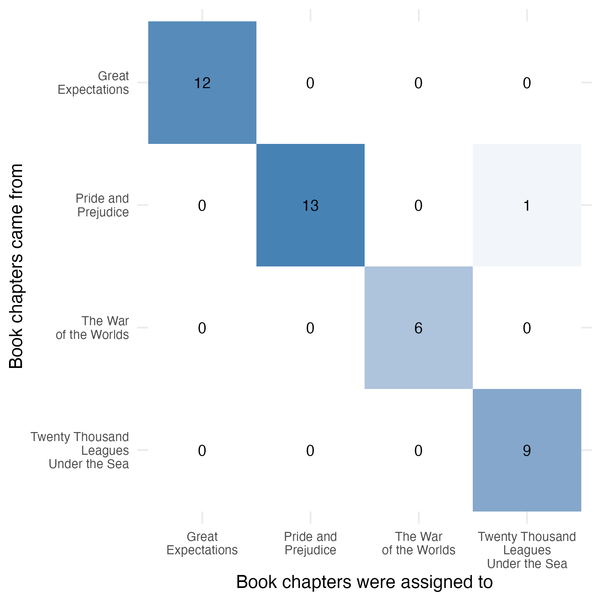
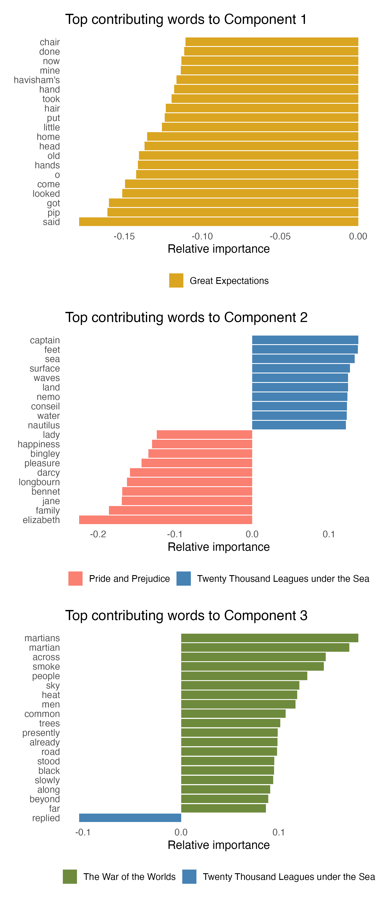

> 💾 **Prefer reading offline?**\
> You can [download a PDF version of this post](index.pdf) for printing or future reference.

**Partial Least-Squares Discriminant Analysis** (PLS-DA) is a multivariate dimensionality-reduction method that has been widely used in so-called *omics* data analyses (Ruiz-Perez et al).

In these contexts — such as genomics, transcriptomics, or metabolomics — datasets often consist of thousands of variables (e.g., gene expression levels or metabolite intensities) measured over a relatively small number of samples. This characteristic regime of many more features than observations presents significant challenges for classical dimensionality-reduction methods like Principal Component Analysis (PCA), which do not account for the underlying class structure of the dataset and can be easily misled by noise-dominated variability.

PLS-DA addresses this issue by introducing supervision: as will be illustrated in the following, it seeks projections of the original data that are *maximally correlated with the known class labels*, rather than relying solely on overall variance to identify promising projection directions.

The aim of dimensionality-reduction methods such as PCA and PLS-DA is to compute a linear transformation that projects the data into a lower-dimensional space — optimally, in the sense of minimizing some form of reconstruction or classification error, depending on the method.

Let us suppose that the original data matrix $\mathbf{X}$ is composed of $n$ samples, each characterized by a feature vector with $m$ components - that is, $\mathbf{X}$ is an $n\times m$ matrix. A linear transformation is described by a matrix $\mathbf{A}$ of size $m\times d$ that *optimally* maps $\mathbf{X}$ into a set of $n$ transformed vectors in $\mathbb{R}^d$, commonly referred to as *scores*. These scores are collected row-wise in the matrix $\mathbf{S}\in\mathbb{R}^{n\times d}$. Given the error matrix $\mathbf{E}$ of the same size, the model being fit takes the form:

$$
\mathbf{S}=\mathbf{X}\mathbf{A}+\mathbf{E}
$$

The transformed variables, one for each observation and each axis in the projected space, are referred to as *principal components* (PC) in the context of Principal Component Analysis (PCA).

## Principal Component Analysis

The PC vectors are computed by doing the eigenvector-eigenvalue analysis of the covariance matrix $\mathbf{C}$:

$$
\mathbf{C} = \dfrac{1}{n - 1} \mathbf{X}^T \mathbf{C}_n \mathbf{X}
$$

where the centering matrix $\mathbf{C}_n$, of size $n \times n$, is defined as:

$$
\mathbf{C}_n = \mathbf{I}_n - \dfrac{1}{n} \mathbf{1}_n \mathbf{1}_n^T
$$

Here, $\mathbf{I}_n$ is the $n \times n$ identity matrix, and $\mathbf{1}_n$ is a column vector of ones of length $n$. The matrix $\mathbf{C}_n$ (symmetric and idempotent) acts as a projection operator that removes the mean from each column of $\mathbf{X}$, thereby centering the data.

The *loading vectors*, denoted by $\mathbf{d}_i$, are expressed in terms of the eigenvectors $\mathbf{e}_i$ and eigenvalues $\lambda_i$ of $\mathbf{C}$:

$$
\mathbf{d}_i = \sqrt{\lambda_i}\,\mathbf{e}_i, \quad i = 1,\dots,n
$$

Since $\mathbf{C}$ is symmetric and positive semi-definite, its eigenvectors form an orthonormal basis and the associated eigenvalues are real and non-negative.

Let us suppose that the eigenvalues are sorted in decreasing order. The first PC is then given by the first loading vector $\mathbf{d}_1 = \sqrt{\lambda_1} \mathbf{e}_1$, which corresponds to the direction of *maximum variance* in the data. Each subsequent PC $\mathbf{d}_2, \mathbf{d}_3, \dots$ defines a new axis that is orthogonal to the previous ones and captures the largest remaining variance.

The set $\{ \mathbf{d}_1, \dots, \mathbf{d}_d \}$ spans the reduced feature space onto which the data are projected.

The associated score vectors are obtained by projecting the original data onto each loading vector:

$$
\mathbf{t}_i = \mathbf{X} \mathbf{d}_i, \quad i = 1,\dots,d
$$

These form the columns of the score matrix $\mathbf{S} \in \mathbb{R}^{n \times d}$, where each row represents a transformed observation in the low-dimensional space. This is the same matrix introduced earlier in the general model formulation.

PCA identifies the loading vectors $\mathbf{d}_i$ by maximizing the variance of the projected data along each component, subject to orthogonality constraints. This ensures that each PC captures the greatest possible amount of variance not already explained by previous components. Implicitly, the PCA model assumes that the residuals in $\mathbf{E}$ are uncorrelated, homoscedastic, and normally distributed — although in practice, PCA is often used as a purely geometric transformation without relying on strict distributional assumptions.

## Partial Least-Squares Discriminant Analysis

Let us suppose that the class labels for each observational unit are known. In the binary case, the labels can be collected in a column vector $\mathbf{y} \in \mathbb{R}^{n \times 1}$; in the multiclass setting, they are typically represented by a matrix $\mathbf{Y} \in \mathbb{R}^{n \times q}$, where $q$ is the number of distinct classes and each row is a one-hot encoded vector.

As in PCA, we seek a set of $d$ latent components by projecting the original data $\mathbf{X}$ onto a lower-dimensional subspace. However, unlike PCA, PLS-DA chooses the projection directions in such a way that the *covariance between the projected data and the class labels* is maximized.

The matrix of cross-covariance is defined as:

$$
\mathbf{C}_{XY} = \frac{1}{(n-1)^2} \mathbf{X}^\top \mathbf{C}_n \mathbf{Y} \mathbf{Y}^\top \mathbf{C}_n \mathbf{X}
$$

and the optimal projection direction $\mathbf{a}_1$ (the first loading vector) is found as the leading eigenvector of $\mathbf{C}_{XY}$. This ensures that the first latent component captures as much class-discriminative information as possible in a single direction.

The algorithm proceeds iteratively. Once the first loading vector $\mathbf{a}_1$ has been determined, the corresponding score vector $\mathbf{t}_1 = \mathbf{X} \mathbf{a}_1$ is computed, and a linear regression of $\mathbf{Y}$ on $\mathbf{t}_1$ is performed to obtain $\mathbf{c}_1$, the weight vector in label space. The outer product $\mathbf{t}_1 \mathbf{c}_1^T$ yields a rank-one approximation of the class label structure.

In order to extract additional components, the information already captured by the current component is removed from both $\mathbf{X}$ and $\mathbf{Y}$ through a deflation step. This is achieved by subtracting the contribution explained by $\mathbf{t}_1$) and $\mathbf{c}_1$, resulting in residual matrices:

$$
\mathbf{X}^{(1)} = \mathbf{X} - \mathbf{t}_1 \mathbf{p}_1^T, \quad
\mathbf{Y}^{(1)} = \mathbf{Y} - \mathbf{t}_1 \mathbf{c}_1^T
$$

The process is then repeated on the residuals to obtain the next components. Each new latent component is orthogonal to the previous ones in $\mathbf{T}$, and captures additional class-discriminative information, if available.

Unlike PCA, PLS-DA explicitly exploits the structure of $\mathbf{Y}$ to guide dimensionality reduction, making it a supervised projection method. It is particularly well suited to settings where the number of features is large and class separation is expected to be encoded in specific linear combinations of variables. Similar to PCA, the error structure in PLS-DA follows the same assumptions — namely, centered, uncorrelated, and homoscedastic residuals — although in practice, the method is often used with minimal reference to distributional properties.

PLS-DA can be further extended by introducing sparsity constraints on the loading vectors, yielding sparse PLS-DA (sPLS-DA). In this variant, only a subset of the original variables — those deemed most informative for class separation — are retained in the projection. The number of retained features per component is controlled by the parameter \texttt{keepX}, and the optimization is regularized accordingly.

This formulation enables both class separation and embedded feature selection, which is particularly useful in high-dimensional datasets such as omics or text.

Geometrically, sPLS-DA defines a projection of the data into a low-dimensional latent space, just like PCA, but the directions are chosen to maximize class separability rather than data variance. This distinction is crucial: while PCA may preserve structure unrelated to the class labels, PLS-DA aligns the representation with the supervised task.

As will become evident in the following sections, this shift in optimization criterion can make PLS-DA a powerful tool for supervised dimension reduction. However, it also introduces specific vulnerabilities — particularly in high-dimensional settings with limited sample size — where the method may overfit to noise or to accidental separability. Careful validation is therefore essential to assess the generalization performance of PLS-DA models.

```{r Fig 1, echo = FALSE, eval = FALSE, message = FALSE, warning = FALSE}

set.seed(42)

# Generate an elliptical cloud
mu    <- c(0, 0)
Sigma <- matrix(c(1, 0.25, 0.25, 1), 2, 2)
df    <- as.data.frame(mvrnorm(n = 150, mu = mu, Sigma = Sigma))
colnames(df) <- c("X1", "X2")

# Labeling: titled separation (es. y > x → B)
df$class <- ifelse(df$X2 > df$X1, "B", "A")

# PCA direction (maximal variance)
pca_dir <- prcomp(df[, c("X1", "X2")])$rotation[, 1]

# PLS-DA direction (orthogonal to the margin y = x)
pls_dir <- c(-1, 1) / sqrt(2)

# Arrows
arrow_df <- function(dir, label) {
  data.frame(
    x = 0, y = 0,
    xend = dir[1], yend = dir[2],
    label = label
  )
}

arrows <- rbind(
  arrow_df(pca_dir, "PCA"),
  arrow_df(pls_dir, "PLS-DA")
)

my_theme <- function(output = c("pdf", "png"), text_scale = 1) {
  output <- match.arg(output)

  if (output == "pdf") {
    axis_text_size <- 9 * text_scale      
    axis_title_size <- 10 * text_scale
  } else {
    axis_text_size <- 11 * text_scale     
    axis_title_size <- 12 * text_scale
  }

  theme_minimal() +
    theme(
      axis.ticks = element_line(),
      axis.ticks.length = unit(0.15, "cm"),
      axis.ticks.y = element_line(),
      axis.ticks.x = element_line(),
      axis.line = element_line(),
      axis.text = element_text(size = axis_text_size),
      axis.title = element_text(size = axis_title_size),
      panel.grid.major = element_blank(),
      panel.grid.minor = element_blank(),
      legend.title = element_blank(),
      legend.position = "inside",
      legend.position.inside = c(0.15, 0.9))
}

# Plot
p_png <- ggplot(df, aes(x = X1, y = X2, color = class)) +
    stat_ellipse(data = df, 
                 aes(x = X1, y = X2),   
                 type = "norm",
                 level = 0.95,
                 color = "grey40",
                 alpha = 0.15,
                 size = 1) + 
    geom_point(aes(color = class), alpha = 0.7, size = 2) +
    geom_segment(data = arrows,
                 aes(x = x, y = y, xend = xend, yend = yend, color = label),
                 inherit.aes = FALSE,
                 arrow = arrow(length = unit(0.3, "cm")),
                 linewidth = 1) +
    scale_color_manual(values = c("A" = "orange", "B" = "purple",
                                  "PCA" = "firebrick1", "PLS-DA" = "steelblue1")) +
    scale_x_continuous(breaks = seq(-3, 3, 1), limits = c(-3, 3)) +
    scale_y_continuous(breaks = seq(-3, 3, 1), limits = c(-3, 3)) +
    coord_fixed() +
    labs(x = "Feature 1", y = "Feature 2") +
    my_theme("png", text_scale = 1.2)

# Preview (PNG)
ggsave("Fig1.png", plot = p_png, width = 6, height = 6, 
       dpi = 300, bg = "white")
```

::: {#exm-1 .callout-example}
## PCA and PLS-DA in action

The geometric distinction between unsupervised and supervised dimensionality-reduction methods can be visualized in a simplified example. Suppose that all data points are drawn from a single elliptical distribution, yet class labels are assigned based on their position relative to a tilted decision boundary. In this case, the direction of maximum variance — as identified by PCA — is not informative about the class structure. In contrast, PLS-DA selects a projection direction that aligns with the known class labels, even if it corresponds to a direction of lower overall variance.

@fig-1 illustrates this contrast.
:::

{#fig-1 fig-align="center" width="70%"}

## The Great Library Heist

To illustrate the use of dimensionality-reduction and classification techniques in text data, I consider a corpus known as the "Great Library Heist", originally featured by Silge and Robinson in *Text Mining with R* (https://www.tidytextmining.com), where it is used to demonstrate the potential of Latent Dirichlet Allocation — one of the most common algorithms for topic modeling.

Topic modeling is a method for unsupervised classification of documents, in this case applied to the chapters of four well-known English novels from Project Gutenberg:

-   *Great Expectations* by Charles Dickens
-   *Pride and Prejudice* by Jane Austen
-   *The War of the Worlds* by H. G. Wells
-   *Twenty Thousand Leagues Under the Sea* by Jules Verne

```{r}
#| code-fold: true
#| code-summary: "upload libraries"
#| eval: true
#| message: false
#| warning: false

library(tidyverse)   # Core data wrangling and piping (includes dplyr, tidyr, etc.)
library(ggplot2)     # Grammar of graphics for plots (explicit, though included in tidyverse)
library(MASS)        # For multivariate data simulation (e.g., mvrnorm)
library(tidymodels)  # Unified framework for modeling and machine learning workflows
library(textrecipes) # Text preprocessing steps within tidymodels recipes
library(stringr)     # Consistent string handling (regex, manipulation)
library(mixOmics)    # Multivariate methods including sPLS-DA, PLS, PCA
library(yardstick)   # Performance metrics and confusion matrices
library(patchwork)   # Combine multiple ggplot2 plots into one layout
```

Following the general strategy introduced by Silge and Robinson, each chapter of the four books in the "Great Library Heist" corpus is treated as a separate document.

In author's own words: \> When examining a statistical method, it can be useful to try it on a very simple case where we know the "right answer". For example, a set of documents that definitely relate to four separate topics is collected, then topic modeling is performed to see whether the algorithm can correctly distinguish the four groups. This lets us double-check that the method is useful, and gain a sense of how and when it can go wrong.

The goal of the analysis is to construct a term-document matrix based on term frequency (TF) scores, which will serve as the input for both dimensionality reduction and classification. In this classical bag-of-words approach, each document is represented as an unordered collection of words — ignoring grammar, syntax, and word order. What matters is the frequency of each term across documents.

I intend to do the same with sPLS-DA. In doing so, I take inspiration from Saccenti and Tenori, who applied sPLS-DA to the stylometric analysis of the Divina Commedia.

```{r}
#| code-fold: true
#| code-summary: "The Great Library Heist"
#| eval: true
#| message: false
#| warning: false

load("books.rda")

df_books <- books %>%
    
  # Identify chaper for each book
  group_by(title) %>%
  mutate(chapter = cumsum(str_detect(text, regex("^chapter\\s", ignore_case = TRUE)))) %>%
  ungroup() %>%
  filter(chapter > 0) %>%
  
  # Prepare label and document name 
  mutate(label = str_squish(title)) %>%
  unite(document, title, chapter, sep = "_") %>%
  
  # All text for each chapter, in each book, is united in a single field
  group_by(label, document) %>%
  summarise(text = str_c(text, collapse = " "), .groups = "drop") %>%
  
  # Remove headings like "CHAPTER I", "CHAPTER TWENTY-ONE", etc.
  mutate(text = str_remove(text, regex("^CHAPTER\\s+.*?\\s+", ignore_case = TRUE))) %>%

  # To get chapters in order
  mutate(chapter_num = as.integer(str_extract(document, "\\d+$"))) %>%
  arrange(label, chapter_num) %>%
  dplyr::select(label, document, text)
```

### Data preparation and feature encoding

In the data preparation phase, I split the dataset into three parts:

-   a training set (`train_set`), used to learn the TF vocabulary and train the model;
-   a validation set (`val_set`), reserved for potential model selection;
-   and a test set (`test_set`), used exclusively for out-of-sample evaluation.

In the current pipeline, however, the validation set is not used. This is because I adopt internal cross-validation (`Mfold`) within the `tune.splsda()` function from the `mixOmics` package to select the optimal number of features (`keepX`) per component. The tuning procedure relies entirely on resampling the training set, rendering the explicit use of `val_set` unnecessary.

The reason for keeping a separate `val_set` is flexibility: it enables external model selection (e.g., grid search or alternative tuning strategies beyond those provided by `mixOmics`). Although the validation set (`val_set`) is not used in the current analysis, it is explicitly carved out from the training data to support future extensions. To maximize the data available for model training and internal cross-validation, only 5% of the training set is reserved for `val_set`. This ensures methodological robustness while preserving as much data as possible for fitting and tuning the model via `tune.splsda()`.

Feature engineering is performed using the `textrecipes` package, which allows defining a preprocessing pipeline through `recipe`. In this case, the text is tokenized, stop words are removed, the vocabulary is limited to the top 500 most frequent tokens, and a term frequency (TF) encoding is applied. This recipe is trained on the training set and then used to transform all data splits consistently, avoiding data leakage.

```{r}
#| code-fold: true
#| code-summary: "Train/validation/test splits with TF encoding"
#| eval: true
#| message: false
#| warning: false

set.seed(123)

# First split 80% train_val vs 20% test
split_1   <- initial_split(df_books, prop = 0.80, strata = label)
train_val <- training(split_1)
test_set  <- testing(split_1)

# Second split 95% train vs 5% val (part of training)
split_2   <- initial_split(train_val, prop = 0.95, strata = label)
train_set <- training(split_2)
val_set   <- testing(split_2)

# Check
df_check <- bind_rows(
  train = count(train_set, label),
  validation = count(val_set, label),
  test = count(test_set, label),
  .id = "split"
)
n_chapters <- sum(df_check$n)

# Feature engineering via textrecipes::recipe
text_rec <- recipe(label ~ text, data = train_set) %>%
  step_tokenize(text) %>%
  step_stopwords(text) %>%
  step_tokenfilter(text, max_tokens = 500) %>%
  step_tf(text)

# Prep/bake the recipe
rec_prep <- prep(text_rec)

X_train  <- bake(rec_prep, new_data = NULL) %>% dplyr::select(-label) %>% as.matrix()
y_train  <- bake(rec_prep, new_data = NULL) %>% pull(label)

X_test <- bake(rec_prep, new_data = test_set) %>% dplyr::select(-label) %>% as.matrix()
y_test <- bake(rec_prep, new_data = test_set) %>% pull(label)
```

```{r PCA_full, echo = FALSE, eval = FALSE, message = FALSE, warning = FALSE}

# Load required library
library(nnet)

# --- Preprocessing: recipe on full corpus ---
text_rec_all <- recipe(label ~ text, data = df_books) %>%
  step_tokenize(text) %>%
  step_stopwords(text) %>%
  step_tokenfilter(text, max_tokens = 500) %>%
  step_tf(text)

rec_all <- prep(text_rec_all)

X_all <- bake(rec_all, new_data = NULL) %>%
  dplyr::select(-label) %>%
  as.matrix()

y_all <- bake(rec_all, new_data = NULL) %>%
  pull(label)

# --- PCA on full TF matrix ---
pca_model <- prcomp(X_all, center = TRUE, scale. = TRUE)
df_pca <- as_tibble(pca_model$x[, 1:3]) %>%
  mutate(.truth = factor(y_all))

# --- Logistic regression on PCA space ---
logit_pca <- multinom(.truth ~ ., data = df_pca, trace = FALSE)
df_pca$.pred_class <- predict(logit_pca, newdata = df_pca)

# --- Evaluation ---
# Ensure consistent factor levels
class_levels <- levels(df_pca$.truth)
df_pca$.truth <- factor(df_pca$.truth, levels = class_levels)
df_pca$.pred_class <- factor(df_pca$.pred_class, levels = class_levels)

# Accuracy and metrics
acc_pca <- accuracy(df_pca, truth = .truth, estimate = .pred_class)$.estimate
metrics_pca <- metrics(df_pca, truth = .truth, estimate = .pred_class)

# --- Confusion matrix heatmap ---
confmat_pca <- conf_mat(df_pca, truth = .truth, estimate = .pred_class)

# Relabel for visualization
pretty_labels <- c(
  "Great\nExpectations",
  "Pride and\nPrejudice",
  "The War\nof the Worlds",
  "Twenty Thousand\nLeagues\nUnder the Sea"
)

test_pca$.truth <- factor(test_pca$.truth, labels = pretty_labels)
test_pca$.pred_class <- factor(test_pca$.pred_class, labels = pretty_labels)

# Confusion matrix
confmat_pca <- conf_mat(test_pca, truth = .truth, estimate = .pred_class)

# Visualization
p_conf_pca <- autoplot(confmat_pca, type = "heatmap") +
  scale_fill_gradient(low = "white", high = "steelblue") +
  labs(
    x = "Predicted", y = "True",
    title = "Confusion Matrix (PCA + Logistic Regression)"
  ) +
  theme_minimal(base_size = 13) +
  theme(
    legend.position = "none",
    axis.text.x = element_text(size = 9),
    axis.text.y = element_text(size = 9)
  )
```

```{r PLS-DA_full, echo = FALSE, eval = TRUE}

# Whole corpus used for fit and assessment
text_rec_all <- recipe(label ~ text, data = df_books) %>%
  step_tokenize(text) %>%
  step_stopwords(text) %>%
  step_tokenfilter(text, max_tokens = 500) %>%
  step_tf(text)

rec_all <- prep(text_rec_all)

X_all <- bake(rec_all, new_data = NULL) %>%
  dplyr::select(-label) %>%
  as.matrix()

y_all <- bake(rec_all, new_data = NULL) %>%
  pull(label)

splsda_all <- splsda(X_all, y_all, ncomp = 3, keepX = c(500, 500, 500))  
pred_all <- predict(splsda_all, X_all)

df_all_proj <- as.data.frame(pred_all$variates)
df_all_proj$.truth <- factor(y_all)
df_all_proj$.pred_class <- factor(pred_all$class$max.dist[, 3], levels = levels(df_all_proj$.truth))

n_errors <- as.integer((1 - accuracy(df_all_proj, truth = .truth, estimate = .pred_class)$.estimate) * nrow(df_all_proj))
```

### Model tuning with adaptive feature selection

In the `tune.splsda()` step, I explicitly include `max_tokens` (i.e., the full vocabulary size) in the grid of `keepX`. This allows the tuning procedure to consider not only sparse sPLS‑DA models, but also the special case of full PLS‑DA with no feature selection. Crucially, `tune.splsda()` returns a separate optimal `keepX` for each component, enabling each latent dimension to adaptively select the number of features most useful for class separation.

Because the procedure runs efficiently, I can afford a relatively fine grid for robust comparison. A typical choice might be:

```{r echo = TRUE, eval = FALSE}
set.seed(1234)
tune_result <- tune.splsda(
  X_train, y_train,
  ncomp = 3,
  test.keepX = c(25, 50, 75, 100, 125, 150, 200, 250, 500),
  validation = "Mfold",
  folds = 5,
  dist = "max.dist",
  progressBar = FALSE
)
```

```{r}
#| code-fold: true
#| code-summary: "sPLS-DA model fit"
#| eval: true
#| message: false
#| warning: false

# Tuning keepX for sPLS-DA
set.seed(1234)
tune_result <- tune.splsda(
  X_train, y_train,
  ncomp = 3,
  test.keepX = c(25, 50, 75, 100, 125, 150, 200, 250, 500),
  validation = "Mfold",
  folds = 5,
  dist = "max.dist",
  progressBar = FALSE
)

# Final fit with best keepX
best_keepX <- tune_result$choice.keepX
splsda_fit <- splsda(X_train, y_train, ncomp = 3, keepX = best_keepX)

# Predict on training set
pred_train <- predict(splsda_fit, X_train, comp = 1:3)

# Predict on test set
pred_test <- predict(splsda_fit, X_test, comp = 1:3)
```

```{r}
#| code-fold: true
#| code-summary: "Model evaluation with yardstick"
#| eval: true
#| message: false
#| warning: false

# --- 1. PREDICTIONS TEST SET

# Tibble for accuracy calculation
df_test_proj             <- as.data.frame(pred_test$variates)
df_test_proj$.truth      <- factor(y_test)
df_test_proj$.pred_class <- factor(pred_test$class$max.dist[, 3], levels = levels(df_test_proj$.truth))

# Accuracy calculated on the test set
acc_test <- accuracy(df_test_proj, truth = .truth, estimate = .pred_class)$.estimate

# --- 2. PREDICTIONS TRAINING SET

# Tibble for accuarcy calculation
df_train_proj <- as.data.frame(pred_train$variates)
df_train_proj$.truth <- factor(y_train)
df_train_proj$.pred_class <- factor(pred_train$class$max.dist[, 3], levels = levels(df_train_proj$.truth))

# Accuracy calculated on the training set
acc_train <- accuracy(df_train_proj, truth = .truth, estimate = .pred_class)$.estimate

# --- 3. COMPLETE METRICS TABLE

# Test set
metrics_test <- metrics(df_test_proj, truth = .truth, estimate = .pred_class)

# Training set
metrics_train <- metrics(df_train_proj, truth = .truth, estimate = .pred_class)

# --- 4. LATENT SPACE VISUALIZATION USING TRUE LABELS

p_12 <- ggplot(df_test_proj, aes(x = dim1, y = dim2, color = .truth)) +
  geom_point(size = 2, alpha = 0.85) +
  labs(title = "sPLS-DA: Test set projected by true labels",
       x = "Component 1", y = "Component 2") +
  theme_minimal(base_size = 13) +
  theme(legend.title = element_blank())

p_13 <- ggplot(df_test_proj, aes(x = dim1, y = dim3, color = .truth)) +
  geom_point(size = 2, alpha = 0.85) +
  labs(title = "sPLS-DA: Test set projected by true labels",
       x = "Component 1", y = "Component 3") +
  theme_minimal(base_size = 13) +
  theme(legend.title = element_blank())

p_23 <- ggplot(df_test_proj, aes(x = dim2, y = dim3, color = .truth)) +
  geom_point(size = 2, alpha = 0.85) +
  labs(title = "sPLS-DA: Test set projected by true labels",
       x = "Component 2", y = "Component 3") +
  theme_minimal(base_size = 13) +
  theme(legend.title = element_blank())

# --- 5. IMPORTANT WORD VISUALIZATION (the visualization will be produced later using ggplot)

# Component 1
# p_1 <- plotLoadings(splsda_fit,
#                     comp = 1,
#                     method = "mean",
#                     contrib = "max",
#                     ndisplay = 20,
#                     title = "Words most contributing to Component 1")

# Component 2
# p_2 <- plotLoadings(splsda_fit,
#                     comp = 2,
#                     method = "mean",
#                     contrib = "max",
#                     ndisplay = 20,
#                     title = "Words most contributing to Component 2")

# Component 3
# p_3 <- plotLoadings(splsda_fit,
#                     comp = 3,
#                     method = "mean",
#                     contrib = "max",
#                     ndisplay = 20,
#                     title = "Words most contributing to Component 3")

# --- 6. CONFUSION MATRIX 

pred_labels <- pred_test$class$max.dist[, 3]  
test_coords <- as.data.frame(pred_test$variates)

df_test_proj <- test_coords %>%
  mutate(
    .truth = factor(y_test),
    .pred_class = factor(pred_labels, levels = levels(factor(y_test)))
  )

confmat <- conf_mat(df_test_proj, truth = .truth, estimate = .pred_class)
```

```{r Fig 2, echo = FALSE, eval = FALSE}

# --- 6. CONFUSION MATRIX 

pred_labels <- pred_test$class$max.dist[, 3]  
test_coords <- as.data.frame(pred_test$variates)

df_test_proj <- test_coords %>%
  mutate(
    .truth = factor(y_test),
    .pred_class = factor(pred_labels, levels = levels(factor(y_test)))
  )

confmat <- conf_mat(df_test_proj, truth = .truth, estimate = .pred_class)

pretty_labels <- c(
  "Great\nExpectations",
  "Pride and\nPrejudice",
  "The War\nof the Worlds",
  "Twenty Thousand\nLeagues\nUnder the Sea"
)

df_test_proj$.truth <- factor(df_test_proj$.truth, labels = pretty_labels)
df_test_proj$.pred_class <- factor(df_test_proj$.pred_class, labels = pretty_labels)

confmat <- conf_mat(df_test_proj, truth = .truth, estimate = .pred_class)

p_conf <- autoplot(confmat, type = "heatmap") +
  scale_fill_gradient(low = "white", high = "steelblue") +
  labs(x = "Book chapters were assigned to", y = "Book chapters came from") +
  theme_minimal(base_size = 13) +
  theme(
    legend.position = "none",
    axis.text.x = element_text(size = 9),
    axis.text.y = element_text(size = 9)
  )

# Preview (PNG)
ggsave("Fig2.png", plot = p_conf, width = 6, height = 6, 
       dpi = 300, bg = "white")

```

As shown in @fig-2, the model achieves an accuracy of `r round(100 * acc_test, 1)`% on the test set. Since the training accuracy is `r round(100 * acc_train, 1)`%, this small difference indicates that the model generalizes well, with no signs of overfitting.

{#fig-2 fig-align="center" width="70%"}

The tuning procedure selected `keepX = c(200, 200, 500)` as the optimal number of features to retain on each of the three components. This means that the first two components focus on relatively sparse subsets of the vocabulary (200 terms each), while the third component includes the entire trimmed vocabulary of 500 terms. This adaptive behavior reflects the role of each component in capturing residual discriminative structure: early components rely on compact feature sets, while later ones may require broader lexical support to separate harder-to-distinguish classes.

```{r Fig 3, echo = FALSE, eval = FALSE}

# --- Palette manuale coerente ---
book_colors <- c(
  "Pride and Prejudice" = "salmon",
  "Twenty Thousand Leagues under the Sea" = "steelblue",
  "The War of the Worlds" = "darkolivegreen4",
  "Great Expectations" = "goldenrod"
)

# --- Funzione per estrarre e plottare le parole top di una componente ---
plot_component <- function(fit, comp, colors) {
  load_df <- plotLoadings(fit,
                          comp = comp,
                          method = "mean",
                          contrib = "max",
                          ndisplay = 15)

  df_plot <- as.data.frame(load_df$X) %>%
    rownames_to_column("term") %>%
    mutate(term = gsub("^tf_text_", "", term))

  p <- ggplot(df_plot, aes(x = reorder(term, importance), y = importance, fill = GroupContrib)) +
    geom_col(show.legend = TRUE) +
    scale_fill_manual(values = colors) +
    coord_flip() +
    labs(
      title = paste("Top contributing words to Component", comp),
      x = NULL,
      y = "Relative importance"
    ) +
    theme_minimal(base_size = 13) +
    theme(
      plot.title = element_text(margin = margin(b = 10)),
      plot.margin = margin(10, 10, 10, 10),
      legend.title = element_blank(),
      legend.position = "bottom",
      panel.grid.major = element_blank(),
      panel.grid.minor = element_blank()
    )
  return(p)
}

# --- Plotta e combina i 3 grafici ---
p_1 <- plot_component(splsda_fit, 1, book_colors)
p_2 <- plot_component(splsda_fit, 2, book_colors)
p_3 <- plot_component(splsda_fit, 3, book_colors)

p_png <- p_1 / p_2 / p_3  # patchwork vertical layout

# --- Salva la figura in PNG ---
ggsave("Fig3.png", plot = p_png, width = 6, height = 14, dpi = 300, bg = "white")
```

Since the method assumes that classes can be linearly separated in the latent space, it becomes relatively straightforward to assign an importance score to each feature, reflecting its contribution to the separation along each component. This enables direct interpretability of the model in terms of the most discriminative words associated with each class. The function `plotLoadings()` from the `mixOmics` package conveniently extracts and visualizes these features. As shown in @fig-3, the method assigns a class-specific contribution to each selected term, allowing us to interpret each component in terms of discriminative words. It is important to note that terms are not necessarily exclusive to a single novel — many occur in multiple chapters across books. The color in the barplots reflects the class (i.e., book) for which the term contributes most strongly to class separation along that component, not exclusivity of occurrence. Component 1 highlights features specific to *Great Expectations* (e.g., "pip", "havisham’s"). Component 2 reflects opposing contributions from *Pride and Prejudice* and *Twenty Thousand Leagues Under the Sea* — with "jane", "elizabeth", and "darcy" linked to the former, and "captain", "nemo", and "nautilus" to the latter. Component 3 is almost entirely dominated by lexical signals from *The War of the Worlds* (e.g., "martians", "martian", "people").

{#fig-3 fig-align="center" width="70%" fig-pos="H"}

Several of the terms highlighted by sPLS-DA (see @fig-3) also appear among the top-ranked topic terms extracted via LDA, indicating that lexical cues effective for supervised classification often coincide with those that define unsupervised thematic structure.

Quantitatively, both models perform remarkably well on the Great Library Heist dataset. The original LDA model (trained on the full corpus) misclassified only 2 out of `r n_chapters` documents, despite being entirely unsupervised (accuracy: `r round(100*(1-2/n_chapters), 1)`%). The sPLS-DA classifier, trained on just 80% of the corpus, reached `r round(100 * acc_test, 1)`% on a held-out test set. When retrained on the full corpus (with no sparsity constraint), sPLS-DA misclassified `r n_errors` documents (accuracy: `r round(100*(1-n_errors/n_chapters), 1)`%).

> This post illustrated how sparse PLS-DA — a linear, supervised method — can be used effectively for document classification. Along the way, I compared it with topic modeling via LDA, observed strong performance on real-world text data, and provided a complete, reproducible R workflow. Despite its simplicity, this approach proved to be both interpretable and surprisingly effective.

## References

Ruiz-Perez D, Guan H, Madhivanan P, Mathee K, and Narasimhan G, "So you think you can PLS-DA?" *BMC Bioinformatics* 2020, vol 21, (suppl 1):2.

Saccenti E, Tenori L, "Stylometric investigation of Dante's Divina Commedia by means of multivariate data analysis techniques" *Internat J Comput Linguistics Res* 2012, vol 3, n 2, pp 35-48.
