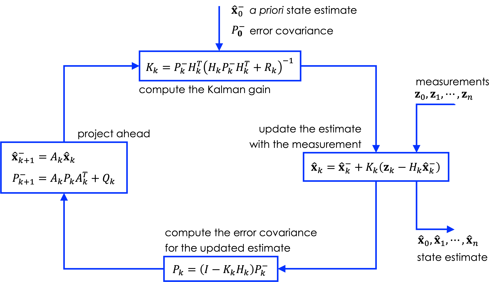
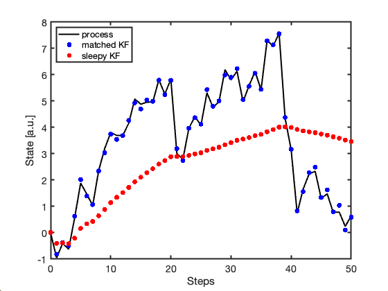
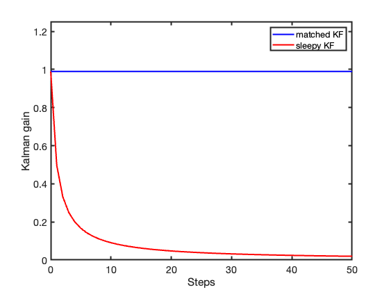
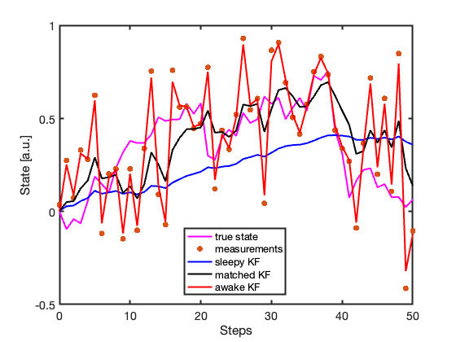
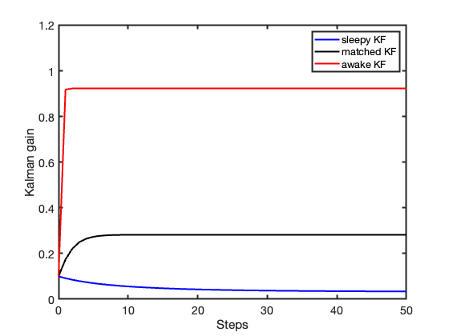

> 💾 **Prefer reading offline?** You can [download a PDF version of this post](post_pdf.pdf) for printing or future reference.

## About the sample mean

The experimental activity considered in this post consists of acquiring a dataset of $n$ measurements of some quantity at discrete instants of time that, without loss of generality, can be assumed equally spaced by an interval $\Delta T$.

The measurand, whose physical nature is immaterial for the present discussion, is taken to be constant and equal to $\mu$. Observations are affected by additive noise modeled as a random variable $V$ with zero mean and constant variance $\sigma^2$.

The resulting sequence can therefore be written as

$$x_k=\mu+v_k,\qquad k=1,\dots,n,$$

where the explicit time dependence has been omitted for the sake of clarity.

If measurement errors are furthermore assumed to be independent, a basic probabilistic model consists of $n$ independent identically distributed (IID) random variables $\{X_k\}_{k=1}^n$, whose realizations are $\{x_k\}_{k=1}^n$. No assumption has yet been made about the probability distribution of $V$.

A central result of estimation theory is that the unknown quantity $\mu$ can be estimated using the *sample mean*, defined as

$$\bar X_n=\frac{1}{n}\sum_{k=1}^n X_k.$$

Since $\bar X_n$ is itself a random variable, the available dataset yields the numerical estimate

$$\bar x_n=\frac{1}{n}\sum_{k=1}^n x_k.$$ {#eq-3}

The expectation of $\bar X_n$ is

$$\mathbb{E}[\bar X_n]=\frac{1}{n}\sum_{k=1}^n\mathbb{E}[X_k]=\mu.$$

This holds for every value of $n$, meaning that the estimator is unbiased.

The variance of $\bar X_n$ is

$$\mathrm{Var}(\bar X_n)=\frac{1}{n^2}\sum_{k=1}^n\mathrm{Var}(X_k)=\frac{\sigma^2}{n},$$

showing the decrease of uncertainty as the number of observations increases. This result ultimately relies on the fact that the variance of a sum is equal to the sum of the variances if the added terms are independent (or at least pairwise uncorrelated).

Moreover, provided that $\sigma$ is finite, the central limit theorem implies that, for sufficiently large $n$, the distribution of $\bar X_n$ becomes approximately Gaussian even when the original noise distribution is not.

All these results are mathematically elegant, but they also hide an important practical issue: in real experimental settings, collecting a “large” number of genuinely independent observations may be much more difficult than it first appears.

Under the additional assumption of Gaussian noise, the sample mean enjoys several important optimality properties. In particular, it coincides with:

- the least-squares (LS) solution,
- the maximum-likelihood (ML) estimator,
- the minimum mean-square error (MMSE) estimator.

From an LS perspective, the problem of estimating a constant quantity can also be interpreted as a particularly simple regression model. Since data are acquired sequentially, the acquisition index (or time itself) may be formally regarded as a predictor variable, while the observations play the role of the response.

In regression terms, computing the sample mean corresponds to fitting an intercept-only model, or equivalently a linear model with zero slope. Importantly, the LS solution does not require Gaussian assumptions. In fact, the regression coefficients are obtained simply by minimizing a quadratic cost function, which leads to a linear system of equations when its gradient is set to zero. This procedure produces a straight line that always passes through the centroid of the observed data. When the slope is explicitly constrained to zero, the LS solution coincides with the sample mean. Probabilistic assumptions on $V$ instead determine the statistical properties and optimality characteristics of the estimator. In particular, under Gaussian assumptions, the sample mean is also the MMSE estimator.

Before leaving this section, one further observation is worth making: the sample mean admits a recursive formulation. If $\bar x_{k-1}$ denotes the estimate computed from the first $k-1$ observations, then the arrival of a new observation $x_k$ produces the updated estimate

$$\bar x_k=\left(1-\frac{1}{k}\right)\bar x_{k-1}+\frac{1}{k}x_k,\qquad k=1,\dots,n.$$ {#eq-5}

This recursive expression is algebraically equivalent to the batch computation of the sample mean in @eq-3, but it highlights a key idea: the estimate can be updated sequentially using the previous estimate and each newly acquired observation. As $k$ increases, the weight assigned to new data points progressively decreases.

## The Kalman filter in a nutshell

When Rudolf E. Kálmán (1930--2016) introduced his recursive filtering framework in the early 1960s, the problem was not merely statistical. Modern dynamical systems — aircraft, missiles, spacecraft — were generating streams of noisy observations that needed to be processed sequentially and in real time. Batch estimation techniques already existed, but recomputing the entire estimate from scratch as new data arrived was computationally unattractive, especially on the constrained onboard computers of that era.

Kalman's key insight was that, under linear Gaussian assumptions, the estimate could instead be updated recursively: each newly acquired observation could be combined with the current state estimate and its uncertainty to produce an improved estimate, without storing or reprocessing the entire measurement history. Equally important, if not revolutionary, was the adoption of a state-space approach to estimation, in which both system dynamics and the measurement process could be modeled explicitly and treated within a unified probabilistic framework.

Over the decades, Kalman's original linear framework has been extended in many directions, including nonlinear filtering approaches such as the Extended Kalman Filter (EKF), the Unscented Kalman Filter (UKF), and particle filters. Despite their substantial algorithmic differences, all these approaches share the same Bayesian genealogical roots: sequentially updating probabilistic beliefs as new information becomes available.

::: callout-note
## Linear Kalman filter

In its simplest linear form, the Kalman filter (KF) can be regarded as a recursive MMSE estimator for dynamical systems observed through noisy measurements.

The KF alternates between two complementary operations: a prediction step based on the dynamical model, and a correction step driven by incoming measurements, as schematically illustrated in @fig-kf-diagram.

```{r}
#| label: fig-kf-diagram
#| echo: false
#| fig-cap: "Conceptual structure of the Kalman filter recursion. Model-based prediction and measurement-based correction interact continuously to update the state estimate and its uncertainty."


```

For a linear discrete-time dynamical system observed through noisy measurements,

$$\begin{cases}
\mathbf{x}_{k+1}&=A_k\mathbf{x}_k+\mathbf{w}_k\\
\mathbf{z}_k&=H_k\mathbf{x}_k+\mathbf{v}_k
\end{cases}$$ {#eq-6}

where the state vector is $\mathbf{x}_k\in\mathbb{R}^n$, the state transition matrix $A_k$ is square $n\times n$, the measurement vector is $\mathbf{z}_k \in \mathbb{R}^m$, and $H_k$ is an $m\times n$ measurement matrix.

The *process noise* $\mathbf{w}_k$ and the *measurement noise* $\mathbf{v}_k$ are modeled as zero-mean Gaussian random vectors with covariance matrices

$$\begin{cases}
\mathbf{w}_k&\sim\mathcal{N}(0,Q_k) \\
\mathbf{v}_k&\sim\mathcal{N}(0,R_k)
\end{cases}$$

The covariance matrices $Q_k$ and $R_k$ are associated with the assumption that the process and measurement noise components are temporally uncorrelated. Because the noise processes are Gaussian, uncorrelated components are also statistically independent. $Q_k$ and $R_k$ fully characterize the second-order statistical structure of the process and measurement noise.

In Kalman filtering notation, the symbols $\hat{\mathbf{x}}_k^-$ and $\hat{\mathbf{x}}_k^+$ denote the predicted (a priori) and updated (a posteriori) state estimates at time step $k$, respectively. The corresponding estimation errors are

$$\begin{cases}
\mathbf{e}_k^-&=\mathbf{x}_k-\hat{\mathbf{x}}_k^-\\
\mathbf{e}_k^+&=\mathbf{x}_k-\hat{\mathbf{x}}_k^+,
\end{cases}$$

with covariance matrices

$$\begin{cases}
P_k^-&=\mathbb{E}\left[\mathbf{e}_k^{-}(\mathbf{e}_k^{-})^\top\right] \\
P_k^+&=\mathbb{E}\left[\mathbf{e}_k^{+}(\mathbf{e}_k^{+})^\top\right].
\end{cases}$$
:::

### Estimating the value of a constant measurand

Let us now return to the experimental scenario introduced above. The measurand is assumed constant and observations are affected by additive Gaussian noise. In Kalman-filter notation, this corresponds to the scalar model

$$\begin{cases}
x_{k+1}&=x_k\\
z_k&=x_k+v_k,
\end{cases}$$ {#eq-7}

where

$$v_k\sim\mathcal{N}(0,R),\qquad R=\sigma^2.$$

We also have:

$$A=1,\qquad H=1,\qquad Q=0.$$

The condition $Q=0$ is particularly important. The filter is explicitly told that the state is constant: measurements are noisy, but the measurand is assumed not to evolve in time. There is therefore uncertainty in the observations, but no uncertainty in the state dynamics: the filter assumes that the true value remains constant and that any fluctuations arise solely from measurement noise.

For the scalar model considered here, the KF equations simplify considerably. Since $A=1$ and $Q=0$, the prediction step leaves both the estimate and its uncertainty unchanged:

$$\hat x_k^-=\hat x_{k-1}^+,\qquad P_k^-=P_{k-1}^+.$$

The Kalman gain is therefore

$$K_k=\frac{P_k^-}{P_k^-+R}.$$

Suppose the filter is initialized with no prior knowledge about the value of the state. In practice, this means that the initial estimate is regarded as extremely uncertain. This corresponds to assigning a very large initial uncertainty to the estimate, formally $P_1^- \to \infty$. As a consequence,

$$K_1=\frac{P_1^-}{P_1^-+R}\to 1,$$

so the first measurement is trusted completely:

$$\hat x_1^+=z_1.$$

The updated covariance is

$$P_1^+=\left(1-\frac{P_1^-}{P_1^-+R}\right)P_1^-=\frac{RP_1^-}{P_1^-+R}\to R.$$

Because $Q=0$, the prediction step does not reinject uncertainty into the model:

$$P_2^-=P_1^+=R.$$

At the second iteration,

$$K_2=\frac{R}{R+R}=\frac12.$$

The updated estimate is therefore

$$\hat x_2^+=\hat x_1^+ +\frac12(z_2-\hat x_1^+)=\frac{z_1+z_2}{2},$$

and the corresponding covariance becomes

$$P_2^+=\frac{R}{2}.$$

Continuing the recursion, one obtains

$$\hat x_k^+=\left(1-\frac{1}{k}\right)\hat x_{k-1}^+ +\frac{1}{k}z_k,$$

which is exactly the formula for the sample mean introduced in @eq-5. In this special case, the Kalman gain becomes

$$K_k=\frac{1}{k}.$$

The KF therefore progressively stops reacting to new measurements: each additional observation receives less weight as confidence in the estimated value gradually increases.

## Is a physical quantity ever really constant?

In the previous section, the KF state was assumed perfectly constant, corresponding to the choice $Q=0$. Let us now relax this assumption and consider the more realistic situation in which the state may slowly evolve over time.

The simplest stochastic model for a slowly varying quantity consists of describing the scalar state as a random walk driven by continuous-time white noise with strength $q$:

$$\dot x(t) = w(t),$$

where

$$\mathbb{E}[w(t)w(t+\tau)] = q\,\delta(\tau).$$

If observations are acquired every $\Delta T$ seconds, the corresponding discrete-time model becomes

$$x_{k+1}=x_k+\Delta w_k,$$

where $\Delta w_k$ represents the stochastic increment accumulated over the sampling interval $\Delta T$. The variance of this discrete-time process noise is therefore

$$Q=q\,\Delta T.$$

This simple relation already contains an important physical idea: uncertainty accumulates over time. The longer the interval between consecutive observations, the larger the uncertainty injected during the prediction step.

For the scalar random-walk model,

$$\begin{cases}
x_{k+1}&=x_k+\Delta w_k \\
z_k&=x_k+v_k,
\end{cases}$$

the KF prediction step is particularly simple. Since $A=1$ and $H=1$,

$$P_k^-=P_{k-1}^++Q.$$

The Kalman gain is therefore

$$K_k=\frac{P_k^-}{P_k^-+R}=\frac{P_{k-1}^++Q}{P_{k-1}^++Q+R}.$$

After the measurement update,

$$P_k^+=(1-K_k)P_k^-.$$

Substituting the expression of $K_k$,

$$P_k^+=\left(1-\frac{P_{k-1}^++Q}{P_{k-1}^++Q+R}\right)(P_{k-1}^++Q),$$

and therefore

$$P_k^+=\frac{(P_{k-1}^++Q)R}{P_{k-1}^++Q+R}.$$

This recursion is the scalar Riccati equation for the random-walk model.

The most interesting behavior emerges when the recursion reaches steady state:

$$P_k^+=P_{k-1}^+=P_\infty,$$

then

$$P_\infty=\frac{(P_\infty+Q)R}{P_\infty+Q+R}.$$

Unlike the previous case with $Q=0$, the covariance no longer collapses toward zero because uncertainty is continuously reinjected into the dynamics.

Solving this quadratic equation gives

$$P_\infty=\frac{-Q+\sqrt{Q^2+4QR}}{2}.$$

As soon as $Q>0$, the steady-state covariance remains strictly positive. Consequently, the steady-state Kalman gain is also strictly positive:

$$K_\infty=\frac{P_\infty+Q}{P_\infty+Q+R}.$$

The KF therefore never stops listening to new measurements.

## Simulations

The following simulation compares two KFs observing the same random-walk process. The first filter uses the correct stochastic model ($Q=q\Delta T$), so that uncertainty is continuously reinjected during prediction. The second incorrectly assumes a perfectly constant state ($Q=0$), producing the *sleepy* behavior discussed below.

```{matlab}
%| code-fold: true
%| code-summary: "A filter that never forgets — and one that does"

% ********************************
% Random-walk process simulation
% ********************************

dt    = 1;          % sampling interval, s
T     = 50;         % observation time, s

q     = 1;          % continuous-time noise strength, [a.u.]^2/s
std_q = sqrt(q*dt); % discrete-time process noise std, [a.u.]
std_v = 0.1;        % measurement noise standard deviation, [a.u.]

% ***************
% Path generation
% ***************

rng(1234)

N  = T/dt + 1;
xi = zeros(N,1);

for i = 2:N
    xi(i) = xi(i-1) + sqrt(q*dt)*randn;
end

x = xi;

z_meas = x + randn(N,1)*std_v;

% ******
% Models
% ******

F = 1;
H = 1;

R = std_v^2;

Q_true = std_q^2;
Q_sleepy = 0;

P_0 = Q_true;

% **************
% Initialization
% **************

x_true = zeros(N, 1);
P_true = zeros(N, 1);
K_true = zeros(N, 1);

x_sleepy = zeros(N, 1);
P_sleepy = zeros(N, 1);
K_sleepy = zeros(N, 1);

x_pred_true = 0;
P_pred_true = P_0;

x_pred_sleepy = randn;
P_pred_sleepy = P_0;

for i = 1:N

    % *******************
    % compute Kalman gain
    % *******************

    K_true(i)   = P_pred_true*H/(H*P_pred_true*H + R);
    K_sleepy(i) = P_pred_sleepy*H/(H*P_pred_sleepy*H + R);
  
    % ******
    % update
    % ******

    x_true(i) = x_pred_true + ...
                K_true(i)*(z_meas(i) - H*x_pred_true);

    P_true(i) = (1 - K_true(i)*H)*P_pred_true;

    x_sleepy(i) = x_pred_sleepy + ...
                K_sleepy(i)*(z_meas(i) - H*x_pred_sleepy);

    P_sleepy(i) = (1 - K_sleepy(i)*H)*P_pred_sleepy;

    % *************
    % project-ahead
    % *************

    x_pred_true = F*x_true(i);
    P_pred_true = F*P_true(i)*F + Q_true;

    x_pred_sleepy = F*x_sleepy(i);
    P_pred_sleepy = F*P_sleepy(i)*F + Q_sleepy;
    
end

% ************************
% State estimate evolution
% ************************

plot((0:N-1), x, 'k', 'LineWidth', 2)

hold on

plot((0:N-1), x_true, 'b.', ...
     (0:N-1), x_sleepy, 'r.', ...
     'LineWidth', 1, ...
     'MarkerSize', 18)

legend("process", ...
       "matched KF", ...
       "sleepy KF", ...
       "Location", "northwest")

xlabel('Steps')
ylabel('State [a.u.]')

set(gca, 'FontSize', 14, 'LineWidth', 2)

% ***********************
% Kalman gain evolution
% ***********************

figure

plot((0:N-1), K_true, 'b', ...
     (0:N-1), K_sleepy, 'r', ...
     'LineWidth', 2)

legend("matched KF", ...
       "sleepy KF")

ylim([0 1.25])

xlabel('Steps')
ylabel('Kalman gain')

set(gca, 'FontSize', 14, 'LineWidth', 2)
```

@fig-kf-path compares the state estimates produced by the two KFs. While the KF using the correct process model continues to track the evolving random walk, the KF with $Q=0$ progressively loses responsiveness.

```{r}
#| label: fig-kf-path
#| echo: false
#| out-width: "70%"
#| fig-align: "center"
#| fig-cap: "State estimates produced by the two filters."


```

The consequences become evident in @fig-kf-gain. When $Q=0$, the Kalman gain progressively collapses toward zero and the KF gradually stops incorporating new information. By contrast, when $Q=q\Delta T$, the gain converges to a finite steady-state value, allowing the KF to remain responsive to the evolving dynamics. In other words, the KF never becomes completely certain about the system.

```{r}
#| label: fig-kf-gain
#| echo: false
#| out-width: "70%"
#| fig-align: "center"
#| fig-cap: "Evolution of the Kalman gain."


```

To better visualize the effect of the process noise variance $Q$, a second simulation is performed using three different process models obtained by perturbing a nominal value of Q by one order of magnitude in both directions. More precisely, the three KFs use

$$Q=[0.1,\ 1,\ 10]\times q\Delta T,$$

with $q=0.1$, while the measurement noise standard deviation is kept fixed at $\sigma=0.3$.

The first KF intentionally underestimates the process uncertainty and behaves as a *sleepy* filter, characterized by long memory and slow response to incoming measurements. The second KF uses the correct stochastic model and represents a balanced compromise between prediction and measurement update. The third KF largely overestimates the process uncertainty and behaves as an *awake* filter, rapidly incorporating incoming measurements into the state estimate.

@fig-kf-path-3q compares the resulting state estimates.

```{r}
#| label: fig-kf-path-3q
#| echo: false
#| out-width: "75%"
#| fig-align: "center"
#| fig-cap: "State estimates obtained using different values of the process noise variance."


```

The effect of the different values of $Q$ becomes even more evident in the corresponding Kalman gains shown in @fig-kf-gain-3q.

```{r}
#| label: fig-kf-gain-3q
#| echo: false
#| out-width: "75%"
#| fig-align: "center"
#| fig-cap: "Kalman gain evolution for the three filters."


```

The process noise variance $Q$ effectively acts as a tuning knob. Small values of $Q$ produce KFs with slow response, while large values of $Q$ produce highly responsive filters that rapidly follow incoming measurements — sometimes too closely.

This behavior is simply another manifestation of the classical trade-off between promptness of response and noise sensitivity encountered in virtually every filtering problem. In practice, mildly overestimating $Q$ is often less dangerous than underestimating it: an awake filter may become noisy, but a sleepy filter may eventually stop reacting altogether.

## Conclusion

Throughout this post, we explored how different assumptions about the measurand lead to different KF behaviors: from the recursive averaging of a perfectly static constant ($Q=0$) to a drifting random walk with independent increments ($Q>0$). We saw how the process noise covariance $Q$ acts as a tuning knob balancing promptness of response and noise sensitivity.

Many physical quantities, however, possess a more structured temporal behavior than a simple random walk. In the next post, we will move one step further by modeling the measurand as a first-order Gauss–Markov process: we will see how the KF manages systems with intrinsic temporal memory.
