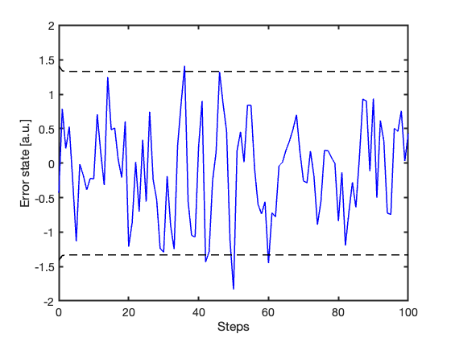
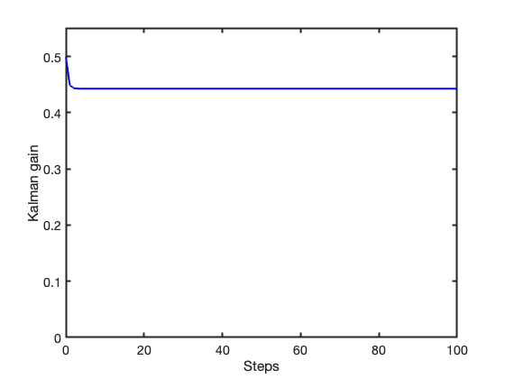
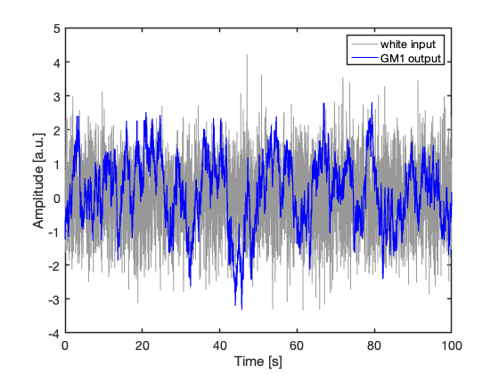
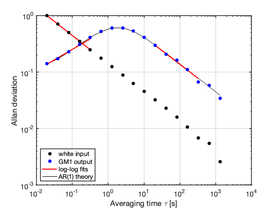

> 💾 **Prefer reading offline?** You can [download a PDF version of this post](post_pdf.pdf) for printing or future reference.

## Short-range dependent stochastic processes

The random-walk model introduced in the previous post of this series ([here](https://amsabatini.netlify.app/posts/post_1/)) is often unrealistic for slowly varying quantities. A random walk possesses infinite memory; once a perturbation affects the system, its impact is never fully forgotten. Consequently, the variance grows indefinitely, and the process continuously accumulates uncertainty. Many real physical systems, however, gradually lose memory of past disturbances. Mechanical damping, thermal relaxation, fluid dynamics, electronic feedback, and various dissipative phenomena typically produce stochastic dynamics whose memory fades over time.

The simplest mathematical framework to capture this fading memory is the first-order Gauss-Markov (GM1) process. This model effectively bridges the gap between pure randomness and deterministic decay. Like any first-order Markov process, the GM1 process depends on the past only through its current state, making the future conditionally independent of the remaining history. This property yields a highly tractable linear stochastic differential equation:

$$\dot x(t)=-b\,x(t)+w(t),$$ {#eq-1}

where $b>0$ is a damping rate and $w(t)$ is continuous-time white Gaussian noise with strength $q$:

$$R_{WW}(\tau)=\mathbb{E}[w(t)w(t+\tau)]=q\,\delta(\tau).$$

In probability theory and statistical physics, this process is commonly known as the Ornstein–Uhlenbeck process, originally introduced to model Brownian motion with friction. In engineering and signal-processing applications, the equivalent formulation is often referred to as a first-order Gauss–Markov process.

The term $-b\,x(t)$ in @eq-1 continuously pulls the process back toward a mean state, formalizing the concept of thermal relaxation or mechanical damping introduced above. Meanwhile, the stochastic forcing injects random fluctuations into the dynamics. The variance does not grow indefinitely but converges to a finite, stationary value $\sigma_X^2$, thereby providing a simple model for systems with short-range dependence.

The corresponding autocorrelation function is

$$R_{XX}(\tau)=\sigma_X^2 \exp (-b|\tau|)=\dfrac{q}{2b}\,\exp (-b|\tau|),$$ {#eq-2}

showing that the process forgets its past over the characteristic correlation time

$$\tau_c = \frac{1}{b}.$$

Using the correlation time $\tau_c$, @eq-2 can be rewritten as

$$R_{XX}(\tau)=\dfrac{q\,\tau_c}{2}\,\exp\left(-\dfrac{|\tau|}{\tau_c}\right),$$ {#eq-3}

For a sampling time $\Delta T$ the corresponding exact discrete-time model becomes

$$x_{k+1}=A\,x_k+\Delta w_k,$$

with

$$A=\exp\left(-\dfrac{\Delta T}{\tau_c}\right),$$

where $\Delta w_k$ represents the stochastic increment resulting from integrating white noise over the sampling interval $\Delta T$.

The corresponding discrete-time process-noise variance is

$$Q=\dfrac{q\tau_c}{2}\left[1-\exp\left(-\dfrac{2\Delta T}{\tau_c}\right)\right].$$

Two important limiting regimes immediately emerge from these expressions. For very small sampling intervals, $A\approx 1-\Delta T/\tau_c\approx 1$ and $Q\approx q\,\Delta T$, and the process locally behaves like the random walk introduced in the previous post. Conversely, for sampling intervals much longer than the correlation time, $A\approx 0$ and $Q\approx q\tau_c/2$, meaning that consecutive samples progressively lose statistical dependence and the process approaches a memoryless regime.

::: callout-tip
## Kalman estimator

The exact discrete-time representation is particularly useful because it can be incorporated directly into a Kalman-filter (KF) model. The state is not observed directly. Instead, measurements are assumed to be affected by additive Gaussian noise:

$$z_k = x_k + v_k,\qquad v_k \sim \mathcal N(0,R).$$

The resulting state-space model is therefore

$$\begin{cases}
x_{k+1}=A\,x_k+\Delta w_k,\\
z_k=x_k+v_k,
\end{cases}$$

where $A$ and $Q$ are given by the exact discretization above.

At steady state, the updated covariance satisfies the algebraic Riccati equation

$$P_\infty=A^2P_\infty+Q-\frac{(A^2P_\infty+Q)^2}{A^2P_\infty+Q+R},$$ {#eq-4}

whose positive solution is

$$P_\infty=\frac{-\left(Q+R-A^2R\right)+\sqrt{\left(Q+R-A^2R\right)^2+4A^2RQ}}{2A^2}.$$ {#eq-5}

The corresponding steady-state Kalman gain is

$$K_\infty=\frac{A^2P_\infty+Q}{A^2P_\infty+Q+R}.$$ {#eq-6}

After the initial transient, the KF behaves as a stationary recursive estimator with constant asymptotic gain.
:::

From a discrete-time perspective, the sampled GM1 process is equivalent to a first-order autoregressive process, usually denoted AR(1). This equivalence connects the continuous-time physical interpretation of the GM1 process with the classical theory of correlated discrete-time stochastic sequences. Because the discretization is exact, the discrete-time autocorrelation sequence is simply obtained by sampling the continuous-time autocorrelation function of @eq-2:

$$r_{XX}[h]=R_{XX}(h\Delta T)=\dfrac{q\tau_c}{2}\exp\left(-\dfrac{\Delta T}{\tau_c}|h|\right),$$

showing that adjacent samples become strongly correlated when the sampling interval $\Delta T$ is much shorter than the correlation time $\tau_c$.

It is noteworthy that, for a sequence of $n$ observations generated by a GM1 process, the variance of the sample mean is

$$\mathrm{Var}(\bar X_n)=\frac{q\tau_c}{2n}\left[1+2\sum_{h=1}^{n-1}\left(1-\frac{h}{n}\right)\phi^{h}\right],$$

where $\phi=\exp(-\Delta T/\tau_c)$. This variance is always larger than in the limiting case $\phi=0$, corresponding to statistically independent observations. In that case, the classical result is recovered:

$$\mathrm{Var}(\bar X_n)=\frac{q\tau_c}{2n}$$

In practical terms, increasing the sampling frequency within the correlation-time range of the process provides far less independent information than expected under independence assumptions.

## Simulation

The discrete-time GM1 model introduced above can be incorporated directly into a scalar Kalman filter. In this simulation, the filter is deliberately matched to the process that generated the data: the same values of $A, Q, H$, and $R$ are used both in the simulation model and in the estimator.

This represents the simplest possible scenario. Any discrepancy between the true state and the estimate therefore arises solely from the stochastic uncertainty associated with the process and measurement noise, rather than from model mismatch.

```{matlab}
%| code-fold: true
%| code-summary: "Kalman filter perfectly matched to the Gauss-Markov process"
% ********************************
% First-order Gauss-Markov process
% ********************************

b     = 0.5; % inverse of the correlation time, s^-1 
std_x = 1;   % stationary process standard deviation, [a.u.]
dt    = 1;   % sampling time, s
T     = 100; % observation time, s
std_v = 1;   % measurement error standard deviation, [a.u.]

% ***************
% Path generation
% ***************

rng(1250)

Ti  = 2*T;
dti = dt;

Ni = Ti/dti + 1;
N  = T/dt + 1;

xi = zeros(Ni, 1);

A_sim = exp(-b*dti);
Q_sim = std_x^2*(1 - exp(-2*b*dti));

for i = 2:Ni
    xi(i) = A_sim*xi(i-1) + randn*sqrt(Q_sim);
end

% Remove the first half to reduce dependence on initialization
x_true = xi((Ni-1)/2+1:dt/dti:end);

z_meas = x_true + randn(N, 1)*std_v;

% *******************
% Discrete-time model
% *******************

A = exp(-b*dt);
Q = std_x^2*(1 - exp(-2*b*dt));

H = 1;
R = std_v^2;

% **************
% Initialization
% **************

x_hat = zeros(N, 1);
P     = zeros(N, 1);
K     = zeros(N, 1);

x_pred = 0;
P_pred = std_x^2;

for i = 1:N

    % Kalman gain
    K(i) = P_pred*H/(H*P_pred*H + R);

    % Measurement update
    x_hat(i) = x_pred + K(i)*(z_meas(i) - H*x_pred);
    P(i) = (1 - K(i)*H)*P_pred;

    % Prediction
    x_pred = A*x_hat(i);
    P_pred = A*P(i)*A + Q;

end

% ************
% Error plot
% ************

figure
plot(0:N-1, x_hat - x_true, 'b', 'LineWidth', 1.5)
hold on
plot(0:N-1,  2*sqrt(P), 'k--', ...
     0:N-1, -2*sqrt(P), 'k--', 'LineWidth', 1.5)
xlabel('Steps')
ylabel('Error state [a.u.]')
set(gca, 'FontSize', 14, 'LineWidth', 2)

% ****************
% Kalman gain plot
% ****************

figure
plot(0:N-1, K, 'b', 'LineWidth', 2)
xlabel('Steps')
ylabel('Kalman gain')
ylim([0 0.55])
set(gca, 'FontSize', 14, 'LineWidth', 2)
```

@fig-error-state shows the estimation error together with the approximate 95% confidence bounds predicted by the KF. After the initial transient, the error behaves as expected for a correctly specified model: it fluctuates around zero and mostly remains within the predicted uncertainty bounds.

```{r}
#| label: fig-error-state
#| echo: false
#| out-width: "70%"
#| fig-align: "center"
#| fig-cap: 'Estimation error and approximate 95% confidence bounds predicted by the KF ($\pm 2\sqrt{P_k}$). After the initial transient, the error remains mostly confined within the uncertainty interval associated with the estimated covariance.'


```

@fig-kf-gain shows the corresponding Kalman gain. After a short transient, the gain reaches a steady-state value, reflecting the stationary nature of the underlying process and the steady balance between prediction and measurement uncertainty.

```{r}
#| label: fig-kf-gain
#| echo: false
#| out-width: "70%"
#| fig-align: "center"
#| fig-cap: "Evolution of the Kalman gain."


```

For the parameters used in this simulation ($b=0.5\,\mathrm{s}^{-1}$, $\Delta t=1\,\mathrm{s}$, $\sigma_X=1\,\mathrm{a.u.}$, and $R=1\,(\mathrm{a.u.})^2$), the scalar Riccati equation (@eq-4) predicts a steady-state covariance (@eq-5) and Kalman gain (@eq-6) with the same numerical value, although the associated physical units differ:

$$P_\infty=K_\infty \approx 0.443.$$

This result is in excellent agreement with the simulated gain trajectory shown in @fig-kf-gain. The equality $P_\infty=K_\infty$ follows here from the scalar structure of the problem with $H=1$ and $R=1$.

## Probing the environment

The GM1 process introduced above should not be regarded merely as a convenient mathematical model. In many sensing applications, temporally correlated fluctuations are not simply a nuisance: they are the signature of the physical medium being observed.

A barometric pressure sensor, for example, does not only measure the electronic noise of its readout chain. It also responds to slow pressure fluctuations, thermal effects, air motion, and environmental dynamics. Similarly, an ultrasonic time-of-flight system probes a propagation medium whose temperature, humidity, turbulence, and local gradients affect the measured delay.

In this sense, many sensors act as environmental probes. Their output reflects not only the sensor itself, but also the dynamics of the surrounding medium, which often evolves over finite correlation times.

The key point is that correlated noise is not always “bad noise”. Sometimes it is the phenomenon of interest. Rather than averaging it away blindly, it is often more informative to characterize its temporal structure. From a measurement perspective, a related question is how much independent information is actually gained by sampling faster: is oversampling really a good recipe to improve signal-to-noise ratio?

## Allan deviation as a multiscale diagnostic tool

Allan deviation provides exactly the multiscale view we need to reveal how variability changes across different averaging times. Originally introduced in the context of oscillator stability analysis, it is now routinely used to characterize temporally correlated stochastic processes across many areas of measurement science and signal processing.

The following simulation reproduces a long-duration acquisition from a stationary GM1 process with correlation time $\tau_c=1\,\mathrm{s}$. The process is sampled every $T_s = 20\,\mathrm{ms},$ corresponding to an oversampling ratio of 50 samples per correlation time. The total observation time is approximately three hours (about 175 minutes), yielding a record of $2^{19}$ samples. A white Gaussian sequence with the same stationary variance is generated as a reference. This allows the Allan-deviation analysis to isolate the effects of temporal correlation from those associated solely with signal variance.

```{matlab}
%| code-fold: true
%| code-summary: "Simulation of a long-term recording for Allan deviation analysis"
% ***************************************
% GM1 signal for Allan deviation analysis
% ***************************************

clear
clc
close all

rng(2026)

% Physical / stochastic parameters

tau     = 1;      % correlation time [s]
std_y   = 1;      % stationary standard deviation [a.u.]
osr     = 50;     % samples per correlation time
Ts      = tau/osr;
Fs      = 1/Ts;

N       = 2^19;   % number of samples
t       = (0:N-1)'*Ts;

% Exact discrete-time GM1 model

F = exp(-Ts/tau);
Q = std_y^2*(1 - F^2);

y = zeros(N,1);

% Start at stationarity
y(1) = std_y*randn;

for k = 2:N
    y(k) = F*y(k-1) + sqrt(Q)*randn;
end

% White input sequence with same stationary variance for comparison

u = std_y*randn(N,1);

% Basic checks

fprintf('Sampling interval Ts = %.4g s\n', Ts)
fprintf('Observation time     = %.2f h\n', N*Ts/3600)
fprintf('Correlation time tau = %.4g s\n', tau)
fprintf('Empirical var white  = %.4g (a.u.)^2\n', var(u))
fprintf('Empirical var GM1    = %.4g (a.u.)^2\n', var(y))

% Save for Allan analyzer

save('allan_signals_gm1.mat', 'u', 'y', 't', 'Ts', 'Fs', 'tau', 'std_y', 'F', 'Q')

% Quick visualization

figure
plot(t(1:5000), u(1:5000), 'Color', [0.6 0.6 0.6])
hold on
plot(t(1:5000), y(1:5000), 'b', 'LineWidth', 1.2)
xlabel('Time [s]')
ylabel('Amplitude [a.u.]')
legend('white input', 'GM1 output')
set(gca, 'FontSize', 14, 'LineWidth', 1.5)
```

The GM1 process can be interpreted as the output of a first-order stochastic shaping filter driven by white Gaussian noise. @fig-signal compares a short segment of the reference white-noise sequence with the corresponding correlated GM1 output generated by the discrete-time model. Although the two processes have approximately the same variance, their temporal structure is markedly different. The GM1 process appears visibly smoother because its dynamics suppress rapid fluctuations and introduce finite temporal correlation. This apparent smoothness should not be confused with a larger amount of independent information. Samples acquired within a correlation time remain strongly redundant, even when the signal appears less noisy.

```{r}
#| label: fig-signal
#| echo: false
#| out-width: "70%"
#| fig-align: "center"
#| fig-cap: "Short segment of the simulated white-noise input and corresponding GM1 output."


```

```{matlab}
%| code-fold: true
%| code-summary: "Allan deviation analysis"
% ************************
% Allan deviation analysis
% ************************

clear
clc
close all

load('allan_signals_gm1.mat')

% Cluster sizes: powers of two
N = length(u);
maxM = floor(N/8);
m = 2.^(0:floor(log2(maxM)));

% Allan variance
[avar_u, tau_u] = allanvar(u, m, Fs);
[avar_y, tau_y] = allanvar(y, m, Fs);

adev_u = sqrt(avar_u);
adev_y = sqrt(avar_y);

% Approximate number of Allan clusters
M = floor(N ./ m) - 1;

% Fit regions
idx_white     = tau_u >= 0.02 & tau_u <= 0.5;
idx_gm1_short = tau_y >= 0.02 & tau_y <= 0.5;
idx_gm1_long  = tau_y >= 20   & tau_y <= 500;

% Log-log weighted linear regression helper
fit_loglog = @(tau, adev, idx, M) fitlm( ...
    log10(tau(idx)), ...
    log10(adev(idx)), ...
    'linear', ...
    'Weights', M(idx));

mdl_white     = fit_loglog(tau_u, adev_u, idx_white, M);
mdl_gm1_short = fit_loglog(tau_y, adev_y, idx_gm1_short, M);
mdl_gm1_long  = fit_loglog(tau_y, adev_y, idx_gm1_long, M);

% Extract slopes and confidence intervals
ci_white     = coefCI(mdl_white);
ci_gm1_short = coefCI(mdl_gm1_short);
ci_gm1_long  = coefCI(mdl_gm1_long);

fprintf('White input slope    = %.3f, 95%% CI [%.3f, %.3f]\n', ...
    mdl_white.Coefficients.Estimate(2), ci_white(2,1), ci_white(2,2))

fprintf('GM1 short-time slope = %.3f, 95%% CI [%.3f, %.3f]\n', ...
    mdl_gm1_short.Coefficients.Estimate(2), ci_gm1_short(2,1), ci_gm1_short(2,2))

fprintf('GM1 long-time slope  = %.3f, 95%% CI [%.3f, %.3f]\n', ...
    mdl_gm1_long.Coefficients.Estimate(2), ci_gm1_long(2,1), ci_gm1_long(2,2))

% Fitted lines
tau_fit_white = tau_u(idx_white);
fit_white = 10.^predict(mdl_white, log10(tau_fit_white));

tau_fit_gm1_short = tau_y(idx_gm1_short);
fit_gm1_short = 10.^predict(mdl_gm1_short, log10(tau_fit_gm1_short));

tau_fit_gm1_long = tau_y(idx_gm1_long);
fit_gm1_long = 10.^predict(mdl_gm1_long, log10(tau_fit_gm1_long));

% AR(1) theoretical Allan deviation
phi = F;
sigma2 = std_y^2;

n = m(:);
tau_avg = n * Ts;

var_mean = zeros(size(n));

for ii = 1:numel(n)
    h = (1:n(ii)-1)';
    var_mean(ii) = sigma2/n(ii)^2 * ...
        (n(ii) + 2*sum((n(ii)-h).*phi.^h));
end

cov_adj = sigma2 ./ n.^2 .* ...
    phi .* (1 - phi.^n).^2 ./ (1 - phi)^2;

avar_theory = var_mean - cov_adj;
adev_theory = sqrt(avar_theory);

% ************
% Final figure
% ************

figure

h_fit_white = loglog(tau_fit_white, fit_white, ...
    'r', 'LineWidth', 2);
hold on

h_theory = loglog(tau_avg, adev_theory, ...
    'k', 'LineWidth', 1);

h_fit_gm1_short = loglog(tau_fit_gm1_short, fit_gm1_short, ...
    'r', 'LineWidth', 2);

loglog(tau_fit_gm1_long, fit_gm1_long, ...
    'r', 'LineWidth', 2);

h_white = loglog(tau_u, adev_u, ...
    'k.', 'MarkerSize', 24);

h_gm1 = loglog(tau_y, adev_y, ...
    'b.', 'MarkerSize', 24);

grid on
ax = gca;
ax.XMinorGrid = 'off';
ax.YMinorGrid = 'off';
ax.GridAlpha = 0.15;

xlabel('Averaging time \tau [s]')
ylabel('Allan deviation')

legend([h_white, h_gm1, h_fit_white, h_theory], ...
       {'white input', ...
        'GM1 output', ...
        'log-log fits', ...
        'AR(1) theory'}, ...
       'Location', 'southwest')

set(gca, 'FontSize', 14, 'LineWidth', 1.5)
```

The Allan-deviation curves obtained from the simulated sequences are shown in @fig-allan.

```{r}
#| label: fig-allan
#| echo: false
#| out-width: "70%"
#| fig-align: "center"
#| fig-cap: 'Allan-deviation comparison between white noise and a GM1 process with correlation time $\tau_c = 1\,\mathrm{s}$. Red segments indicate local log--log regressions used for slope estimation, while the solid black curve represents the theoretical AR(1) prediction.'

```

Several features of temporal correlation become immediately apparent.

For the white-noise input, the Allan deviation follows the familiar power law

$$\sigma_A(\tau) \propto \tau^{-1/2},$$

indicating that longer averaging times continuously increase the amount of statistically independent information available through averaging. The corresponding log--log regression yields a slope of $-0.500$ ($95\%$ CI $[-0.502,-0.497]$), in excellent agreement with the theoretical value $-1/2$.

The GM1 process behaves very differently. At short averaging times, its Allan deviation lies below the white-noise reference because the first-order dynamics suppress rapid fluctuations and smooth the process locally. However, as the averaging time approaches the correlation-time region, the effects of temporal memory progressively dominate the averaging process.

In this regime, consecutive observations no longer behave as statistically independent measurements. The Allan-deviation curve departs from the white-noise scaling law and exhibits a markedly different slope structure. The short-time log--log regression yields a positive slope of $0.371$ ($95\%$ CI $[0.296,0.446]$), directly reflecting the fact that local oversampling is collecting strongly correlated information rather than statistically independent samples. In other words, additional samples are being acquired faster than new independent information is being generated by the underlying process.

Only for averaging times significantly longer than the correlation time does the process progressively recover a white-noise-like averaging behavior. In this asymptotic regime, the long-time slope approaches the classical $-1/2$ value expected for effectively decorrelated observations. The corresponding regression yields a slope of $-0.489$ ($95\%$ CI $[-0.582,-0.395]$).

The theoretical Allan-deviation curve derived from the equivalent AR(1) representation closely matches the simulated GM1 behavior across all averaging scales, confirming the exact equivalence between the sampled Gauss–Markov process and its discrete-time autoregressive representation.

::: callout-note
## A closer look at Allan averaging

The Allan variance can be interpreted in a particularly illuminating way when the underlying process possesses temporal correlation.

For a sequence divided into adjacent blocks of length $n$, define the local averages

$$\bar x_{1,n}=\frac1n\sum_{k=1}^n x_k,$$

and

$$\bar x_{2,n}=\frac1n\sum_{k=n+1}^{2n} x_k.$$

The Allan variance is constructed from the squared difference between consecutive local averages:

$$\sigma_A^2(n)=\frac12\mathbb E\left[(\bar X_{2,n}-\bar X_{1,n})^2\right].$$

Using the elementary identity

$$\mathrm{Var}(A-B)=\mathrm{Var}(A)+\mathrm{Var}(B)-2\mathrm{Cov}(A,B),$$

and exploiting stationarity,

$$\mathrm{Var}(\bar X_{1,n})=\mathrm{Var}(\bar X_{2,n}),$$

one immediately obtains

$$\sigma_A^2(n)=
\mathrm{Var}(\bar X_n)-\mathrm{Cov}(\bar X_{1,n},\bar X_{2,n}).$$ {#eq-7}

This expression provides a remarkably intuitive interpretation of Allan variance. The first term, $\mathrm{Var}(\bar X_n),$ describes the uncertainty reduction produced by averaging. The second term, $\mathrm{Cov}(\bar X_{1,n},\bar X_{2,n}),$ measures the temporal redundancy that survives between adjacent local averages.

For white noise, adjacent averages are statistically independent and the covariance term vanishes. Allan averaging therefore behaves exactly as expected from the familiar $1/\sqrt{n}$ law. For correlated processes such as GM1 or AR(1), however, adjacent averages remain statistically dependent over time scales comparable with the correlation time.

This expression reveals that Allan variance is not simply the variance of a sample mean. A correlated process may even exhibit a smaller Allan deviation than white noise over some averaging ranges. This does not imply that more independent information is being collected. Rather, it reflects the fact that temporal correlation smooths short-term fluctuations while simultaneously increasing redundancy between neighboring samples.

The key question is therefore not how small the Allan deviation becomes at a particular averaging time, but how efficiently additional averaging continues to reduce uncertainty.
:::

## Concluding remarks

At first sight, averaging appears to be a straightforward recipe for reducing uncertainty: collect more samples, average them, and the noise decreases. This intuition is perfectly valid when observations are statistically independent. However, many real-world processes possess temporal memory, and successive samples may carry strongly redundant information.

The first-order Gauss--Markov process provides a simple yet powerful framework for describing this behavior. Through its finite correlation time, it bridges the gap between purely random fluctuations and deterministic dynamics, while remaining mathematically tractable and directly compatible with Kalman filtering.

The analysis based on Allan deviation highlights an important consequence of temporal correlation. Two processes may exhibit the same variance while carrying very different amounts of independent information across time. In such situations, increasing the sampling frequency does not necessarily yield the statistical benefits predicted by classical independence assumptions.

Understanding how uncertainty, correlation, and information evolve across time scales is therefore just as important as understanding the magnitude of the fluctuations themselves. In many measurement problems, the key question is not simply how noisy a signal is, but how much new information each additional sample actually provides.
