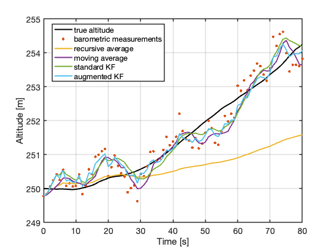
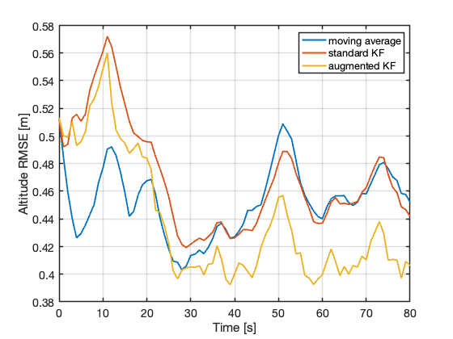

> 💾 **Prefer reading offline?** You can [download a PDF version of this post](post_pdf.pdf) for printing or future reference.

## Phileas Fogg’s altimeter

In *Around the World in Eighty Days*, Jules Verne imagines his hero, Phileas Fogg, betting 20,000 pounds that he can travel around the world in just eighty days. Fogg never actually travels by hot-air balloon, nor does he carry a barometric altimeter. Nevertheless, the iconic imagery of his journey provides a natural backdrop for the thought experiment explored in this post.

Imagine a hot-air balloon drifting slowly around the globe. In the novel, Fogg rejects the idea of travelling by balloon as too risky for his wager. Fortunately, our thought experiment is much simpler: the balloon follows a nearly horizontal path, remaining close to its intended cruising altitude. From Fogg’s perspective, estimating altitude should be trivial. A barometric altimeter continuously reports altitude, and modern electronics allow us to acquire measurements as fast as we like.

Yet a subtle difficulty appears.

The atmosphere is never perfectly still. Slow pressure fluctuations, thermal gradients, and large-scale weather dynamics continuously perturb barometric readings. These variations evolve over time scales that are much longer than the sensor's sampling interval. As a consequence, successive measurements are highly correlated.

A natural reaction would be to sample faster and average more aggressively. If noise is the problem, collecting more data should improve the estimate. But what if the fluctuations themselves possess memory? What if the sensor is repeatedly measuring the same underlying atmospheric disturbance?

## State-space models

Let $h_k$ denote the true altitude of the balloon at the discrete time $k\Delta t$, where $\Delta t$ is the constant sampling interval at which measurements are received. In this first version of the experiment, the balloon is assumed to travel almost horizontally, remaining close to its intended cruising altitude. Small unmodeled vertical perturbations are represented by the random-walk model

$$h_{k+1}=h_k+w^h_k,$$

where $w^h_k$ denotes a small process disturbance.

The barometric altimeter measurements are affected by two different error sources. The first is ordinary white measurement noise. The second is a slowly varying barometric disturbance, denoted by $b_k$, which represents atmospheric fluctuations that bias the altitude readings. The measurement model is therefore

$$z_k=h_k+b_k+v_k,$$

where $v_k$ is white measurement noise.

The correlated disturbance is modeled as a first-order Gauss--Markov process, or equivalently as an AR(1) sequence,

$$b_{k+1}=\phi\,b_k+w^b_k,\qquad 0\leq\phi<1,$$
 {#eq-1}

and $w_k^b$ is a white process noise term that drives the evolution of the disturbance.

The parameter $\phi$ controls how much memory the disturbance retains from one sample to the next. Values of $\phi$ close to one correspond to slow fluctuations with long correlation times, while smaller values correspond to faster decorrelation, approaching white noise in the limiting case when $\phi=0$.

The stochastic assumptions are

$$w^h_k\sim\mathcal N(0,Q_h),
\qquad
w^b_k\sim\mathcal N(0,Q_b),
\qquad
v_k\sim\mathcal N(0,R),$$

where the three noise processes are assumed to be Gaussian and mutually independent in this simplified scenario. At this stage, $Q_h$ is simply a scalar variance associated with the random-walk model. Its role will be generalized later when vertical dynamics are introduced.

To apply the Kalman filter (KF), the key modeling step is to treat the barometric disturbance as an additional state variable:

$$\mathbf{x}_k=
\begin{bmatrix}
h_k\\
b_k
\end{bmatrix}.$$

The resulting augmented state-space model is

$$\mathbf{x}_{k+1}=
\underbrace{\begin{bmatrix}
1 & 0\\
0 & \phi
\end{bmatrix}}_A
\mathbf{x}_k
+
\begin{bmatrix}
w^h_k\\
w^b_k
\end{bmatrix},$$

with measurement equation

$$z_k=
\underbrace{\begin{bmatrix}
1 & 1
\end{bmatrix}}_H\,
\mathbf{x}_k+v_k.$$

This formulation makes explicit what naive averaging ignores: measurement error is not merely random scatter around the true altitude. Part of the error evolves according to its own temporal dynamics and therefore cannot be eliminated simply by averaging successive observations.

The state-space framework offers a natural way to account for this behavior. By augmenting the state vector with the disturbance term, the KF can estimate both the altitude and the barometric bias simultaneously. In this way, the filter can attempt to separate the quantity of interest, $h_k$, from the slowly varying disturbance, $b_k$.

In this augmented formulation, the process-noise covariance matrix is

$$Q =
\begin{bmatrix}
Q_h & 0\\
0 & Q_b
\end{bmatrix},$$

while the measurement-noise covariance reduces to the scalar variance

$$R=\mathrm{Var}(v_k).$$

The off-diagonal terms of $Q$ are set to zero in our toy example, implying that the altitude perturbations and the barometric disturbance are modeled as independent. This assumption is made for simplicity rather than physical realism. In an actual atmospheric environment, the same meteorological processes may influence both the balloon’s vertical motion and the pressure fluctuations sensed by the altimeter. Consequently, nonzero cross-covariance terms between the process disturbances could arise in $Q$.

Once $A$, $H$, $Q$, and $R$ have been specified, the KF recursion can be applied as discussed [here](https://amsabatini.netlify.app/posts/post_1/). The prediction step propagates the augmented state estimate and its covariance through the model, while the correction step uses the barometric measurement to update both components of the state.

The important point is that the filter is no longer estimating altitude alone. It is estimating altitude and barometric disturbance simultaneously. By explicitly modeling the disturbance dynamics, the filter can treat slowly varying pressure fluctuations as a state variable to be estimated rather than as random measurement noise to be averaged away.

## Adding vertical gusts

To some extent, the model discussed above can be viewed as a continuation of the "teddy bears" example introduced in my previous post [(here)](https://amsabatini.netlify.app/posts/post_1/). The experiment is intentionally favorable to simple averaging. The balloon is assumed to remain at a nearly constant altitude, so the main difficulty arises from the correlated barometric disturbance.

Vertical perturbations are present in the random-walk model through the process noise term $w_k^h$. In that formulation, however, altitude changes are represented directly as random increments of altitude.

In the present scenario, vertical gusts are modeled more explicitly. Rather than acting directly on altitude, gusts are treated as acceleration disturbances that influence the balloon's vertical motion. This leads naturally to the standard constant-velocity (CV) model, in which altitude and vertical velocity evolve according to a simple kinematic relationship, as discussed [here](https://amsabatini.netlify.app/posts/stochastic_model/).

The state of the balloon is therefore extended to include vertical velocity:

$$\mathbf{x}^{(h)}_k=
\begin{bmatrix}
h_k\\
\dot{h}_k
\end{bmatrix}.$$

The vertical dynamics are

$$\mathbf{x}^{(h)}_{k+1}
=
\begin{bmatrix}
1 & \Delta t\\
0 & 1
\end{bmatrix}
\mathbf{x}^{(h)}_k
+
\mathbf{w}^{(h)}_k,$$

with

$$\mathbf{w}^{(h)}_k=\begin{bmatrix}w_k^{h}\\w^{\dot{h}}_k\end{bmatrix} \sim \mathcal N(0,Q_h),$$

where the process-noise covariance associated with white acceleration noise is

$$Q_h=
q_h
\begin{bmatrix}
\Delta t^3/3 & \Delta t^2/2\\
\Delta t^2/2 & \Delta t
\end{bmatrix}.$$

As discussed in the referenced post, the covariance structure $Q_h$ arises from a single white acceleration disturbance acting on the continuous-time model.

The barometric disturbance retains the same AR(1) dynamics introduced earlier (@eq-1).

The complete augmented state is now

$$\mathbf{x}_k=\begin{bmatrix}\mathbf{x}^{(h)}\\b_k\end{bmatrix}=
\begin{bmatrix}
h_k\\
\dot{h}_k\\
b_k
\end{bmatrix},$$

with transition model

$$\mathbf{x}_{k+1}
=
\underbrace{\begin{bmatrix}
1 & \Delta t & 0\\
0 & 1        & 0\\
0 & 0        & \phi
\end{bmatrix}}_A
\mathbf{x}_k
+
\begin{bmatrix}
w^h_k\\
w^{\dot{h}}_k\\
w^b_k
\end{bmatrix}.$$

The corresponding process-noise covariance becomes

$$Q=
\begin{bmatrix}
q_h\Delta t^3/3 & q_h\Delta t^2/2 & 0\\
q_h\Delta t^2/2 & q_h\Delta t     & 0\\
0               & 0               & Q_b
\end{bmatrix}.$$

The relationship between $Q_b$ and the underlying continuous-time Gauss–Markov model and its dependence on $\Delta t$ are discussed [(here)](https://amsabatini.netlify.app/posts/post_2/).

The measurement equation can be written as follows:

$$z_k=
\underbrace{\begin{bmatrix}
1 & 0 & 1
\end{bmatrix}}_H\,
\mathbf{x}_k+v_k,
\qquad
v_k\sim\mathcal N(0,R).$$

This model gives the estimator two distinct mechanisms for explaining variations in the barometric reading: genuine vertical motion of the balloon and slowly varying atmospheric disturbance. The task is no longer simply to smooth noisy measurements, but to infer how much of the observed variation should be attributed to the trajectory and how much to the sensor environment.

This separation is possible because the two components obey different dynamical models. The balloon altitude follows a constant-velocity kinematic model, whereas the barometric disturbance evolves according to an AR(1) process. In a state-space setting, these distinct temporal signatures provide the information needed to distinguish between the two effects.

## Simulation study

The simulation study considered four estimation strategies.

The first estimator was a **recursive average**, representing the most naïve accumulation of information. Each new measurement contributes to the estimate with a weight inversely proportional to the number of samples collected so far.

The second estimator was a **causal moving average** with a fixed time window of 5 s (chosen equal to the GM1 decorrelation time, assumed known for the purpose of the simulation). Unlike the recursive average, its memory remains finite, allowing the estimate to adapt more rapidly to changes in altitude.

The third estimator was a **standard KF**, based on the balloon dynamical model. This filter assumes that the measurements are affected only by white measurement noise and therefore ignores the existence of the correlated barometric disturbance.

The fourth estimator was the **augmented KF** introduced in the previous section. In this case, the barometric disturbance is explicitly included in the state vector and estimated together with the balloon states: altitude in the no-gust scenario, and altitude and vertical velocity when vertical gusts are present.

The two KFs differ only in the way the barometric disturbance is modeled. Their state-space formulations are summarized in @tbl-kf-structure.

| Quantity | Standard KF | Augmented KF |
|:-----------------------|:-----------------------|:-----------------------|
| State vector | $\begin{bmatrix} h_k \end{bmatrix}$ or $\begin{bmatrix} h_k \\ \dot{h}_k \end{bmatrix}$ | $\begin{bmatrix} h_k \\ b_k \end{bmatrix}$ or $\begin{bmatrix} h_k \\ \dot{h}_k \\ b_k \end{bmatrix}$ |
| Transition matrix $A$ | $\begin{bmatrix} 1 \end{bmatrix}$ or $\begin{bmatrix} 1 & \Delta t \\ 0 & 1 \end{bmatrix}$ | $\begin{bmatrix} 1 & 0 \\ 0 & \phi \end{bmatrix}$ or $\begin{bmatrix} 1 & \Delta t & 0 \\ 0 & 1 & 0 \\ 0 & 0 & \phi \end{bmatrix}$ |
| Measurement matrix $H$ | $\begin{bmatrix} 1 \end{bmatrix}$ or $\begin{bmatrix} 1 & 0 \end{bmatrix}$ | $\begin{bmatrix} 1 & 1 \end{bmatrix}$ or $\begin{bmatrix} 1 & 0 & 1 \end{bmatrix}$ |
| Process covariance $Q$ | $Q_h$ | $\begin{bmatrix} Q_h & 0 \\ 0 & Q_b \end{bmatrix}$ |
| Measurement covariance $R$ | $R'$ | $R$ |
| Barometric disturbance | Ignored | Explicitly modeled and estimated |

: State-space formulations of the standard and augmented Kalman filters. Whenever two expressions are shown, the first corresponds to the *no-gust* scenario and the second to the *vertical-gust* scenario. The standard KF ignores the correlated barometric disturbance and compensates for model mismatch through an increased measurement-noise covariance $R'$. The augmented KF explicitly models the disturbance as an additional state variable.

Four simulation scenarios were investigated. Two sampling intervals were considered, 1 s and 0.1 s, corresponding respectively to nominal sampling and a ten-fold oversampling condition. For each sampling interval, simulations were performed both with and without vertical gusts. The resulting scenarios were therefore:

1.  no-gust, $\Delta t = 1~\mathrm{s}$;
2.  no-gust, $\Delta t = 0.1~\mathrm{s}$;
3.  vertical-gust, $\Delta t = 1~\mathrm{s}$;
4.  vertical-gust, $\Delta t = 0.1~\mathrm{s}$.

Each scenario was repeated over 250 independent Monte Carlo runs. Estimator performance was assessed through trajectory RMSE, while NIS and NEES were used as consistency diagnostics for the Kalman-based estimators.

::: callout-note
## Consistency checks: NIS and NEES

When the true state is known in simulation, KF performance can be assessed not only by looking at the estimation error, but also by checking whether the predicted covariance is statistically consistent with that error.

Two standard diagnostics are commonly used.

The normalized innovation squared (NIS) is defined as

$$\epsilon^z_k = \nu_k^\top S_k^{-1}\nu_k,$$

where

$$\nu_k=z_k-H\hat x_k^-$$

is the innovation and

$$S_k=HP_k^-H^\top+R$$

is its predicted covariance [(here)](https://amsabatini.netlify.app/posts/post_1/).

The normalized estimation error squared (NEES) is defined as

$$\epsilon^x_k = e_k^\top (P_k^+)^{-1}e_k,$$

where

$$e_k=x_k-\hat x_k^+$$

is the state-estimation error.

A practical difference between the two metrics is that NIS can be computed using only quantities available to the filter and is therefore applicable both in simulation and in real operation. NEES, by contrast, requires the true state and is generally available only in simulation studies.

For a consistent KF, NIS and NEES follow chi-square distributions with degrees of freedom equal to the dimensions of the measurement and state vectors, respectively. In a Monte Carlo experiment, their empirical averages can therefore be compared with the corresponding theoretical expectations and confidence intervals.
:::

## Results

Final RMSE values are summarized separately for the *no-gust* and *vertical-gust* scenarios in @tbl-no-gusts and @tbl-gusts.

```{r}
#| label: tbl-no-gusts
#| tbl-cap: "Final altitude RMSE for the four estimators in the absence of vertical gusts. Because the balloon altitude remains essentially constant, recursive averaging performs nearly as well as the Kalman-based estimators."
#| echo: false

library(knitr)
library(kableExtra)

df_no_gusts <- data.frame(
  `Sampling interval` = c("1.0 s", "0.1 s"),
  `Recursive average [m]` = c(0.175, 0.180),
  `Moving average [m]` = c(0.437, 0.420),
  `Standard KF [m]` = c(0.182, 0.242),
  `Augmented KF [m]` = c(0.170, 0.172),
  check.names = FALSE
)

kbl(
  df_no_gusts,
  digits = 3,
  align = c("l", "r", "r", "r", "r"),
  booktabs = TRUE
) |>
  kable_styling(
    full_width = FALSE,
    position = "center"
  )
```

```{r}
#| label: tbl-gusts
#| tbl-cap: "Final altitude RMSE for the four estimators in the presence of vertical gusts. Once the altitude becomes time-varying, the recursive average is unable to track the trajectory and its error increases dramatically. Reducing the sampling interval from 1.0 s to 0.1 s produces only modest changes compared with the gain obtained by modeling the correlated disturbance."
#| echo: false

library(knitr)
library(kableExtra)

df_gusts <- data.frame(
  `Sampling interval` = c("1.0 s", "0.1 s"),
  `Recursive average [m]` = c(2.559, 2.635),
  `Moving average [m]` = c(0.452, 0.474),
  `Standard KF [m]` = c(0.442, 0.490),
  `Augmented KF [m]` = c(0.406, 0.417),
  check.names = FALSE
)

kbl(
  df_gusts,
  digits = 3,
  align = c("l", "r", "r", "r", "r"),
  booktabs = TRUE
) |>
  kable_styling(
    full_width = FALSE,
    position = "center"
  )
```

The recursive average performs well in the *no-gust* scenario because the balloon remains close to its cruising altitude and the averaging horizon effectively suppresses part of the measurement noise. This is not entirely unexpected. In the idealized case of a constant signal corrupted only by white noise, the variance reduction achieved by averaging $N$ samples scales as $1/N$, whereas a moving average with window length $W$ achieves only a $1/W$ reduction. For $N \approx 80$ and $W = 5$, one would therefore expect the recursive average to outperform the moving average by roughly a factor $\sqrt{W/N} \approx 0.25$ in RMSE. The observed ratio is less favorable because the measurements are affected by a correlated barometric disturbance and the balloon altitude is not perfectly constant. Nevertheless, the result still reflects the advantage of exploiting the entire observation history in this particularly benign scenario.

As soon as vertical dynamics are introduced, however, recursive averaging becomes unsuitable because its memory is too long to follow the evolving trajectory. For this reason, the remaining results focus on the moving average, the standard KF, and the augmented KF.

Interestingly, the moving average exhibits nearly identical RMSE values across all scenarios. This robustness should not be interpreted as superior modeling capability. Rather, it reflects the fact that the 5 s averaging window acts primarily as a low-pass filter, smoothing both the correlated barometric disturbance and the relatively weak vertical dynamics. As a result, the estimator remains largely insensitive to the distinction between the no-gust and vertical-gust scenarios.

A further observation is the limited effect of oversampling. Once the process-noise models are scaled consistently with $\Delta t$, reducing the sampling interval from $1~\mathrm{s}$ to $0.1~\mathrm{s}$ produces only modest changes in estimation accuracy. In this example, the dominant limitation is not the availability of measurements, but the presence of a slowly varying correlated disturbance affecting the observations.

The consistency diagnostics reveal a clear difference between the standard and augmented KFs. In all four scenarios, the augmented KF produces NIS values close to the theoretical expectation of one and NEES values close to the corresponding state dimension, indicating statistical consistency between the assumed model and the simulated process.

By contrast, the standard KF exhibits substantially inflated NEES values, particularly under oversampling, despite the use of an increased measurement-noise covariance to compensate for the unmodeled barometric disturbance. This behavior indicates that the filter is overconfident about the accuracy of its state estimates. The inconsistency becomes especially pronounced for $\Delta t = 0.1~\mathrm{s}$, where repeated observations of the same slowly varying disturbance further expose the limitations of the simplified model.

These results suggest that increasing the sampling rate alone cannot compensate for model mismatch. In this example, model fidelity proves more important than measurement frequency.

A representative realization of the *vertical-gust* scenario with $\Delta t = 1~\mathrm{s}$ is shown in @fig-trajectory.

{#fig-trajectory}

The recursive average rapidly loses the ability to track the true altitude because its effective memory grows continuously with time. The moving average remains considerably more responsive, thanks to its finite memory window. The standard KF reacts more quickly to altitude variations, but part of the slowly varying barometric disturbance is incorrectly interpreted as genuine balloon motion. The augmented KF is the only estimator capable of explicitly separating the environmental disturbance from the vehicle dynamics.

To quantify these differences, the root-mean-square error was evaluated over the full trajectory and averaged across Monte Carlo runs, as shown in @fig-rmse.

{#fig-rmse}

The RMSE curves reveal an initial transient during which the standard and augmented KFs exhibit very similar performance. During this phase, both filters are adapting from their initial conditions, while the augmented KF has not yet accumulated sufficient information to reliably separate the slowly varying barometric disturbance from the balloon dynamics. As time progresses, the advantage of explicitly modeling the correlated disturbance becomes increasingly evident, leading to a persistent reduction in RMSE for the augmented KF.

## Reproducibility

All MATLAB scripts used to generate the simulations, figures, tables, and Monte Carlo analyses discussed in this post are available in the accompanying [GitHub repository](https://angelosabatini.github.io/blog.engineering/posts/post_3/).

The repository includes the main simulation driver, the reusable Monte Carlo function implementing the four estimators, and a separate analysis script used to generate the figures, summary tables, consistency diagnostics, and statistical comparisons reported in this post.

## Concluding remarks

At first sight, the balloon experiment may appear to be a simple estimation problem. A sequence of noisy altitude measurements is available, and the objective is merely to recover the true trajectory.

The simulations reveal that the situation is more subtle. The barometric signal contains information about two different phenomena at the same time: the actual motion of the balloon and the slowly evolving state of the surrounding atmosphere. Increasing the sampling rate alone cannot separate these contributions. Oversampling simply produces more observations of the same correlated process.

The key ingredient is not additional data, but an appropriate model.

By explicitly introducing the atmospheric disturbance as an additional state variable, KF is able to exploit temporal structure rather than merely suppress fluctuations. Uncertainty is reduced by reorganizing information according to a dynamical description of the system.

This idea extends far beyond balloons and barometers. Many sensing problems involve measurements influenced simultaneously by the quantity of interest and by slowly varying environmental effects. Whenever temporal correlation is present, understanding the dynamics often becomes more valuable than collecting additional samples.

In the end, the lesson is not that averaging is useless, nor that oversampling is always a mistake.

> | The real challenge is not simply to collect measurements, but to interpret them through an appropriate model of the physical world: the most valuable information is often not contained in a single observation, but in the way successive observations are connected across time.
