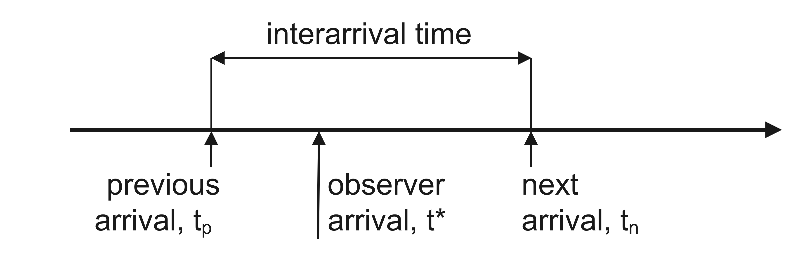

Consider the situation when the continuous time axis of our observations is partitioned into a sequence of interarrival intervals. With the term *arrival*, we designate the occurrence of everything we are interested to observe, for instance, a particle emitted from radioactive material and captured by a radiation counter, a message reaching its destination queue, maybe the bus that we are waiting for at the bus stop. Usually, probabilistic models that attempt to describe these different type of arrivals share the same assumption: namely the interarrival times (i.e., the times between successive arrivals) are modeled as independent random variables. For instance, the continuous-time Poisson process (hopefully, this is not the right model to predict the next bus arrival!) is the case where the interarrival times are modeled as independent identically exponentially distributed random variables.

::: callout-note
## Exponential distribution

A continuous random variable $X$ is said to be exponential, or exponentially distributed with parameter $\lambda$, when its cumulative distribution function (CDF) is written

$$
F_X(x)=\text{Pr}(X\leq x)=1-e^{-\lambda x},\;x\geq0
$$

The probability density function (PDF) is then given by:

$$
p_X(x)=\frac{d}{dx}F_X(x)=\lambda\,e^{-\lambda x},\;x\geq0
$$

The mean value, the mean square value and the variance of $X$ are:

$$
\left\{
\begin{split}
E[X]&=\int_0^{\infty}xp_X(x)\,dx=\frac{1}{\lambda}\\
E[X^2]&=\int_0^{\infty}x^2p_X(x)\,dx=\frac{2}{\lambda^2}\\
\text{Var}(X)&=E[X^2]-E[X]^2=\frac{1}{\lambda^2}
\end{split}
\right.
$$

Integration by parts can be used to calculate the two expectations $E[X]$ and $E[X^2]$.
:::

::: callout-note
## Poisson process

Consider a sequence of independent exponential random variables $T_1,T_2,T_3\cdots,$ with common parameter $\lambda$, and let these stand for the interarrival times. The arrivals are then recorded at times $T_1,T_1+T_2,T_1+T_2+T_3,\cdots$ and so forth, to define a continuous-time Poisson process.

A Poisson process is endowed with the following important properties:

1.  **Independence of non-overlapping sets of times**. This is a direct consequence of the assumed independence of the interarrival times.

2.  **Fresh-start property**. The part of the Poisson process that starts at any particular time $t>0$ is a probabilistic replica of the Poisson process starting at time 0, and is independent of the part of the process prior to time $t$. This can be seen as a special case of point 1.

3.  **Memoryless interarrival time distribution**. If $T$ is the time of the first arrival and if we know that $T>t$, then the remaining time $T−t$ is exponentially distributed, with the same parameter $\lambda$:

$$
\begin{split}
\text{Pr}(T>t+s\,\vert\,T>t)&=\frac{\text{Pr}(T>t+s,T>t)}{\text{Pr}(T>t)}\\
&=\frac{\text{Pr}(T>t+s)}{\text{Pr}(T>t)}=\frac{1-F_T(t+s)}{1-F_T(t)}\\
&=\frac{e^{-\lambda(t+s)}}{e^{-\lambda t}}=e^{-\lambda s}=\text{Pr}(T>s)
\end{split}
$$

Properties 2.-3. can be rephrased saying that the ones whose life is modeled by an exponential distribution, well they should remain *forever young*: no matter how long they have lived so far, the remaining time to their death is predicted as if they are just born!
:::

The term **random incidence** denotes the arrival of an observer at an arbitrary time $t^*$ into a *gap* between two consecutive arrivals in an arrival-type process that is not necessarily described by a Poisson model, @fig-fig1.

{#fig-fig1 fig-align="center" width="450"}

We are not saying that $t^*$ is random; in this regard, perhaps, using the term random incidence may appear misleading. However, the interval between the time of the previous arrival $t_p$ and $t^*$, and the interval between $t^*$ and the time of the next arrival $t_n$ are random. All we need to state to start our discussion is to assume that the observer enters the arrival-type process in a situation when a previous arrival has surely occurred: probabilistically, the gap $t_n-t_p$ is then a well-defined quantity.

Suppose that we know the probability law of the interarrival times $Y$. Let us denote by $W$ the random variable that describes the duration of the gap entered by random incidence, $W=T_n-T_p$. Finally, we denote by $T$ the random variable that describes the waiting time for the next arrival from when the gap is entered by random incidence, $T=T_n-T^*$.

It is argued that the probability that $W$ assumes a value between $w$ and $w+dw$ is proportional to both the the duration of the gap $w$ and the relative frequency of occurrence of such gaps $p_Y(w)dw$:

$$
\text{Pr}(w\leq W\leq w+dw)=p_W(w)dw\propto w\,p_Y(w)dw
$$

Therefore:

$$
p_W(w)=\frac{w\,p_Y(w)}{E[Y]}
$$ {#eq-eq1}

where the constant of proportionality is calculated to enforce the constraint of normalization for the PDF $p_W(w)$ of $W$ (its integral from 0 to infinity must be 1).

Now, given that a gap of length $w$ is entered by random incidence, we are equally likely to be anywhere within the gap. More precisely, *given* $w$, the time until the next arrival $T$ has a uniform PDF:

$$
p_{T\vert W}(t\,\vert\,w)=\frac{1}{w},\;0\leq t\leq w
$$ {#eq-eq2}

where $p_{T\vert W}(t\,\vert\,w)$ is the conditional PDF of $T$ given $W$. Using @eq-eq1, @eq-eq2 the joint PDF $p_{TW}(t,w)$ can be written:

$$
p_{TW}(t,w)=p_{T\vert W}(t\,\vert\,w)\,p_W(w)=\frac{p_Y(w)}{E[Y]},\;0\leq t\leq w<\infty
$$

Finally, the marginal PDF $p_T(t)$ of the waiting time for the next arrival from when the gap is entered by random incidence can be formed simply by *integrating out* $W$:

$$
\boxed{p_T(t)=\int_{t}^{\infty}\frac{p_Y(w)}{E[Y]}dw=\frac{1-F_Y(t)}{E[Y]},\;t\geq0}
$$ {#eq-eq3}

::: {#exm-exm1}
Consider a bus passenger arriving at a bus stop. The probabilistic law of the bus headways $F_Y(y)$ will determine the probability law for the waiting time until the next bus arrives, $p_T(t)$ via @eq-eq3, if we ignore interactions between successive buses and assume that the arrivals are identically distributed and independent.

Suppose that buses maintain perfect headways, being always spaced $T_0$ minutes apart:

$$
F_Y(y)=\left\{\begin{split}0&\quad y<T_0\\1&\quad y\geq T_0\end{split}\right.\rightarrow p_Y(y)=\delta(y-T_0)\rightarrow E[Y]=T_0
$$

where the PDF is expressed in terms of a delta function located at time $T_0$. The PDF of $T$ can be written:

$$
p_T(t)=\left\{\begin{split}&\frac{1}{T_0}&\quad 0\leq t\leq T_0\\&0&\quad t>T_0\end{split}\right.\rightarrow E[T]=\frac{T_0}{2}
$$

As expected intuitively, the time until the next arrival, *given random incidence*, is uniformly distributed between $0$ and $T_0$, with mean value $E[T]=T_0/2$: if $T_0=60$ min the average waiting time is 30 min.

Now, suppose that the bus headways are on the hour, and fifteen minutes after the hour. Thus, the interarrival times alternate between 15 and 45 minutes. If the bus passenger shows up at the bus stop at any time uniformly distributed within a hour, she/he has to wait for an average time of 15/2 min (with probability 1/4) and 45/2 min (with probability 3/4):

$$
E[T]=\frac{15}{2}\cdot\frac{1}{4}+\frac{45}{2}\cdot\frac{3}{4}=18.75\;\text{min}
$$

More formally:

$$
F_Y(y)=\left\{\begin{split}0&\quad0\leq y<15\\1/2&\quad15\leq y<45\\1&\quad y\geq45\end{split}\right.\rightarrow E[Y]=30\;\text{min}
$$

Using @eq-eq3:

$$
p_T(t)=\left\{\begin{split}1/30&\quad0\leq t<15\\1/60&\quad15\leq t<45\\0&\quad t\geq45\end{split}\right.\rightarrow E[T]=18.75\,\text{min}
$$

On average, the bus passenger has to wait longer than it might be expected taking into account $E[Y]$ only, namely $E[Y]/2=15$ min.

> This is because an observer who arrives at an arbitrary time, the bus passenger in this example, is more likely to fall in a large rather than a small interarrival interval: large interarrival intervals tend therefore to determine longer waiting times!
:::

::: {#exm-exm2}
Consider the (unrealistic) case that the bus headways are Poissonian. What does this mean? Basically, we state that the interarrival times are modeled by independent exponentially distributed random variables with rate $\lambda$ (the rate denotes the number of arrivals per unit time):

$$
F_Y(y)=1-e^{-\lambda t},\;t\geq 0\rightarrow p_Y(y)=\frac{F_Y(y)}{dy}=\lambda e^{-\lambda t},\;t\geq0\rightarrow E[Y]=1/\lambda
$$

Using @eq-eq3:

$$
p_T(t)=\lambda e^{-\lambda t},\;t\geq0
$$

Hence $T$ is exponentially distributed with rate $\lambda$. The average time of waiting is $E[T]=1/\lambda$. No matter when the event occurred, the observer who arrives at an arbitrary time $t^*$ (the bus passenger in this example) sees the Poisson process to start fresh at time $t^*$, @fig-fig1. It is worth noting that, according to the properties of independence, start-fresh and memorylessness stated above, we can run a Poisson process either forwards or backwards in time, without any modification in its properties. Hence, not only $T_n-T^*$, but also $T^*-T_p$ is exponentially distributed with parameter $\lambda$. Moreover, $T_n-T^*$ and $T_n-T^*$ are independent. We have therefore established that the gap $W$ entered by random incidence is the sum of two independent exponential random variables with parameter $\lambda$ and mean value $2/\lambda$. More formally, using @eq-eq1 we get:

$$
p_W(w)=\lambda w\,e^{-\lambda w},\;w\geq0
$$

We recall that the random variable $X$ Erlang of order $k$ has PDF:

$$
p(x)=\frac{\lambda^kx^{k-1}e^{-\lambda x}}{(k-1)!}
$$

In conclusion, the gap duration is a random variable Erlang of order 2.

> In a similar fashion to @exm-exm1, when landing into a Poisson process at an arbitrary time, we are more likely to fall in a large interarrival interval; therefore, the length of what we perceive as a *typical* interarrival interval is greater than it is in reality.
:::
