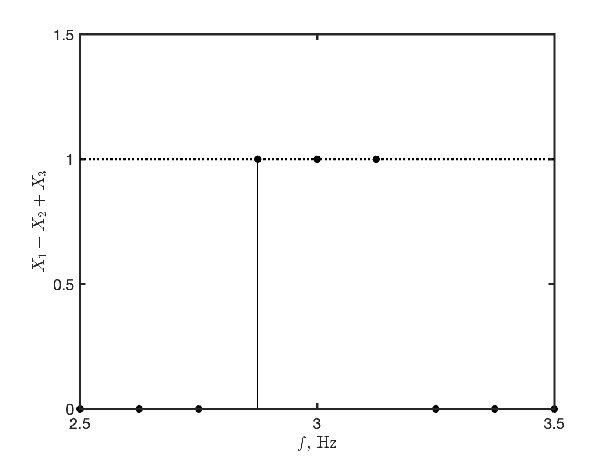
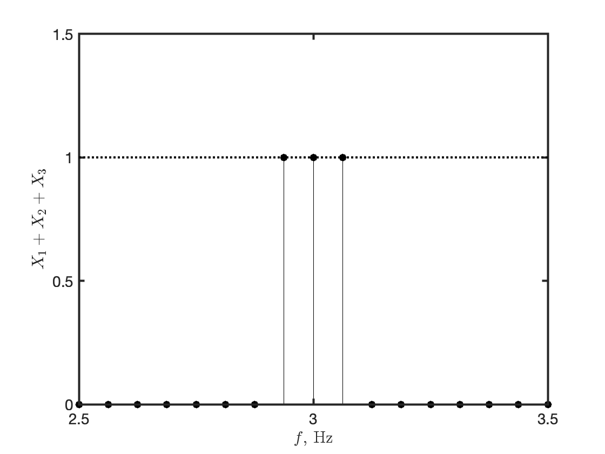

**Frequency resolution** is the size of the smallest frequency for which details in the frequency response and the spectrum can be resolved by the estimate. For example, a resolution of 0.1 Hz means that the frequency response variations at frequency intervals at or below 0.1 Hz cannot be resolved.

Consider an analog band-limited signal $x(t)$ with bandwidth $B$ Hz; $x(t)$ is observed over a **sample period** of $T_r$ s (the length of the data record) and sampled at a **sampling frequency** of $f_s$ Hz ($T_s=1/f_s$ denotes the **sampling interval**). The total available number of samples of $x(t)$ is $N=\lfloor T_r/T_s\rfloor$, where $\lfloor\cdot\rfloor$ denotes the floor function (or greatest integer function), namely the function that takes as input a real number $r$ and gives as output the greatest integer less than or equal to $r$.

According to the Shannon-Nyquist sampling theorem, if the sampling frequency $f_s$ is chosen to be $2B$, the maximum resolvable frequency is:

$$
f_{\text{max}}=\frac{f_s}{2}
$$

On the other hand, the minimum resolvable frequency is inversely related to the sample period:

$$
f_{\text{min}}=\frac{1}{T_r}=\frac{1}{NT_s}
$$ {#eq-eq1}

and hence the number of frequencies that can be resolved from $f_{\text{min}}$ to $f_{\text{max}}$ is

$$
N_f=\frac{f_{\text{max}}-f_{\text{min}}}{\Delta f}
$$

where $\Delta f$ is the frequency resolution. Since $\Delta f=f_{\text{min}}$, I also have:

$$
N_f=\dfrac{\dfrac{f_s}{2}-\dfrac{f_s}{N}}{\dfrac{f_s}{N}}=\frac{N}{2}-1
$$

This implies that will be $N/2$ discrete frequencies from $0$ to $f_{\text{max}}$.

The accurate detection of frequency components in the spectrum $X(f)$ of the signal $x(t)$ is challenged by the phenomenon known as **spectral leakage**, or amplitude ambiguity; it consists of ambiguous and false amplitudes occurring in the spectrum $X(f)$ whenever the sample period $T_r$ is not an integer multiple of *all* of the contributory periods in $x(t)$. That is, false or ambiguous amplitudes will occur at frequencies that are immediately adjacent to the actual frequency.

For aperiodic signals, $T_r$ theoretically must be infinite. For periodic signals, $T_r$ *must be equal to the least common integer multiple of all the periods contained in the signal*. Application of the DFT (Discrete Fourier Transform) or FFT (Fast Fourier Transform) to an aperiodic signal implicitly assumes that the signal is infinite in length and formed by repeating the signal of length $T_r$ an infinite number of times. This leads to discontinuities in the amplitude that occur at each integer multiple of $T_r$. These discontinuities are step-like, which introduce false amplitudes that decrease around the main frequencies.

*All the periods contained in the signal cannot be known before the spectral analysis is performed*, therefore the stated condition on the sample period cannot be fulfilled; the best method to minimize the effect of spectral leakage is **windowing**.

Herein, I just provide a brief explanation of windowing, without testing it in the examples to follow. Windowing reduces the amplitude of the discontinuities at the boundaries of each finite sequence of samples of $x(t)$. It does so by multiplying the acquired sequence by a finite-length window with an amplitude that varies smoothly and gradually toward zero at the edges. This makes the endpoints of the waveform meet and, therefore, results in a continuous waveform without sharp transitions.

::: callout-tip
## Can discrete-time sinusoids be non-periodic?

The normalized frequency $f$ in cycles per sample of a **discrete-time sinusoid**:

$$
x[n]=\cos(2\pi fn)
$$

is restricted to values in the interval $-1/2\leq f\leq1/2$. This is because, for any discrete-time sinusoid with frequency $\vert f\vert>1/2$, an integer $m$ exists such that $f=f_0+m$ and $\vert f_0\vert\leq1/2$:

$$
\cos 2\pi fn=\cos[2\pi (f_0+m)\,n]=\cos(2\pi f_0n)+\cos(2\pi mn)=\cos(2\pi f_0n)
$$

It is worth noting that the highest rate of oscillation of discrete-time sinusoids is when, at every time instant, the output sample flips polarity with respect to the previous output sample:

$$
f_0=\frac{1}{2}\rightarrow\cos(2\pi f_0n)=\cos(\pi n)=(-1)^n
$$

Moreover, a discrete-time sinusoid can be periodic, i.e, characterized by patterns that exactly repeat themselves in time, if and only if its frequency can be expressed in terms of a rational number; moreover, an additive mixture of periodical discrete-time sinusoids (called here **sinusoidal mixture**) is periodic with period equal to the least common integer multiple of their periods.
:::

As outlined above, a spectrum line at frequency $f$ will be accurately represented by the DFT when $f_s\geq2f_{\text{max}}$ and $T_r = mT$, where $m=1,2,\cdots$, and $T=1/f$. This implies that $N=mf_s/f$. If $T_r$ is not an integer multiple of $T$, leakage will occur in the DFT. This appears as amplitudes at $f$ spilling onto adjacent frequencies.

As an example, consider a sinusoidal mixture with three unit-amplitude components at 2.875 Hz, 3 Hz, 3.125 Hz. The sampling frequency is set to $f_s=16$ Hz and the sample period to $T=8$ s ($N=128$): the component at 2.875 Hz is observed for 23 periods, the component at 3 Hz for 24 periods, and the component at 3.125 Hz for 25 periods. The resolution calculated according to @eq-eq1 is 0.125 Hz.

A chunk of code written in MATLAB (Natick, Massachusetts: The MathWorks, Inc., <https://www.mathworks.com>) shows how to simulate the sinusoidal mixture and to perform spectral analysis.

``` matlab
% *****************************
% sinusoidal mixture generation
% *****************************

fs = 16;   % sampling frequency, Hz
Ts = 1/fs; % sampling interval, s
T  = 8;    % sample period, s

t  = (0:Ts:T-Ts); % time domain, s
N  = length(t);   % number of samples

f1 = 2.9375;      % frequency component 1, Hz
f2 = 3;           % frequency component 2, Hz
f3 = 3.0625;      % frequency component 3, Hz

x1 = cos(t.*(2*pi*f1)); % sinusoid 1
x2 = cos(t.*(2*pi*f2)); % sinusoid 2
x3 = cos(t.*(2*pi*f3)); % sinusoid 3
X  = x1 + x2 + x3;      % sinusoidal mixture

% ********************************************************
% calculation of single-side spectrum (see comments below)
% ********************************************************

P              = fft(X, N);         % FFT calculation
P2             = abs(P/N);          % double-side spectrum, rescaled by N     
P1             = P2(1:N/2+1);  
P1(:, 2:end-1) = 2*P1(2:end-1); 
Y              = P1(1:end-1);       % single-side spectrum
f              = (0:N/2-1).*(fs/N); % frequency domain, Hz
```

::: callout-note
## Comments

The documentation in MATLAB explains the procedure to convert the N-points FFT spectrum of the signal to the single-side amplitude spectrum:

1.  Because the FFT function includes a scaling factor N between the original and the transformed signals, rescale the spectrum by dividing by N.

2.  Take the complex magnitude of the FFT spectrum. The two-side amplitude spectrum P2, where the spectrum in the positive frequencies is the complex conjugate of the spectrum in the negative frequencies, has half the peak amplitudes of the time-domain signal.

3.  To convert to the single-side spectrum Y, take the first half P1 of the two-side spectrum P2 and multiply by 2. P1(1) and P1(end) are not multiplied by 2 because these amplitudes correspond to the zero and Nyquist frequencies, respectively, and they do not have the complex conjugate pairs in the negative frequencies.

4.  Define the frequency domain f for the single-side spectrum Y.
:::

The single-side spectrum of the sinusoidal mixture is shown in @fig-fig1.

{#fig-fig1 fig-align="center" width="600"}

Consider now the case that the three components of the sinusoidal mixture have frequencies 2.9375 Hz, 3 Hz, 3.0625 Hz. To resolve them, I would need to double the frequency resolution of the FFT, up to 0.0625 Hz, with respect to the scenario of @fig-fig1. Erroneously, I double the sampling frequency. However, this expedient leaves the frequency resolution unaltered, since doubling the sample period without touching the sample period also doubles the number of samples. Moreover, the sample period is not properly chosen to avoid spectral leakage, as clearly seen in @fig-fig2.

{#fig-fig2 fig-align="center" width="600"}

To resolve the components of the sinusoidal mixture and avoid spectral leakage, the frequency resolution of 0.0625 Hz can be achieved by extending the time period to $T_r=16$ s, which corresponds to $N=256$ samples at the original sampling frequency $f_s=16$ Hz, see @fig-fig3.

{#fig-fig3 fig-align="center" width="600"}

> To conclude: whereas the sampling frequency sets the time resolution, the sample period occupies a central place in setting the frequency resolution when spectral analysis is performed. The sample period being the same, just increasing the sampling frequency simply increases the number of samples by the same ratio, leaving their ratio unaltered. The only means to increase the frequency resolution is to increase the sample period, trying at the same time to minimize the effects of spectral leakage.
