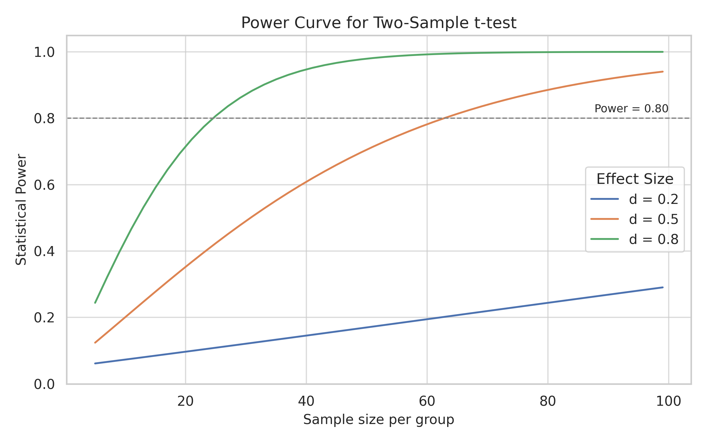

One of the most important similarities between statistics and machine learning (ML) is that both rely heavily on models. While this connection is sometimes overlooked, it forms the backbone of how we organize and analyze data. Regardless of the number and type of variables involved—whether explanatory or response variables, continuous or categorical—statistical modeling remains at the core of the process. Whether our goal is to predict outcomes, uncover relationships, or assess differences, modeling gives structure and meaning to the patterns we observe. ML, too, builds on this idea of modeling, but with a slightly different emphasis. Here, the focus is often more explicitly on defining a mathematical mapping between inputs and outputs—a modeling aspect that tends to be more immediately visible than in traditional statistical practice.

Several practical factors make a full overlap between the two approaches less straightforward. One is the sheer difference in the size of datasets: classical statistical analyses often rely on relatively small samples, especially in fields such as medicine or social sciences. This distinction, however, is beginning to blur: modern applications in fields like digital health, education technology, or online behavioral studies increasingly generate larger datasets, enabling the use of ML-inspired methods even in traditionally small-sample domains. ML, by contrast, tends to operate in contexts where large datasets are available—or at least assumed. Another difference lies in the typical workflow: in ML, it is standard practice to split data into training, validation, and testing sets, managing the trade-off between fitting well and generalizing. This concern, central to ML, is less explicitly present in traditional statistical workflows.

Despite these differences, statistics and ML increasingly share common objectives and approaches: building models that capture meaningful patterns while balancing complexity against generalization.(For readers unfamiliar with some of the technical terms, a brief summary is provided in the Key Concepts sections below.)

## What is a statistical model?

In classical statistics — for example, for methods introduced early in the training of sophomore students, such as simple linear regression and ANOVA (ANalysis Of VAriance) — the model is typically written in a very structured form. Let us suppose that $Y$ is the response variable (outcome) and $X_1,X_2,\cdots,X_m$ are explanatory variables (predictors), collected into the vector $\mathbf{X}$; the model is the equation that we suppose relate together the predictors to the outcome, for any of a number $n$ of observational units, with an important element noticed in the formulation of the model-the random error term, $\varepsilon$:

$$
Y_{i}=f(\mathbf{X}_i;\theta)+\varepsilon_i,\quad i=1,...,n 
$$ {#eq-model-general}

where $\theta$ are the parameters to be estimated. This decomposition highlights two essential ideas:

-   There is an underlying systematic component ($f(\mathbf{X}_i;\theta)$),
-   Plus an error component ($\varepsilon_i$), which captures variability not explained by the model.

The classical statistical inferential procedures—whether hypothesis testing or interval estimation—are fundamentally designed around the behavior of this error term. It is also important to realize that we can never observe the error term, but we can infer its behavior from the analysis of the model residual — the difference between observed and predicted values.

In classical parametric inference, crucial assumptions are made about the behavior of the error terms $\varepsilon_i$ in the general model @eq-model-general.

To ensure analytical tractability and valid inference, it is common to summarize these assumptions using the acronym LINE — Linearity, Independence, Normality, and Equality of variance:

1.  **Linearity**: The model is linear in the parameters $\theta$; that is, the expected value of the outcome variable $Y$ can be expressed as a linear combination of the parameters, possibly through transformations of the predictors $\mathbf{X}$.

2.  **Independence**: The error terms are independent across observations. In particular, for time series data, consecutive errors are assumed to be uncorrelated. In cross-sectional data, failure of independence often reflects issues in experimental design, such as inadequate random assignment or hidden confounding. Detecting such problems can be challenging and typically requires careful planning at the data collection stage.

3.  **Normality**: The error terms are normally distributed with mean zero.

4.  **Equality of variance (Homoscedasticity)**: The error terms have constant variance across the range of the predictors.

These assumptions provide the theoretical foundation for estimating parameters, constructing confidence intervals, and performing hypothesis tests in a coherent analytical framework. Understanding how residuals behave is not only crucial in classical inference, but also serves as a bridge toward modern predictive approaches, as discussed in the note below.

::: {.callout-note title="Residuals and ML"}
The concept of residuals — as discrepancies between observed outcomes and model predictions — remains central in ML as well. Although the term "residual" is less frequently emphasized explicitly, the analysis of prediction errors underpins critical tasks such as model evaluation, hyperparameter tuning, and post-hoc diagnostics across supervised learning workflows.

Understanding residuals provides a natural bridge between classical inferential thinking and modern predictive modeling practices.
:::

This careful structure is what allows classical statistics to calibrate confidence intervals, compute p-values, and estimate statistical power, all based on theoretically derived sampling distributions. However, when these assumptions are violated, the inferential reliability may break down — often in unpredictable ways. Modern approaches like **bootstrap resampling** offer alternatives that reduce dependency on strong theoretical assumptions, and interestingly, align closely with resampling strategies widely used in ML (such as cross-validation for hyperparameter tuning). In a sense, bootstrapping can be seen as a bridge: a classical method moving closer to the data-driven, flexible spirit that characterizes much of modern ML practice.

## Key Concepts

::: callout-important
### Statistics-Based Key Concepts

-   **Estimator**: A function of sample data used to infer the value of an unknown population parameter. Estimators form the basis for constructing confidence intervals and conducting hypothesis tests.

-   **Sampling Distribution**: The probability distribution of an estimator over many hypothetical repeated samples from the same population.

-   **Confidence Interval**: An estimated range, derived from an estimator, that likely contains the true value of the population parameter with a given level of confidence.

-   **p-value**: The probability, under the null hypothesis, of obtaining a test statistic at least as extreme as the one observed.

-   **Statistical Power**: The probability that a statistical test correctly rejects the null hypothesis when the alternative hypothesis is true.

-   **Type I Error**: Incorrectly rejecting a true null hypothesis (false positive).

-   **Type II Error**: Failing to reject a false null hypothesis (false negative).

-   **Residual**: The difference between the observed value and the corresponding predicted value from a statistical model. Residuals are empirical proxies for the unobservable error terms, enabling diagnostic analyses of model fit and assumptions.

-   **Degrees of Freedom**: The number of independent values in a calculation that are free to vary. In statistical inference, degrees of freedom determine the shape of sampling distributions (e.g., t or F) and reflect the amount of information available to estimate variability.
:::

::: callout-important
### ML-based key concepts

-   **Confusion Matrix**: a table showing true positives, false positives, true negatives, and false negatives.

-   **ROC Curve**: a plot of true positive rate vs false positive rate across different thresholds.

-   **ROC AUC**: a single-number summary of a model's discrimination ability across thresholds.

-   **Operating Point (Threshold Selection)**: the decision threshold balancing false positives and false negatives, based on context.

-   **Class Imbalance**: a condition where the categories in the outcome variable are unequally represented. It can lead to biased models, misleading performance metrics, and poor generalization — especially when one class dominates. Common remedies include resampling, weighting, and using metrics like ROC AUC instead of raw accuracy. Although widely addressed in ML, class imbalance also affects classical inference, where low-prevalence categories can distort p-values and test power.
:::

::: callout-important
### Advanced key concepts

-   **Cross-Entropy Loss**: measures the dissimilarity between predicted probabilities and true labels.

-   **Regularization**: techniques (e.g., L1, L2) to prevent overfitting by penalizing model complexity.

-   **Gradient Descent**: an optimization method for minimizing loss functions.

-   **Overfitting and Underfitting**: learning too much noise (overfitting) or missing the signal (underfitting).
:::

## From Hypothesis Testing to Predictive Modeling

Let us now illustrate the modeling perspective starting with a classical example: the independent-samples t-test. First, the neded libraries are uploaded.

```{r}
#| code-fold: true
#| eval: true
#| message: false
#| warning: false

# Load required libraries
library(tidyverse)
library(tidymodels)
library(ggplot2)
library(broom)
library(kableExtra)
```

```{r}
#| echo: false
#| eval: true
#| message: false
#| warning: false

# Enforce the setting of full_width in calling kable_styling()
options(knitr.table.html.attr = "quarto-disable-processing = true")

# Customize the text tables for consistency using HTML formatting
my_kable_styling <- function(dat, caption, digits = 3, font_size = 14, format = "html") {
  kable(dat, format, escape = FALSE, caption = caption, digits = digits) %>%
    kable_styling(
      bootstrap_options = c("condensed", "bordered"),
      font_size = font_size,
      position = "center",
      full_width = FALSE
    )
}
```

### Simulating Data for Classical Inference

```{r}
#| echo: true
#| eval: true

# Simulate two groups with slightly different means
set.seed(123)
group1 <- rnorm(64, mean = 5.0, sd = 1.0)
group2 <- rnorm(64, mean = 5.5, sd = 1.0)

# Combine data into a single data frame
df <- data.frame(
  group = factor(c(rep("A", 64), rep("B", 64))),
  outcome = c(group1, group2)
)
```

We simulate two groups, randomly drawn from two normally distributed populations, with means $\mu_A = 5.0$ and $\mu_B = 5.5$, and standard deviations $\sigma_A = \sigma_B = 1.0$. Each group contains $n = 64$ observations. In the spirit of a real experiment, the population parameters are unknown — the only information we have comes from the observed data. Our inferential task is to test whether a difference exists between the group means, under the standard null and alternative hypotheses:

$$
H_0: \mu_A = \mu_B \quad\quad H_1: \mu_A \ne \mu_B
$$

In this example, we simulate 64 observations per group — a total of 128 — to achieve 80% statistical power for detecting a medium effect size ($d = 0.5$) with a two-sided t-test at the conventional 5% significance level. This decision is not arbitrary: in a well-planned experiment, the sample size should be defined *before* data collection, based on acceptable error rates, either of Type I or Type II. Surprisingly, many — even published — experimental studies skip this crucial planning step, treating sample size as an afterthought rather than a design parameter.

This consideration can be visualized by examining how statistical power varies with the sample size and the effect size. The plot in @fig-power-curve shows the power curves for three typical values of Cohen’s effect size ($d = 0.2$, $0.5$, $0.8$), representing small, medium, and large effects. The dashed line marks the conventional threshold of 80% power.

As the plot shows, detecting a medium effect with 80% reliability requires at least 64 observations *per group*. Informal rules of thumb such as “30 is enough” may drastically underestimate the sample size needed for meaningful results.

```{r}
#| echo: false
#| eval: true
#| label: fig-power-curve
#| fig-cap: "Power curves for two-sample t-tests at significance level \\(\\alpha = 0.05\\), across three common effect sizes (\\(d = 0.2\\), \\(0.5\\), \\(0.8\\)). The dashed horizontal line marks the conventional 80\\% power threshold, often adopted as a design goal. The plot shows how detecting even a moderate effect requires at least 64 observations *per group* — far more than suggested by popular heuristics."
#| fig-align: center
#| out-width: 80%


```

### Performing a t-test and Fitting a Regression Model

In the snippet below, we perform a t-test and fit a regression model on the *same* simulated dataset. The outputs are produced by different functions but convey equivalent statistical information — all centered on testing whether the two group means differ. This equivalence is not accidental: it arises from how categorical variables are treated in regression models. Specifically, dummy (or indicator) coding when doing ANOVA translates group membership into a numeric predictor, allowing the regression coefficient to represent the mean difference between groups — exactly as tested by the t-test.

```{r}
#| code-fold: true
#| code-summary: "Analysis code"

# Perform an independent-samples t-test
t_test_res <- t.test(outcome ~ group, data = df, var.equal = TRUE)

# Fit a linear model with group as a predictor
lm_model <- lm(outcome ~ group, data = df)

# Apply ANOVA to the linear model
anova_res <- anova(lm_model)
```

### Display results

```{r}
#| echo: false
#| eval: true

cat("\n→ t-test\n──────────────\n")
t_test_res
cat("\n→ ANOVA\n──────────────\n")
anova_res
cat("\n→ Linear Model (summary)\n──────────────\n")
summary(lm_model)
```

How should we interpret these numbers? The goal of our analysis was to assess whether the two groups differ in their mean outcome. Both the t-test and the regression model provide consistent answers to this question.

In the regression output, the coefficient `groupB = 0.4509` represents the estimated difference in means between the two groups. The associated p-value (0.00496) indicates that this difference is statistically significant at the conventional 5% level — strong evidence against the null hypothesis $(H_0:\mu_A=\mu_B)$.

The F-statistic from the ANOVA table (8.178) confirms this result, and it is numerically equal to the square of the t-statistic from the regression output $(F=t^2)$, as expected when comparing two groups using a linear model.

The residual standard error (0.8919) provides an estimate of the variability within groups, and the degrees of freedom (126) reflect that all available data were used for estimation. This is typical in classical inference, where no data is held out for validation — in contrast with ML practice.

::: {.callout-tip title="🎯 Interpretation"}
As expected, the t-statistic and the p-value from the t-test correspond exactly to the t-statistic and p-value for the group coefficient in the regression model.
:::

::: {.callout-tip title="t, F and the language of models"}
Although `t.test()` and `lm()` appear to be different tools, they both test the same hypothesis — that the group means differ. The t-statistic for the group coefficient in the regression is identical to the one returned by the t-test. Furthermore, the `anova()` function applied to the linear model produces an F-statistic equal to the square of the t-statistic: $(F = t^2)$. Different outputs, same logic.
:::

::: {.callout-note title="Normality and sample size"}
The values of the t and F statistics shown in the tables are derived from the Student’s t and Fisher’s F distributions, respectively. These distributions — and the reliability of the associated inference — rely on the assumption that residuals follow a normal distribution.

This assumption is especially critical when sample sizes are small. As sample size increases, the central limit theorem ensures that the sampling distribution of the test statistic becomes approximately normal, even if the underlying data are not. With 64 observations per group, the inference is considered robust to moderate departures from normality.
:::

The p-value expresses the degree of statistical surprise associated with the observed value of the test statistic — under the assumption that the null hypothesis is true. In other words, it quantifies how incompatible the data are with what would be expected from the sampling distribution under the null. Paradoxically, in statistical practice we often look for surprise: the lower the p-value, the more tempted we are to conclude that **the null hypothesis may not hold**.

The degrees of freedom associated with a statistical model offer a practical indication of its vulnerability to overfitting. Since they increase with the amount of data and decrease with the number of parameters estimated, a low number of degrees of freedom is a warning signal: the model may be too complex relative to the information available. In traditional statistical practice, this aspect is often underappreciated — yet it plays a critical role in determining the stability and generalizability of inferential results.

This example shows how seemingly different statistical tools — a t-test, a linear model, and an ANOVA — all converge toward the same conclusion, using distinct but mathematically connected representations. What may appear at first as separate techniques are, in fact, different expressions of the same modeling logic.

It is also worth noting that, in this classical setting, all available observations — 64 per group, for a total of 128 — are used entirely for model estimation. No data is reserved for model validation. All degrees of freedom are “spent” in fitting and inference, with no external check on how well the model might generalize to new data. This design choice — to use all data for estimation — is rooted in the assumptions and goals of classical inference. In contrast, ML workflows routinely reserve part of the data for validation, tuning, and performance assessment.

## From Inference to Prediction: A First Machine Learning Example

We now shift from inference to prediction. In supervised ML, model validation is built into the workflow — often using separate training and testing sets — to evaluate how well the model generalizes.

Before diving deeper, it's worth highlighting that although ML is often associated with "algorithms," the core idea remains modeling. Algorithms are tools to find models — representations of patterns in the data — much as in statistics. The shift lies in the greater flexibility and adaptability expected of models built via ML.

Let's now construct a simple classification example using simulated data. To keep the comparison with the previous example meaningful, we simulate two equally sized groups — 64 observations each — and generate two continuous predictors for classification. As with the t-test setting, the balanced design is not strictly necessary, but it remains highly advisable. Severe class imbalance can distort statistical inference and degrade the performance of classifiers, especially when probabilistic calibration is involved.

Wherever possible, experimental design should strive for balanced or near-balanced group sizes. In statistical inference, imbalance may reduce the precision of estimates or distort p-values. In ML, it can lead to biased classifiers, especially when the outcome classes are highly skewed. While techniques exist to handle imbalance — such as weighting, oversampling, or downsampling, it is good experimental practice to minimize it at the design stage whenever possible.

### Simulating Data for Binary Classification

```{r}
#| echo: true
#| eval: true

# Simulate data
set.seed(123)
n <- 100
x1 <- c(rnorm(n, 2.5, 1), rnorm(n, 3.75, 1))
x2 <- c(rnorm(n, 2.5, 1), rnorm(n, 3.75, 1))
class <- factor(c(rep(0, n), rep(1, n)), levels = c("0", "1"))

df_ml <- tibble(x1 = x1, x2 = x2, class = class)
```

The two classes are linearly separable, by design — each group was generated from a distinct bivariate Gaussian distribution, @fig-bivariate-dataset. This separation facilitates learning and allows us to explore classification behavior in a clean, controlled setting.

```{r}
#| echo: false
#| eval: true
#| label: fig-bivariate-dataset
#| fig-cap: "Simulated dataset with two linearly separable classes, used to illustrate binary classification."
#| fig-align: center
#| out-width: 80%

ggplot(df_ml, aes(x = x1, y = x2, color = class)) +
  geom_point(size = 2, alpha = 0.8) +
  labs(
    title = "Simulated Data for Binary Classification",
    x = "Feature x1",
    y = "Feature x2",
    color = "Class"
  ) +
  theme_minimal()
```

### Fitting a Logistic Regression Model

Although the name might suggest otherwise, logistic regression is not a method for modeling continuous outcomes. It is, in fact, one of the simplest and most widely used algorithms for **binary classification**. Given its solid statistical foundations, efficiency, and interpretability, logistic regression often serves as a reliable first choice in many applied ML workflows.

Rather than predicting a numeric value, the model estimates the **probability that each observation belongs to a given class** — typically class 1. The model learns a relationship between the features and this probability, and a threshold (usually 0.5) is then applied to assign class labels.

Here we use the [`tidymodels`](https://www.tidymodels.org/) framework to fit the model. Tidymodels provides a unified and expressive syntax for specifying, training, and evaluating models in R, following the tidyverse principles.

To keep the example simple but realistic, we perform a basic train/test split before fitting the model. This reflects a fundamental aspect of the ML workflow: models are expected to generalize to new, unseen data. In contrast to traditional statistical modeling — where inference is often based on the full dataset, with uncertainty captured via confidence intervals or p-values — ML emphasizes predictive performance on held-out data.

Since logistic regression has no tunable hyperparameters, and our example involves just two features, we do not perform cross-validation or model tuning. A single split suffices to illustrate the predictive logic.

```{r}
#| code-fold: true
#| eval: true
#| code-summary: "Analysis code"

# Split and annotate
set.seed(123)
split <- initial_split(df_ml, prop = 0.75, strata = class)
train_df <- training(split) %>% mutate(set = "Train")
test_df  <- testing(split)  %>% mutate(set = "Test")

df_all   <- bind_rows(train_df, test_df)

# Fit logistic regression on training set
model_ml <- logistic_reg() %>%
  set_engine("glm") %>%
  fit(class ~ x1 + x2, data = train_df)
```

### Visualizing the Decision Boundary

In classical statistical testing, the choice of an operational point is often driven by conventions: a significance level of 0.05 and a power of 0.80 are typically adopted without extensive reflection. In ML, however, this decision is more explicitly tied to the ROC curve. The model provides estimated probabilities, and it is up to the practitioner — in consultation with stakeholders — to choose a classification threshold that reflects real-world priorities: minimizing false positives, false negatives, or some balanced trade-off. In the example discussed here, the boundary decision is plotted as a line over the point distributions of the two classes, as shown in @fig-bivariate-decision.

```{r}
#| echo: false
#| eval: true
#| label: fig-bivariate-decision
#| fig-cap: |
#|   Decision boundary produced by a logistic regression classifier fitted on the training set (circles).
#|   Points in the test set are shown as triangles. Class 0 and Class 1 are represented in blue and red, respectively.
#|   The model learns to separate the two classes by estimating a probability of class membership and applying a threshold (here, 0.5).
#|   This visualization helps assess how well the model generalizes, especially when overlaid on unseen test data.

# Grid preparation
x_seq <- seq(min(df_ml$x1) - 0.5, max(df_ml$x1) + 0.5, length.out = 200)
y_seq <- seq(min(df_ml$x2) - 0.5, max(df_ml$x2) + 0.5, length.out = 200)
grid <- expand.grid(x1 = x_seq, x2 = y_seq)
grid$prob <- predict(model_ml, new_data = grid, type = "prob")$.pred_1

# Plot
ggplot(df_all, aes(x = x1, y = x2)) +
  geom_point(
    data = df_all %>% filter(set == "Train"),
    aes(fill = class, shape = set),
    size = 2.5, alpha = 0.8, color = "grey50", stroke = 0.3
  ) +
  geom_point(
    data = df_all %>% filter(set == "Test"),
    aes(fill = class, shape = set),
    size = 2.5, alpha = 0.8, color = "black", stroke = 0.7
  ) +
  geom_contour(
    data = grid,
    aes(x = x1, y = x2, z = prob),
    breaks = 0.5, color = "black", linewidth = 1
  ) +
  scale_shape_manual(values = c("Train" = 21, "Test" = 24)) +
  scale_fill_manual(values = c("0" = "#1f77b4", "1" = "#d62728")) +
  guides(fill = "none") +
  annotate("text", x = 1, y = 6.5, label = "Class 0", color = "#1f77b4", size = 4, hjust = 0) +
  annotate("text", x = 1, y = 6.0, label = "Class 1", color = "#d62728", size = 4, hjust = 0) +
  labs(
    title = "Decision Boundary with Train/Test Split",
    x = "Feature x1",
    y = "Feature x2",
    shape = "Set"
  ) +
  theme_minimal()
```

### Evaluating Performance: ROC Curve and AUC

We now evaluate model performance using the ROC curve, introduced earlier in the *ML-based key concepts* callout.

```{r}
#| code-fold: true
#| eval: true

# Predict and evaluate
test_df <- test_df %>%
  bind_cols(predict(model_ml, new_data = test_df, type = "prob"))

roc_data <- roc_curve(test_df, truth = class, .pred_0)
auc_val  <- roc_auc(test_df, truth = class, .pred_0)

# Predict on training set (add probabilities + class prediction)
train_df <- train_df %>%
  bind_cols(predict(model_ml, new_data = ., type = "prob")) %>%
  mutate(pred_class = if_else(.pred_1 >= 0.5, "1", "0") %>% factor(levels = c("0", "1")))

# Ensure predicted class exists on test set
test_df <- test_df %>%
  mutate(pred_class = if_else(.pred_1 >= 0.5, "1", "0") %>% factor(levels = c("0", "1")))
```

This curve, shown in @fig-roc, summarizes the trade-off between sensitivity and specificity across all possible thresholds, and provides a basis for threshold-independent comparison between classifiers.

```{r}
#| echo: false
#| eval: true
#| label: fig-roc
#| fig-cap: |
#|   ROC curve for the logistic regression model, evaluated on the test set.
#|   The curve shows how sensitivity (true positive rate) and specificity (1 - false positive rate) evolve as the decision threshold varies.
#|   This version reproduces the staircase structure typical of ROC curves, using a step plot with cleaned and ordered data.
#|   The dashed line represents chance-level performance. The area under the curve (AUC) summarizes overall discriminative ability.

# Clean ROC points: ensure sorted and deduplicated
roc_data_clean <- roc_data %>%
  mutate(fpr = 1 - specificity) %>%
  arrange(fpr, sensitivity) %>%
  distinct(fpr, .keep_all = TRUE)

# Plot with ggplot2
ggplot(roc_data_clean, aes(x = fpr, y = sensitivity)) +
  geom_step(color = "#1f77b4", linewidth = 1.2) +
  geom_abline(linetype = "dashed", color = "gray") +
  coord_equal() +
  labs(
    title = paste0("ROC Curve – AUC: ", round(auc_val$.estimate, 3)),
    x = "1 - Specificity (False Positive Rate)",
    y = "Sensitivity (True Positive Rate)"
  ) +
  theme_minimal()

p_roc <- ggplot(roc_data_clean, aes(x = fpr, y = sensitivity)) +
  geom_step(color = "#1f77b4", linewidth = 1.2) +
  geom_abline(linetype = "dashed", color = "gray") +
  coord_equal() +
  labs(
    x = "1 - Specificity (FPR)",
    y = "Sensitivity (TPR)"
  ) +
  theme_minimal()

ggsave("roc-thumb.png", plot = p_roc, width = 5, height = 4, dpi = 300)
```

The ROC curve provides a global view of model discrimination across all possible thresholds, but model decisions are ultimately made at specific thresholds. This is where the confusion matrix (@fig-confmat) and the classification metrics table come into play: they reveal how a fixed cutoff — here 0.5 — translates into concrete outcomes in terms of correct and incorrect predictions. Such threshold-dependent evaluations are essential when aligning models with real-world decision-making contexts.

```{r}
#| echo: false
#| eval: true
#| message: false
#| warning: false
#| label: fig-confmat
#| fig-cap: |
#|   Confusion matrix for the logistic regression model on the test set (threshold = 0.5).
#|   The matrix summarizes the number of correct and incorrect predictions, broken down by actual and predicted class.
#|   It highlights how model decisions play out at a specific threshold, complementing the global view offered by the ROC curve.

# Confusion matrix
cm <- yardstick::conf_mat(test_df, truth = class, estimate = pred_class)

# Visualization as heatmap
autoplot(cm, type = "heatmap", display_counts = TRUE) +
  scale_fill_gradient(low = "#e6e6e6", high = "#1f77b4") +
  labs(title = "Confusion Matrix – Test Set (Threshold = 0.5)") +
  guides(fill = "none") +
  theme_minimal()
```

To complement the confusion matrix, we report key performance metrics in @tbl-performance-metrics. These include accuracy, sensitivity (recall for the positive class), and specificity (true negative rate), computed separately on the training and test sets.

```{r}
#| code-fold: true
#| eval: true
#| message: false
#| warning: false

# Compute each metric separately, then combine
metrics_train <- tibble(
  set = "Train",
  accuracy = yardstick::accuracy(train_df, truth = class, estimate = pred_class) %>% pull(.estimate),
  sensitivity = yardstick::sens(train_df, truth = class, estimate = pred_class) %>% pull(.estimate),
  specificity = yardstick::spec(train_df, truth = class, estimate = pred_class) %>% pull(.estimate)
)

metrics_test <- tibble(
  set = "Test",
  accuracy = yardstick::accuracy(test_df, truth = class, estimate = pred_class) %>% pull(.estimate),
  sensitivity = yardstick::sens(test_df, truth = class, estimate = pred_class) %>% pull(.estimate),
  specificity = yardstick::spec(test_df, truth = class, estimate = pred_class) %>% pull(.estimate)
)
```

This summary highlights how well the model generalizes and reinforces the idea that threshold selection — while often fixed by convention in statistical testing — plays a pivotal role in applied ML.

```{r}
#| echo: false
#| eval: true
#| message: false
#| warning: false
#| label: tbl-performance-metrics
#| tbl-cap: |
#|   Summary of classification metrics at threshold 0.5 for training and test sets.
#|   Reported metrics include accuracy, sensitivity (recall for class 1), and specificity (true negative rate).
#|   These help interpret model performance beyond the AUC, and illustrate how different metrics depend on the choice of decision threshold.

# Display table
bind_rows(metrics_train, metrics_test) %>%
    my_kable_styling("", digits = 3)
```

## Concluding remarks

The performance table above reveals not just how well the model generalizes from training to test data, but also highlights a deeper contrast between traditional *statistical inference* and *machine learning* practice. In classical statistics, the choice of a decision threshold — say, a significance level $\alpha=0.05$ — is often fixed by convention, serving as a gatekeeper for hypothesis testing. In ML, by contrast, the threshold ($0.5$ in our case) is not sacred: it can and should be *adapted* depending on context, cost, and stakeholder priorities.

The ROC curve offers a *global view* of the model’s discriminative ability across all thresholds, while the confusion matrix and the table of metrics make concrete the implications of a *specific threshold*. Together, they illustrate that prediction is not just about *accuracy*. It’s about *decisions*, *trade-offs*, and the *flexibility to adapt* models to real-world needs. And that’s precisely where statistical reasoning and ML begin to meet — not in opposition, but in *dialogue*.

The tension between theoretical rigor and empirical adaptability will continue to shape the evolving relationship between statistics and ML. In future explorations, we will examine how models behave when ideal conditions break down, and how different strategies — from regularization to robust modeling — attempt to meet the timeless challenge of separating signal from noise.

## Further Reading

If you'd like to dig deeper into the ideas behind inference, prediction, and modern data modeling, here are some recommended readings — ranging from foundational texts to more advanced perspectives:

<strong><em>All of Statistics</em></strong> — Larry Wasserman (2004)<br> A concise and mathematically grounded guide to statistical reasoning, ideal for those transitioning into data science.

<strong><em>Statistics</em></strong> — Freedman, Pisani, Purves (2007)<br> A clear and accessible introduction to the logic and language of statistics.

<strong><em>Applied Predictive Modeling</em></strong> — Kuhn & Johnson (2013)<br> A hands-on resource focused on practical machine learning with a statistical backbone.

<strong><em>Deep Learning</em></strong> — Goodfellow, Bengio, Courville (2016)<br> The reference text for deep learning, covering theory and implementation.

<strong><em>Computer Age Statistical Inference</em></strong> — Efron & Hastie (2016)<br> A beautifully written journey through the convergence of statistics and algorithmic thinking.
