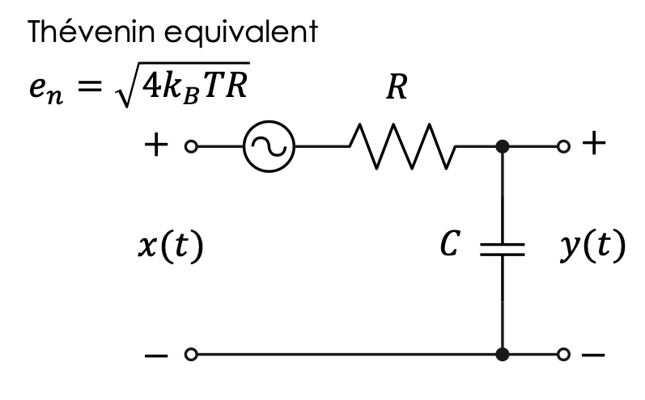
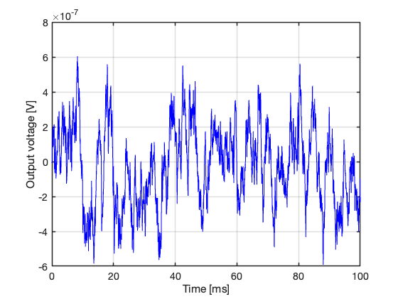
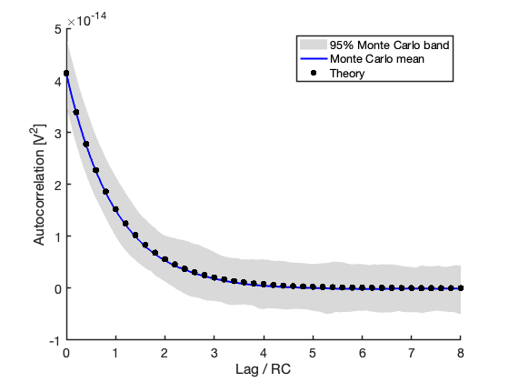

> 💾 **Prefer reading offline?** You can [download a PDF version of this post](post_pdf.pdf) for printing or future reference.

## The physical system

Suppose we have a low-pass RC filter composed of a resistor $R$ in series with a capacitor $C$, with the output voltage available across the capacitor plates. If the output terminals are connected to, e.g., an oscilloscope, a noise-like waveform can be observed on the screen, even in the absence of any externally applied input voltage (@fig-rc-schematic).

```{r}
#| label: fig-rc-schematic
#| echo: false
#| out-width: "50%"
#| fig-align: "center"
#| fig-cap: "Thévenin equivalent model of resistor thermal noise driving the RC low-pass filter. The externally applied input voltage is assumed to be zero in this post, while $y(t)$ is the output voltage across the capacitor. While this post adopts a rigorous double-sided PSD convention ($W_{NN} = 2k_BT R$), electronics textbooks and instruments typically quote the single-sided noise amplitude spectral density, $e_n = \\sqrt{4k_BT R}$, measured in $\\mu$V$/\\sqrt{\\mathrm{Hz}}$."


```

Where does this voltage come from? It is well known that thermal noise is generated by the erratic motion of free electrons in the metallic conductor from which the resistor is made. If the resistor is at absolute temperature $T$, the classical Nyquist--Johnson model states that, to an excellent approximation, this thermal noise can be represented as a zero-mean, stationary, Gaussian white process, with flat power spectral density (PSD)

$$W_{NN}(\omega)=2k_BT R,$$
 {#eq-eq1}

where $k_B$ is Boltzmann's constant ($k_B=1.380649\times 10^{-23}$ J/K).

Using standard circuit theory, the output noise voltage---the one we actually observe---is still Gaussian and stationary, but no longer white. It is colored by the RC low-pass filter, and its PSD is

$$W_{YY}(\omega)=\frac{1}{1+(\omega RC)^2}W_{NN}(\omega)=\frac{2k_BTR}{1+(\omega RC)^2}.$$
 {#eq-eq2}

The variance of the output voltage, equal to its mean-square value since the mean is zero, is therefore

$$\sigma_Y^2=\frac{1}{2\pi}\int_{-\infty}^{+\infty} W_{YY}(\omega)\,d\omega=\frac{k_BT}{C}.$$
 {#eq-eq3}

It can also be shown using the Wiener--Khinchin theorem that the autocorrelation function $R_{YY}(\tau)$ of the output voltage $y(t)$ is the inverse Fourier transform of the PSD:

$$R_{YY}(\tau)=\frac{k_BT}{C}e^{-|\tau|/RC}.$$
 {#eq-eq4}

Here, $RC$ is the time constant of the exponential memory kernel that characterizes the first-order Gauss--Markov process $Y(t)$.

So far, everything looks clear. But this standard analytical treatment---familiar from systems theory and signal processing---hides an important fact from view. The approach, rooted in Wiener's theory, is extremely effective for solving linear ordinary differential equations with constant coefficients and stochastic forcing, almost without giving the impression that one is solving a stochastic differential equation at all.

The crucial step is the formal introduction of white noise: a stationary random process with infinite bandwidth, formally infinite pointwise variance, and impulsive autocorrelation:

$$R_{NN}(\tau)=2k_BTR\,\delta(\tau),$$

where $\delta(\tau)$ is Dirac's delta.

Since ideal white noise has infinite bandwidth and infinite power, it should be regarded more as a mathematical idealization than as a literal physical signal---even when it provides an excellent model for phenomena such as thermal noise over the chosen frequency range of interest.

This is where the central question of the post arises: how can we simulate the simple physical system described above in discrete time? And how can we write, in MATLAB, a simulation code that allows us to verify empirically whether the statistical properties of the output are those predicted by the theory of Gauss--Markov processes?

## The pieces of the puzzle

### Sampling random signals

It is well known that the Nyquist--Shannon sampling theorem---usually formulated for deterministic signals---states that a continuous-time signal $x_a(t)$, whose bandwidth is strictly limited to $B$, can be perfectly reconstructed from the sequence of its samples $x_a(nT_s)$, provided that the sampling frequency $f_s=1/T_s$ satisfies the Nyquist condition $f_s \geq 2B$. The minimum admissible sampling frequency $f_{s,\min}=2B$ is called the *Nyquist rate*, while $f_N=\frac{f_s}{2}$ is called the *Nyquist frequency*, that is, the highest frequency that can be correctly represented for a given sampling frequency.

Whenever we sample too slowly, aliasing is the price to pay. Because of the well-known folding mechanism in the baseband, high-frequency components are mapped back into lower frequencies, producing distortion that may become so severe that the original spectral content is no longer recognizable.

This picture is familiar and well understood when the signal is deterministic. But what happens when the signal is stochastic rather than deterministic? Can the same theorem still be applied? And, more importantly, what exactly does it mean to sample a random process? Are we sampling individual realizations of the process, its autocorrelation function, or both? And what criteria of accuracy can be stated for the reconstruction?

::: callout-important
### Review: sampling wide-sense stationary random processes

Let $X_a(t)$ be a continuous-time wide-sense stationary random process with autocorrelation function $R_{XX}(\tau)$ and PSD $W_{XX}(\omega)$. If each realization of the process is sampled every $T_s$ seconds, the resulting discrete-time process

$$x[n]=x_a(nT_s)$$

is also wide-sense stationary, with autocorrelation sequence

$$r_{XX}[k]=R_{XX}(kT_s).$$

That is, sampling the process induces sampling of its autocorrelation function.

Moreover, if the process is band-limited and the Nyquist condition is satisfied, each realization can be reconstructed from its samples in the *mean-square sense*, that is, with vanishing mean-square reconstruction error.

Equivalently, in the frequency domain, the discrete-time PSD is obtained through periodic replication of the continuous-time spectrum:

$$W_d(e^{j\theta})=\frac{1}{T_s}\sum_{m=-\infty}^{+\infty}W_{XX}\left(\frac{\theta - 2\pi m}{T_s}\right).$$

If $W_{XX}(\omega)$ is strictly band-limited to $B$ and the Nyquist condition is satisfied, these replicas do not overlap and aliasing is avoided.

This is the stochastic analogue of the classical sampling theorem. The crucial point is that the theorem applies to the second-order structure of the process---autocorrelation and PSD---and the reconstruction of sample paths must be understood in the mean-square sense, not necessarily pointwise as for ordinary deterministic signals.
:::

### White noise and its trap

The problem with sampling ideal white noise, as introduced above, is that its PSD is flat over the entire frequency axis. Therefore, no finite band limit can be found, and no matter how fast we sample, aliasing cannot be avoided. At first sight, this leads to a paradox. Since sampling produces periodic replicas of the continuous-time spectrum, an infinite number of copies of a flat PSD would fold back into the baseband. One might then be tempted to conclude that the resulting discrete-time sequence should have infinite pointwise variance.

That conclusion is, of course, nonsense. But the fact that it sounds plausible is exactly the conceptual trap. Now let us see how the picture changes if we assume that the noise is white only within a finite physical bandwidth $B_N$ (in Hz).

Let us choose $B_N$ sufficiently larger than the bandwidth of the physical system receiving the stochastic forcing—in the present case, the RC low-pass filter, namely:

$$B_N \gg \dfrac{1}{2\pi RC}.$$

The system then behaves, for all practical purposes, as if it were driven by ideal white noise. The input noise is no longer an ideal mathematical object with infinite bandwidth, but a physically meaningful band-limited random process whose sampling can be treated consistently within the ordinary framework of sampling theory. Its PSD can be written as

$$W_{NN}(\omega)=
\begin{cases}
N_0, & |\omega| \leq \omega_N \\
0, & \text{otherwise}.
\end{cases}$$

where $\omega_N = 2\pi B_N$, and

$$N_0 = 2k_BTR.$$
 {#eq-eq6}

By the Wiener--Khinchin theorem, the corresponding continuous-time autocorrelation function is the inverse Fourier transform of the rectangular spectrum:

$$R_{NN}(\tau)=\frac{1}{2\pi}\int_{-\omega_N}^{+\omega_N} N_0 e^{j\omega\tau}\,d\omega = \frac{N_0}{\pi\tau}\sin(\omega_N\tau)=2B_NN_0\,\mathrm{sinc}(2B_N\tau),$$

where $\mathrm{sinc}(x) = \sin(\pi x)/(\pi x)$ denotes the normalized sinc function standard in signal processing and MATLAB.

Here lies the elegant resolution of the paradox, matching the simulation strategy: the noise bandwidth $B_N$ is fixed large enough to cover the filter physics, and the system is sampled *exactly at the Nyquist rate of the noise*:

$$f_s = 2B_N.$$
 {#eq-eq7}

Under this specific condition, the sampled input autocorrelation sequence at discrete lags $\tau = k T_s = k/(2B_N)$ evaluates to:

$$r_{NN}[k]=R_{NN}\left(\frac{k}{2B_N}\right) = 2B_NN_0\,\mathrm{sinc}(k) =
\begin{cases}
2B_NN_0, & k=0 \\
0, & k\neq 0.
\end{cases}$$

Because $\mathrm{sinc}(k) = 0$ for all non-zero integers $k$, the samples become completely uncorrelated. This is exactly the defining property of discrete-time white noise.

This is the point where the apparent paradox disappears: a discrete-time white-noise sequence generated numerically (e.g., via `randn` in MATLAB) is not the impossible sampling of ideal continuous-time white noise, but the perfectly legitimate Nyquist-rate sampling of a band-limited white process.

Using (@eq-eq6) and (@eq-eq7), the variance of the discrete-time noise sequence driving the digital filter evaluates to:

$$\sigma_X^2 = 2B_N N_0 = \frac{2k_BTR}{T_s}.$$
 {#eq-eq8}

This is the hidden assumption behind every practical simulation of thermal noise. When a discrete-time noise generator produces a sequence of independent Gaussian samples, it is not simulating ideal white noise in the strict mathematical sense. It is simulating the Nyquist-rate sampling of a band-limited white process whose effective bandwidth has been placed—explicitly or implicitly—by physics.

In other words, the real question is never

*how do we sample white noise?*

but rather

*where does physics place bandwidth?*

::: callout-important
### Why the output variance does not depend on the sampling rate

For a discrete-time linear time-invariant filter driven by white noise with variance $\sigma_X^2$, the output variance is

$$\sigma_Y^2=\sigma_X^2\sum_{n=0}^{\infty} h^2[n],$$

where $h[n]$ is the discrete-time impulse response.

The quantity

$$G_N=\frac{\sigma_Y^2}{\sigma_X^2}=\sum_{n=0}^{\infty} h^2[n]$$

is called the *discrete-time noise gain*.

For the Tustin (bilinear) discretization of the first-order RC filter, the transfer function is

$$H(z)=\frac{b_0+b_1z^{-1}}{1+a_1z^{-1}},$$

with

$$b_0=b_1=\frac{1}{1+\alpha},
\qquad
a_1=\frac{1-\alpha}{1+\alpha},
\qquad
\alpha=\frac{2RC}{T_s}.$$

The resulting impulse response evaluates to $h[0]=b_0$ and, for $n\geq1$, to $h[n]=b_0(1-a_1)(-a_1)^{n-1}$. Summing the squares of this sequence yields a clean geometric series that simplifies to:

$$G_N = b_0^2 \left( 1 + \frac{1-a_1}{1+a_1} \right)=\frac{1}{1+\alpha}=\frac{1}{1+2RC/T_s}.$$

For a sufficiently small sampling interval ($T_s \ll RC$), the parameter $\alpha$ becomes very large, and the discrete-time noise gain can be approximated as:

$$G_N\approx\frac{T_s}{2RC}.$$

As the sampling interval $T_s$ decreases, the variance of the discrete-time white-noise input must increase ($\sigma_X^2 = 2B_N N_0 = N_0/T_s$) in order to represent the same continuous-time thermal-noise PSD. At the same time, the discrete-time noise gain $G_N$ decreases by exactly the same factor, perfectly compensating for the input scaling and recovering the continuous-time result in @eq-eq3:

$$\sigma_Y^2 = \sigma_X^2 \cdot G_N \approx \left(\frac{2k_BTR}{T_s}\right) \cdot \left(\frac{T_s}{2RC}\right) = \frac{k_BT}{C}.$$
:::

## MATLAB code

At this stage, the conceptual picture is now in place: the input noise can be modeled as a discrete-time white Gaussian sequence, provided that we remember what this really means.

We are not sampling ideal continuous-time white noise, but generating the Nyquist-rate representation of a band-limited white process whose effective bandwidth is placed beyond the frequency range relevant for the RC filter. This is the correct interpretation of a standard command such as randn() in MATLAB: it produces independent Gaussian samples with finite variance and impulsive autocorrelation in the discrete-time sense.

That variance, however, must be scaled consistently with the sampling interval so that the equivalent continuous-time PSD matches the physical Nyquist--Johnson thermal-noise level. The following code implements a single realization of the RC output voltage using the Tustin discretization discussed above. The input noise is calibrated directly in physical units, so that the output variance emerges naturally from the model and converges to the theoretical value of (@eq-eq3), rather than being imposed afterward by artificial normalization.

```{matlab}
%| code-fold: true
%| code-summary: "Single realization of the RC thermal-noise output"

clear
clc
close all

rng(1234)           % Reproducibility

% Physical constants and RC parameters

kB = 1.380649e-23;  % Boltzmann constant [J/K]
T  = 300;           % Absolute temperature [K]
R  = 10e3;          % Resistance [Ohm]
C  = 100e-9;        % Capacitance [F]

tau = R*C;          % Theoretical time constant [s]
sigma2_y = kB*T/C;  % Theoretical output variance [V^2]

% Sampling settings

oversampling = 50;
Ts = tau/oversampling; % Sampling interval [s]
Fs = 1/Ts;             % Sampling frequency [Hz]
BN = Fs/2;             % Effective white-noise bandwidth [Hz]

N = 2^14;              % Number of samples

% Tustin discretization

alpha = 2*R*C/Ts;
b0    = 1/(1 + alpha);
b1    = b0;
a1    = (1 - alpha)/(1 + alpha);

% Input white-noise calibration

N0       = 2*kB*T*R;
sigma2_x = 2*BN*N0;
sigma_x  = sqrt(sigma2_x);

% Generate calibrated discrete-time white Gaussian noise

x = sigma_x*randn(N, 1);

% Filter input noise through the discrete-time RC filter

y = zeros(N, 1);

for n = 2:N
    y(n) = b0*x(n) + b1*x(n-1) - a1*y(n-1);
end

% Empirical variance check

fprintf('Theoretical output variance = %.4e V^2\n', sigma2_y)
fprintf('Empirical output variance   = %.4e V^2\n', var(y))

% Time-domain visualization

t = (0:N-1)*Ts;

figure
plot(t(1:5000).*1e3, y(1:5000), 'b', 'LineWidth', 1)

xlabel('Time [ms]')
ylabel('Output voltage [V]')

grid on
set(gca, "FontSize", 14, "LineWidth", 1.5)
```

A single realization of the simulated RC output voltage is shown in @fig-rc-output. The waveform no longer resembles ideal white noise. The RC filter introduces temporal correlation, producing the smooth random fluctuations characteristic of a first-order Gauss--Markov process. The signal remains random, but it now carries memory: nearby samples are no longer statistically independent.

This is exactly the stochastic structure predicted by the continuous-time model discussed above.

```{r}
#| label: fig-rc-output
#| echo: false
#| out-width: "70%"
#| fig-align: "center"
#| fig-cap: "Single realization of the simulated RC thermal-noise output voltage. The waveform exhibits the expected smooth random fluctuations of a first-order Gauss--Markov process, reflecting the finite memory introduced by the RC low-pass filter."


```

## Why autocorrelation estimation is always hungry for data

The final piece of the puzzle is not the simulation itself, but its statistical verification. Generating a discrete-time realization of the RC output voltage is easy. Demonstrating that its statistical properties actually agree with the theory of the Gauss--Markov process is much less trivial. In particular, the key quantity to recover is the exponential autocorrelation law in @eq-eq4, from which both the stationary variance and the characteristic time constant (RC) can be estimated.

A single realization is never enough. Even when the model is perfectly correct, empirical autocorrelation estimates are noisy, strongly variable at large lags, and notoriously hungry for data. Second-order statistics require long observation windows, and the apparent quality of a simulation often depends more on record length than on the model itself.

To make this visible, a Monte Carlo strategy is particularly useful. Rather than generating many completely independent short simulations, it is often more convenient to generate one very long stationary sequence, discard the initial transient needed to reach equilibrium, and then divide the remaining portion into many consecutive segments of equal length.

In MATLAB, this can be done naturally by reshaping the vector into a matrix:

- rows represent time evolution within each realization\
- columns represent approximately independent replications

This provides a practical ensemble over which autocorrelation functions can be estimated and compared.

```{matlab}
%| code-fold: TRUE
%| code-summary: "Monte Carlo verification of the RC Gauss-Markov process"

% The physical constants, sampling settings, and Tustin coefficients
% are the same as in the single-realization example above.

rng(1234)           % Reproducibility

% Monte Carlo settings

nRep       = 200;             % Number of Monte Carlo repetitions
nPerRep    = 2^14;            % Samples per repetition
nTransient = 20*oversampling; % Initial transient to discard
Ntot       = nTransient + nRep*nPerRep;

% Input white-noise calibration

N0       = 2*kB*T*R;
sigma2_x = 2*BN*N0;
sigma_x  = sqrt(sigma2_x);

% Generate calibrated discrete-time white Gaussian noise

x = sigma_x*randn(Ntot, 1);

% Filter input noise through the discrete-time RC filter

y = zeros(Ntot, 1);

for n = 2:Ntot
    y(n) = b0*x(n) + b1*x(n-1) - a1*y(n-1);
end

% Remove transient and reshape into Monte Carlo replications

y_stat = y(nTransient+1:end);

fprintf('Theoretical output variance = %.4e V^2\n', sigma2_y)
fprintf('Empirical output variance   = %.4e V^2\n', var(y_stat))

Y = reshape(y_stat, nPerRep, nRep);

% Autocorrelation estimation

maxLag = round(8*tau/Ts);
lags   = (0:maxLag)';
tLag   = lags*Ts;

acfMat = zeros(maxLag+1, nRep);

for r = 1:nRep
    yr = Y(:, r);
    yr = yr - mean(yr);

    % The biased estimator is used to obtain a smoother and more
    % stable estimate of the exponentially decaying autocorrelation.
    acfFull = xcorr(yr, maxLag, 'biased');

    acfMat(:, r) = acfFull(maxLag+1:end);
end

acfMean = mean(acfMat, 2);
acfLow  = prctile(acfMat, 2.5, 2);
acfHigh = prctile(acfMat, 97.5, 2);

acfTheory = sigma2_y*exp(-tLag/tau);

% Plot autocorrelation estimates

figure
hold on

fill([tLag(2:end); flipud(tLag(2:end))]/tau, ...
     [acfLow(2:end); flipud(acfHigh(2:end))], ...
     [0.85 0.85 0.85], ...
     'EdgeColor', 'none')

plot(tLag/tau, acfMean, 'b', 'LineWidth', 2)
plot(tLag(1:10:end)/tau, acfTheory(1:10:end), ...
     'k.', 'MarkerSize', 18)

xlabel('Lag / RC')
ylabel('Autocorrelation [V^2]')

legend('95% Monte Carlo band', ...
       'Monte Carlo mean', ...
       'Theory', ...
       'Location', 'northeast')

grid off
set(gca, "FontSize", 14, "LineWidth", 1.5)

% Estimate time constant from semilog regression

fitMaxLag = round(3*tau/Ts);
fitIdx    = (1:fitMaxLag)';   % Exclude lag zero

tauHat = zeros(nRep, 1);

for r = 1:nRep
    acf_r = acfMat(:, r);

    yFit = acf_r(fitIdx + 1);

    % Keep only positive values before taking logs
    valid = yFit > 0;

    xReg = tLag(fitIdx(valid));
    zReg = log(yFit(valid));

    p = polyfit(xReg, zReg, 1);

    tauHat(r) = -1/p(1);
end

% Summary of estimated time constants

tauMean = mean(tauHat);
tauCI   = prctile(tauHat, [2.5 97.5]);

fprintf('Theoretical tau = %.4e s\n', tau)
fprintf('Estimated tau   = %.4e s\n', tauMean)
fprintf('95%% Monte Carlo CI = [%.4e, %.4e] s\n', ...
        tauCI(1), tauCI(2))
```

Two situations are especially instructive:

1.  Experimentally realistic regime\
    Longer records allow the expected exponential law to emerge clearly, with confidence intervals narrow enough to support reliable parameter estimation.

2.  Data-poor regime\
    Short records produce unstable autocorrelation estimates, large uncertainty bands, and poor estimates of the decay constant.

The decay constant can be estimated by exploiting the exponential form of the theoretical autocorrelation. Taking logarithms,

$$\log R_{YY}(\tau)=\log\left(\frac{k_BT}{C}\right)-\frac{\tau}{RC},$$

so that the time constant can be recovered by linear regression on the semilog scale.

From repeated Monte Carlo replications, one obtains not only a point estimate of (RC), but also an empirical confidence interval for the estimate itself. This final step closes the loop between theory and simulation: not merely generating a noise-like waveform, but verifying quantitatively that the stochastic process observed numerically is statistically consistent with the physical model from which it originated.

And this is precisely where simulation stops being coding and becomes measurement.

The Monte Carlo results for the experimentally realistic regime are shown in @fig-acf-montecarlo.

```{r}
#| label: fig-acf-montecarlo
#| echo: false
#| out-width: "70%"
#| fig-align: "center"
#| fig-cap: "Monte Carlo estimate of the autocorrelation function of the RC output process. The shaded region represents the empirical 95% confidence band obtained from repeated segments of a long stationary realization. The theoretical exponential law is shown as discrete markers. The agreement confirms that the simulated process reproduces the second-order structure of the continuous-time Gauss--Markov model."


```

The agreement between the empirical mean autocorrelation and the theoretical exponential law of @eq-eq4 is excellent. The shaded region represents the empirical 95% confidence band obtained from repeated stationary segments of the same long realization. Even with a correctly specified model, the uncertainty remains substantial, especially at larger lags where autocorrelation estimates become progressively less stable.

In the present simulation, the theoretical time constant was

$$\tau = RC = 1.00\times10^{-3}\ \mathrm{s},$$

while the Monte Carlo estimate obtained from semilog regression gave

$$\hat{\tau}=9.69\times10^{-4}\ \mathrm{s},$$

with empirical 95% confidence interval

$$\left[5.32\times10^{-4},\ 1.78\times10^{-3}\right]\ \mathrm{s}.$$

The mean estimate is accurate, while the relatively wide confidence interval confirms how demanding autocorrelation-based parameter estimation can be, even when the underlying model is perfectly correct.

The contrast becomes even clearer in the data-poor regime shown in @fig-acf-datapoor.

```{r}
#| label: fig-acf-datapoor
#| echo: false
#| out-width: "70%"
#| fig-align: "center"
#| fig-cap: "Autocorrelation estimate obtained from much shorter records. The increased variability and the widening confidence band illustrate the dramatic loss of statistical reliability when the available data are limited."

knitr::include_graphics("acf_1.png")
```

Repeating exactly the same procedure with much shorter records ($n_{\mathrm{PerRep}} = 2^{10}$ rather than $n_{\mathrm{PerRep}} = 2^{14}$) produced

$$\hat{\tau}=9.53\times10^{-4}\ \mathrm{s},$$

with empirical 95% confidence interval

$$\left[2.87\times10^{-4},\ 3.32\times10^{-3}\right]\ \mathrm{s}.$$

The mean estimate remains reasonable, but the uncertainty increases substantially. Although the physical time constant of the system is only $1$ ms, reliable estimation of that constant from autocorrelation requires observation windows hundreds or even thousands of times longer:

*The process forgets quickly; the statistic does not.*

## Concluding remarks

At first sight, simulating thermal noise in an RC filter looks like a very simple problem. A resistor generates white noise, the filter shapes it, and a few lines of MATLAB code seem enough to reproduce the expected stochastic output. The real difficulty appears only when one asks a slightly more careful question: what exactly is being simulated?

Ideal continuous-time white noise, with infinite bandwidth and impulsive autocorrelation, cannot be sampled in any literal sense. Trying to do so leads immediately to paradoxes involving aliasing, infinite power, and meaningless pointwise variance. The resolution is not mathematical trickery, but physical modeling. Real systems always place bandwidth somewhere.

If thermal noise is assumed to be effectively white only over a sufficiently large frequency range—larger than the bandwidth of the RC filter itself—then discrete-time simulation becomes perfectly well defined. A Gaussian white sequence generated numerically is not the impossible sampling of an idealized process, but the Nyquist-rate representation of a band-limited stochastic process. The filter then completes the picture: the discrete-time implementation is not merely a numerical approximation, but a way of preserving the structure of the underlying Gauss--Markov process.

And finally, statistics reminds us that even a correct model is not enough. Recovering exponential autocorrelation from finite data requires long records, careful estimation, and a healthy respect for the fact that second-order statistics are always hungry for data.

In the end, the most useful question is not

*how do we simulate white noise?*

but rather

*where does physics place bandwidth?*

Everything else—including `randn`, Tustin discretization, and Monte Carlo verification—comes only after that.

## Final note

Give an engineer a noisy oscilloscope trace, and they will immediately start looking for hidden periodicities.

> "Wait… is that mains hum?\
> A badly placed notch?\
> Some forgotten pole?\
> Why does that look suspiciously like 50 Hz?\
> And does the time base actually support that conclusion?"

At that point, the waveform stops being "just noise" and becomes an investigation. Perhaps that is exactly how it should be. For an engineer, noise is rarely just noise. It is usually a signal that is trying—sometimes very stubbornly—to reveal the physical system that generated it. And yes, looking at the thumbnail of this post, I am still not entirely convinced that the oscilloscope trace is innocent.
