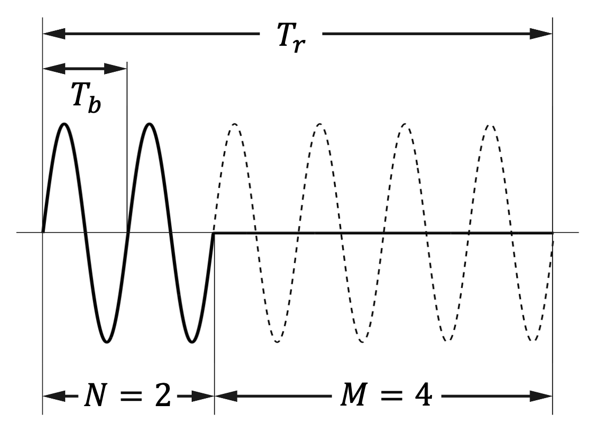
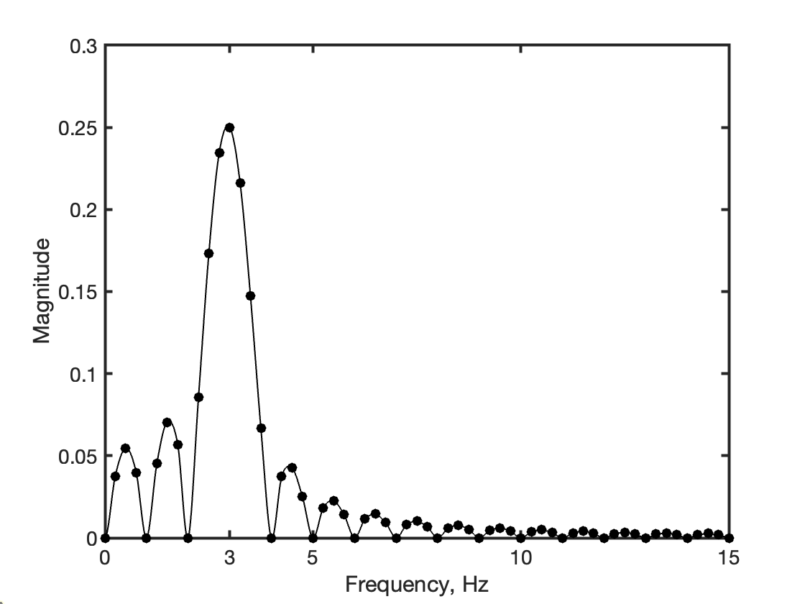
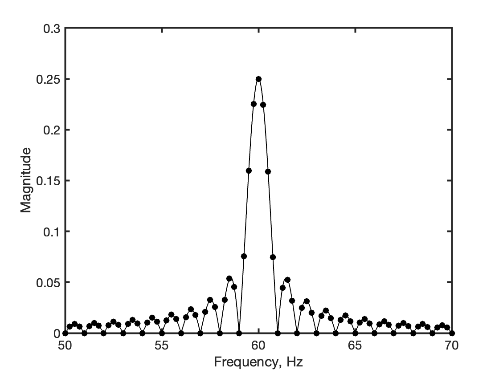

```{r}
#| echo: false
#| eval: false
#| message: false
#| warning: false

library(tidyverse)
```

```{r}
#| echo: false
#| eval: false

N <- 2
M <- 4
T <- (N + M)
h <- (2*pi)/1000
t <- seq(0, T, by = h)

fo <- 1
wo <- 2*pi*fo
y <- sin(wo*t)
y1 <- if_else(t >= 0 & t <= 2, y, 0)
y2 <- if_else(t > 2, y, NA)
df <- data.frame(t = t, y = y, y1 = y1, y2 = y2)
p <- df %>%
  ggplot(aes(x = t, y = y1)) +
  geom_line(linewidth = 1) +
  geom_line(aes(x = t, y = y2), linetype = "dashed") +
  theme(axis.title.x = element_blank(),
        axis.text.x  = element_blank(),  
        axis.ticks.x = element_blank(),
        axis.title.y = element_blank(),
        axis.text.y  = element_blank(),   
        axis.ticks.y = element_blank(),
        panel.grid.major = element_blank(), 
        panel.grid.minor = element_blank(),
        panel.background = element_blank())
```

## Sine-wave tone burst

A sine-wave tone burst signal is shown in @fig-fig1.

{#fig-fig1 fig-align="center" width="350"}

It is formed by "turning on and off" (gating) a sinusoidal signal ([here](https://www.ietlabs.com/pdf/GR_Appnote/IN-105%20Frequency%20Spectrum%20of%20a%20Tone%20Burst.pdf)). The sinusoidal signal, with fundamental period $T_b$ (frequency: $f_b = 1/T_b$) and initial phase $\theta_b$, is assumed here to have unit amplitude:

$$
x_b(t)=\sin\left(2\pi\dfrac{t}{T_b}+\theta_b\right)
$$

Gating amounts to multiply it by $x_p(t)$, which can be described as the time-delayed rectangular function $\text{rect}(t/T_g)$, periodized by the fundamental period $T_r$:

$$
x_p(t)=\sum_{n=-\infty}^{+\infty}\text{rect}\left(\dfrac{t-\tau_r-nT_r}{T_g}\right)
$$

where $\tau_r$ is the time-shift of the rectangular function before submitting it to periodization. Henceforth, we assume that $T_r>T_b$, and a multiple integer of full cycles of $x_b(t)$ is captured in either the time interval $T_g$ or the time interval $T_r$: in @fig-fig1, $T_g=2T_b$ ($N=2$) and $T_r=6T_b$ ($M=4$, hence $N+M=6$).

::: callout-note
## Rectangular function

The rectangular function (also known as the rect function, gate function) is defined as:

$$
\text{rect}\left(\dfrac{t}{T}\right)=\left\{
\begin{align}
1,&\quad\vert t\vert\leq T/2\\
1/2,&\quad t=T/2\\
0,&\quad t>T/2
\end{align}
\right.
$$

The Continuous Time Fourier Transform of the rectangular function $\text{rect}(t/T)$ is:

$$
X(f)=T\,\text{sinc}(fT)
$$
:::

::: callout-note
## Sinc function

In digital signal processing and information theory, the **sinc function** is commonly defined for $x\neq0$ by

$$
\text{sinc}(x)=\dfrac{\sin(\pi x)}{\pi x}
$$
:::

The duty-ratio factor is defined as the ratio of time the tone is ON compared to the total time when it is either ON or OFF, namely $D=N/(N+M)=N/L$. The duty-ratio factor approaches 0 for widely spaced, narrow bursts or 1 for closely spaced, wide bursts: when $D=1$, $x_r(t)=1$ and $x(t)=x_b(t)$ (pure sine-wave).

When the duty-ratio factor is a rational number, the sine-wave tone burst $x(t)$ can be modeled as the product of two periodical signals, namely $x_b(t)$ (with period $T_b$) and $x_r(t)$ (with period $T_r$):

$$
x(t)=x_r(t)\cdot x_b(t)
$$

The fundamental period of $x(t)$ is $T=T_r$. We can appropriately choose the phase shift $\theta_b$ and the time delay $\tau_r$ so as to yield a signal $x(t)$ without discontinuities and further endowed with odd symmetry (e.g., $\theta_b=0$, $\tau_r=0$). Under these conditions, $x(t)$ can be regarded as composed by infinitely many replicas (with period $T_r$) of the time-limited signal $x_p(t)$:

$$
x_p(t)=\left\{
\begin{align}
\sin\left(2\pi\dfrac{t}{T_b}\right),&\quad\vert t\vert\leq T_g/2\\
0,&\quad\text{elsewhere}
\end{align}
\right.
$$

## Fourier analysis

The Fourier series of $x(t)$ is defined as a trigonometric series of the form:

$$
x(t)=A_0+\sum_{n=1}^{+\infty}A_n\cos\left(2\pi \dfrac{n}{T_r}t\right)+\sum_{i=1}^{+\infty}B_n\sin\left(2\pi \dfrac{n}{T_r}t\right)
$$

where the Fourier series coefficients are defined by the integrals:

$$
\left\{
\begin{align}
A_0&=\dfrac{1}{T_r}\int_{-T_{r}/2}^{T_{r}/2}x(t)\,dt\\
A_n&=\dfrac{2}{T_r}\int_{-T_{r}/2}^{T_{r}/2}x(t)\cos\left(2\pi\dfrac{nt}{T_r}\right)\,dt\\
B_n&=\dfrac{2}{T_r}\int_{-T_{r}/2}^{T_{r}/2}x(t)\sin\left(2\pi\dfrac{nt}{T_r}\right)\,dt
\end{align}
\right.
$$

Since $x(t)$ is odd-symmetric, $A_0$ is null (i.e., the sine-wave tone burst has no DC component) and $A_n=0,n=1,\cdots,+\infty$. The harmonic coefficients $B_n$ are given by:

$$
B_n=\dfrac{4}{T_r}\int_0^{T_g/2}\sin\left(2\pi\dfrac{t}{T_b}\right)\sin\left(2\pi\dfrac{nt}{T_r}\right)dt
$$

where $T_r=LT_b$ ($L=N+M$) and $T_g=N T_b$. To make the notation lighter, $T_b=T$ in the following. The spectrum of the sine-wave tone burst requires the calculation of the Fourier integrals:

$$
B_n=\dfrac{4}{LT}\int_{0}^{N T/2}\sin\left(\dfrac{2\pi}{T}t\right)\sin\left(\dfrac{2\pi}{T}\dfrac{n}{L}t\right)dt
$$

::: callout-tip
## Werner formulas

The Werner formulas are the trigonometric product formulas:

$$
\begin{align}
2\sin\alpha\cos\beta&=\sin(\alpha-\beta)+\sin(\alpha+\beta)\\
2\cos\alpha\cos\beta&=\cos(\alpha-\beta)+\cos(\alpha+\beta)\\
2\cos\alpha\sin\beta&=\sin(\alpha+\beta)-\sin(\alpha-\beta)\\
2\sin\alpha\sin\beta&=\cos(\alpha-\beta)-\cos(\alpha+\beta)
\end{align}
$$
:::

Applying the Werner formulas, the integrand can be written:

$$
\sin\left(\dfrac{2\pi}{T}t\right)\sin\left(\dfrac{2\pi}{T}\dfrac{n}{L}t\right)=\dfrac{1}{2}\left[\cos\left(\dfrac{2\pi}{T}\left(1-\dfrac{n}{L}\right)t\right)-\cos\left(\dfrac{2\pi}{T}\left(1+\dfrac{n}{L}\right)t\right)\right]
$$

Therefore:

$$
\begin{align}
B_n &= \dfrac{2}{LT}\dfrac{1}{\dfrac{2\pi}{T}\left(1-\dfrac{n}{L}\right)}\sin\left(\dfrac{2\pi}{T}\left(1-\dfrac{n}{L}\right)t\right)\biggr\vert_0^{NT/2}\\
&-\dfrac{2}{LT}\dfrac{1}{\dfrac{2\pi}{T}\left(1+\dfrac{n}{L}\right)}\sin\left(\dfrac{2\pi}{T}\left(1+\dfrac{n}{L}\right)t\right)\biggr\vert_0^{NT/2}
\end{align}
$$

and

$$
\begin{align}
B_n &= \dfrac{2}{\pi L}\dfrac{1}{\left(1-\dfrac{n}{L}\right)}\sin\left(\pi N\left(1-\dfrac{n}{L}\right)\right)-\dfrac{2}{\pi L}\dfrac{1}{\left(1+\dfrac{n}{L}\right)}\sin\left(\pi N\left(1+\dfrac{n}{L}\right)\right)\\
&=\dfrac{N}{L}\left[\text{sinc}\left(N\left(1-\dfrac{n}{L}\right)\right)-\text{sinc}\left(N\left(1+\dfrac{n}{L}\right)\right)\right]
\end{align}
$$

Using the duty-ratio factor, we have:

$$
B_n=D\left[\text{sinc}(D(L-n))-\text{sinc}(D(L+n))\right]
$$

When $D=1$ (i.e., $x_r(t)=1$), we get $B_n = 0$ for all $n$, but $B_L=1$. Recall that the $L$th harmonic component in the spectrum of $x(t)$ corresponds to the fundamental frequency of the sine-wave, $f_b$ - as noted above, if $x_r(t)=1$, then $x(t)=x_b(t)$. For any value of $D$ different from 1, the maximum value of $B_n$, $B_{\text{max}}=D$ still occurs when $n=L$, however other lines are present in the spectrum. These lines are at the (analog) frequencies $f_n=f_b+(n-L)f_r$.

## Examples

A sine-wave tone burst with duty-ratio factor $D=0.25$ ($f_b=3\,\text{Hz},f_r=0.25\,\text{Hz},T_b=1\,\text{s}$) was simulated in MATLAB. The sampling frequency chosen for the simulation was $f_s=80\,\text{Hz}$. The Fast Fourier Transform (FFT) algorithm was applied for spectrum computation. The guidelines discussed in one previous post of mine ([here](https://amsabatini.netlify.app/posts/resolution/)) were followed to prevent spectral leakage and amplitude ambiguity. Superimposed on the values computed by the FFT (solid black points) is the envelope obtained by interpolating the discrete spectrum $B_n$ (see above), @fig-fig2.

{#fig-fig2 fig-align="center" width="400"}

The MATLAB code was run again in a scenario where the frequency of the sine wave moved up to $f_b=60\,\text{Hz}$, with a corresponding adjustment of the sampling frequency ($f_s=800\,\text{Hz}$). The results of the FFT-based spectrum analysis are reported in @fig-fig3.

{#fig-fig3 fig-align="center" width="400"}

The FFT-based spectrum can be also interpreted as the outcome of the following cascaded frequency-domain signal-processing operations:

-   *frequency sampling* the spectrum $T_g\,\text{sinc}(f\,T_g)$ - this is explained by the time periodization of the rectangular function $\text{rect}(t/T_g)$ with period $T_r$.

-   *frequency shifting* the frequency-sampled spectrum - this is explained by the amplitude modulation impressed on the periodized rectangular function when the latter is multiplied by the sine wave at frequency $f_b$.
